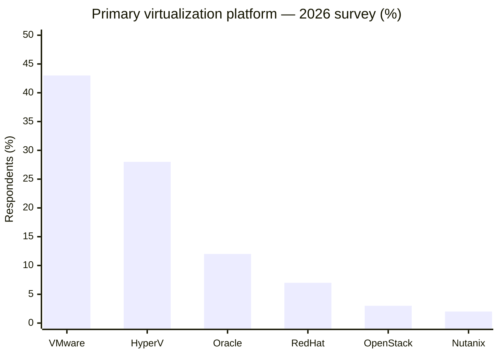

# METI — Six Research Reports: Final Editorial Release

**Edition:** 29 October 2026, v3.0 (cross-document reconciliation)  
**Scope:** Existing research only; **no new external searches, filings, URLs, or source facts introduced by this editorial release**.  
**Research cutoff:** Individual reports retain 28 or 29 October 2026 as stated.  
**Citation meaning:** A reference marked *opened* was opened in the original research run. This packaging exercise did not recheck live source availability; *indexed/failed*, *partially inspected*, and *secondary* references remain so.

## Six authoritative files

| No. | Final filename | Purpose | Superseded source file |
|---:|---|---|---|
| 01 | `01_Peer_Biopharma_VMware_and_Cloud.md` | 19-company enterprise virtualization evidence | `METI_Biopharma_Peer_Virtualization_Evidence_Report_2026-10-28.md` |
| 02 | `02_Broadcom_VMware_Customer_Base.md` | Broadcom financial metrics, VCF purchasing, selective named accounts | `METI_Broadcom_VMware_Customer_Base_Executive_Research_REVISED_2026-10-28.md` |
| 03 | `03_Biopharma_Customer_Base_Triangulation.md` | Historical customer-base and competitor triangulation | `METI_Biopharma_VMware_Competitor_Triangulation_Executive_Report_2026-10-28.md` |
| 04 | `04_VMware_Platform_Competition_Cloud_Leadership.md` | Executive ten-alternative comparison | `METI_VMware_Competition_Cloud_Leadership_EY_Style_Report_2026-10-29.md` |
| 05 | `05_OT_Application_Compatibility_and_Migrations.md` | OT application-version documentation and detailed migration cases | `METI_VMware_Top10_Competitors_OT_Compatibility_Validated_V2_2026-10-29.md` |
| 06 | `06_2026_Virtualization_Market_Position.md` | 2026 primary-platform research survey and limitations | `METI_2026_Virtualization_Market_Share_Report.md` |

## Substantive reconciliations

1. **Roche:** Report 03 identifies a **2022 Roche Diagnostics** VMware simulation/training deployment. This has been carried into Report 01 as **historical** evidence; it is not a 2026 Broadcom retention record. The reported >15,000 VM *consumptions per month* must never be described as 15,000 simultaneously deployed VMs.
2. **Moderna:** Report 03 includes a historical VMware life-sciences promotional quote and a Google Looker/Amazon Redshift data story. Both now appear in Report 01, correctly labeled as promotional/data evidence; neither establishes present-day VMware hypervisor deployment or exit.
3. **Gilead:** Use the accessible AWS re:Invent session report figures (**more than 2,000 servers migrated, more than 1,400 retired**); do not adopt inaccessible-PDF-only more exact numbers as fully verified. Do not add migrated and retired counts or infer whole-company VMware exit.
4. **Broadcom customer growth:** Report 02 is authoritative. Broadcom software revenue growth, VCF *purchasing* among a selected top-10,000 account cohort, and deployed VMware workload/customer growth are different metrics. The existing record does **not** establish net worldwide VMware customer growth.
5. **Competitor customer examples:** Reports 04/05 distinguish verified VMware-origin migration cases from platform-only deployment (Red Hat Emirates NBD; Microsoft CDW) and internal supplier tests (HPE). Named vendor-hosted customer stories are not independent audits.
6. **OT support:** Exact application product/version guidance governs. Hyper-V certification does not automatically certify Azure Local; general KVM operation does not establish manufacturer support for every KVM stack. Detailed records live in Report 05.
7. **Market share:** Report 06 figures (VMware approximately 43% primary-platform response) are from publisher-indexed S&P Global 451 research, with **full-article opening unsuccessful** in the historical run. It is **not** an audited worldwide revenue/VM/customer share and is distinct from the separate 90% private-cloud *presence* measure and future migration *intentions*.

## Reading order and precedence

For an executive briefing, read **02 → 06 → 04 → 05 → 01 → 03**. For named biopharma details, Reports 01 and 03 are complementary; Report 03 supplies deeper original historical-case context. For competitor OT application compatibility, Report 05 takes precedence over the shorter summary in 04. For Broadcom financial and account claims, Report 02 takes precedence over references in other reports.

## Publication assurance

- All six source Markdown files were available and inspected programmatically during this editorial release.
- All six final Markdown files are nonempty and are preserved individually in this ZIP.
- **No new external verification was undertaken.** These are the final *editorially reconciled* reports, not newly independently audited primary-source reports.
- Historical source links can become inaccessible after the original research date; flagged unavailable URLs remain flagged. Do not describe all links as freshly tested.
- Any user-visible numbers that cannot be fully corroborated from an original full-page source remain attributed to the specific publisher and retain their limitations.


---

# REPORT 1: 01_Peer_Biopharma_VMware_and_Cloud.md

# Biopharma Peer Benchmarking: VMware Footprint, Virtualization Strategy & Cloud Infrastructure Evolution

> **RESEARCH STATUS — FINAL EDITORIAL EDITION (v3.0, 29 October 2026).** This file was reconciled against the other five existing METI reports. It preserves original source-access classifications and does **not** claim that external URLs were freshly opened on 29 October. "Final" refers to the selected/reconciled documentation, **not** an independently audited worldwide infrastructure census. Detailed source and claim registers follow in the original body.

**Reconciled edition note (29 October 2026):** Integrates additional **historical** VMware evidence for Roche Diagnostics and a limited historical VMware reference for Moderna from companion Report 03. Neither is evidence of a post-November-2023 Broadcom renewal. The Gilead figures use the accessible AWS session description (>2,000 migrated, >1,400 retired), not the inaccessible slide deck's more precise figures. **This is editorial reconciliation of the existing research, not new external validation.**


**METI | Evidence-led research for Global Cloud & Infrastructure Technology Leadership**  
**Research window:** 22 November 2023–28 October 2026  
**Document status:** Source-qualified research deliverable; public-evidence benchmark, **not** an audited inventory of private customer environments  
**Version:** 1.0 | **Evidence checked:** 28 October 2026  
**Company universe:** 19 named biopharmaceutical companies (user-specified, not a random sample)

> **Reading guide:** The main analysis uses only attributable records whose supporting text was actually opened and inspected in this research run. Vendor-published material is explicitly marked. Unavailable job listings, inaccessible files, and search-only excerpts are excluded from established footprint claims. The report does not equate cloud adoption with VMware displacement.

---

# 1. Executive summary

## The question and the answer

**Question:** What virtualization platforms and cloud-computing infrastructure are these 19 biopharma enterprises demonstrably operating, and what publicly documented VMware decisions have they made since Broadcom acquired VMware?

**Answer:** The public record provides **one named, post-acquisition, quantified VMware-to-cloud migration case in this 19-company set: Gilead Sciences**. An AWS re:Invent 2024 session description and a later AWS conference recap state that Gilead migrated **more than 2,000 servers** from on-premises VMware to AWS-native services and retired **more than 1,400 systems** [S05, S06]. These are accessible **AWS-authored conference records**, not an independently inspected customer slide deck. The records do not establish a full enterprise exit or how much VMware remains.

For **AbbVie**, an accessible, expired **company-authored** data-center operations vacancy documents VMware platform engineering, security support and lifecycle responsibilities [S07]. Because it is an expired job advertisement, it is **operational-requirement evidence**, not current production inventory or a Broadcom renewal. Other earlier cited Lilly and Teva vacancies **failed direct opening** and are not counted as verified current VMware-footprint evidence [X01, X02].

The strongest documented **non-VMware infrastructure** developments include **GSK's Azure Local use in manufacturing and R&D** (Microsoft announcement) [S11], **Roche's 2026 on-premises and cloud AI compute build-out** (Roche announcement) [S09], and **Novo Nordisk's August 2026 designation of AWS as preferred cloud provider** (Novo Nordisk announcement) [S10]. Other companies have documented AWS-based SAP, research, genomics, manufacturing, serverless or data platforms—but these are **not evidence of hypervisor replacement**.

**No enterprise-wide VMware retention rate, licensing expense, VCF renewal inventory, installed virtual-machine counts, or verified full VMware exit can be established for the 19-company group from the inspected records.** The result is a carefully bounded snapshot of published peer evidence, not a census of real-world deployments.

## Executive findings

1. **Actual VMware displacement is publicly quantifiable in one case.** Gilead's AWS-hosted conference material identifies source (on-prem VMware), destination (AWS native) and approximate achieved scale. The figures are **AWS-reported**; customer slide-level independent verification was not performed [C001, S05–S06].
2. **Some VMware operational responsibilities were publicly described after the acquisition; that is different from a renewal.** AbbVie's company careers material identifies VMware lifecycle and operations work but does not disclose contract action, VM counts, or the date the underlying deployment began [C002, S07].
3. **Alternative on-premises infrastructure evidence is scarce but not absent.** Microsoft names GSK as an Azure Local customer in vaccine/medicine manufacturing and R&D laboratories. It does not specify which workloads, if any, replaced VMware [C003, S11].
4. **Major cloud commitments are workload- and contract-specific.** Novo Nordisk calls AWS its *preferred cloud provider* in August 2026, but that neither proves exclusivity nor identifies its VMware estate [C004, S10].
5. **AI/HPC infrastructure should not be mistaken for hypervisor strategy.** Roche announced 2,176 additional on-premises Blackwell GPUs in March 2026, bringing its combined on-premises/cloud AI GPU capacity above 3,500; the disclosure is not a VMware/VCF decision [C005, S09].
6. **Financial filings provide industry and supplier context, not private peer footprint counts.** Broadcom's FY2025 Form 10-K reports infrastructure software revenue of **$27.029 billion** versus **$21.478 billion** in FY2024 and attributes the change largely to VCF demand, subscription transition and certain non-cancellable contracts. This segment includes businesses beyond VMware and does **not** reveal which of the 19 purchased VCF, how much they spent, or their deployed VM counts [C006, S02].
7. **Research publication bias is substantial.** AWS and Microsoft have incentives to publicize cloud wins; renewals and stable legacy virtualization often produce fewer public case studies. Consequently, visible cases cannot establish that migration is prevailing among biopharma enterprises.

## Analyst assessment (interpretation, not a claim of industry prevalence)

The evidence is most useful as a **set of real technical reference points**, not as a vote count on VMware. Gilead offers a documented example of selecting and migrating VMware-sourced workloads; GSK offers a described hybrid/edge deployment; Roche offers a model of substantial on-premises capacity investment for AI; and Novo Nordisk provides an explicit preferred-cloud commitment. These show that enterprise cloud choices are **scope-dependent**. Public evidence is insufficient to say whether the 19 companies are broadly staying with or leaving VMware.

---

# 2. Executive 19-company comparison

**Legend:** `VR` = original VMware deployment/renewal verified; `OR` = operational requirement or vacancy, *not* verified deployed footprint; `MV` = VMware-to-other-platform migration documented; `NPE` = no qualifying public **post-acquisition VMware decision** established; `HIST` = historical VMware-related evidence, **not** current renewal or present-day production confirmation. `AWS/Microsoft case` = vendor-hosted material, often with named customer quotations. “Other platform” only means documented use in the specified scope.

| # | Company | VMware footprint evidence | Post-Broadcom VMware response | Other virtualization/private cloud | Verified alternative cloud/compute evidence | Implementation stage & scope | Source IDs |
|---:|---|---|---|---|---|---|---|
| 1 | Eli Lilly and Company | **NPE**; old VMware job URL inaccessible [X01] | Not established | Not established | AWS data-pipeline project, partner-described | Supplier-reported limited analytics workflow; no estate inference | S23; X01 |
| 2 | Johnson & Johnson | **NPE** | Not established | Not established | Azure designated preferred for *MedTech digital surgery* in a **2022** company announcement | Historical announced relationship, not global J&J hosting | S14; S04 |
| 3 | AbbVie | **OR**: company-authored expired data-center VMware operations role | No verified contract/change | Not established | Windows/VMware infrastructure responsibilities described; not a cloud-provider commitment | Expired recruitment specification, global/OT language; no VM count | S07 |
| 4 | Roche Holding | **HIST:** 2022 Roche Diagnostics VMware ESXi/vCenter/Horizon and VMware Cloud on AWS specialist training estate [S30] | No post-acquisition renewal/exit established | Historical VMware virtual-lab estate; separate 2026 on-prem AI GPU compute is **not** a named hypervisor | 2026 Roche AI factory and NVIDIA compute | 2022 VMware case: >15,000 monthly **VM consumptions**, not 15,000 concurrently deployed VMs; 2026 AI announcement is separate | S09, S30 |
| 5 | Novartis | **NPE** | Not established | Not established | AWS patient-services platform; AWS and Azure data/analytics platform in supplier account not promoted [X04] | AWS workload-specific case; other source inaccessible | S15; X04 |
| 6 | AstraZeneca | **NPE** | Not established | Not established | AWS research/genomics and EC2/EKS compute | Named AWS science/research workload; date of some implementations unspecified | S16; S25 |
| 7 | Amgen | **NPE**; supplier migration **funding illustration** not executed migration [X05] | Not established | Not established | AWS genomics/HealthOmics; AWS reports SAP migration in source directory | Research-workflow implementation; SEC filing shows cloud-computing arrangement costs, **not VMware spend** | S03, S17, S24; X05 |
| 8 | Gilead Sciences | **MV** on-prem VMware → AWS native for disclosed scope | **Migrate/replace within specific scope** | Not established | AWS-native infrastructure | AWS conference record: >2,000 servers migrated; >1,400 systems retired | S05–S06 |
| 9 | Novo Nordisk | **NPE** | Not established | Not established | **AWS preferred cloud provider** (Aug 2026); AWS manufacturing IoT examples | Strategic agreement and limited workload references; no VMware contract disclosed | S10, S12 |
| 10 | Pfizer | **NPE** | Not established | Not established | AWS PACT projects in pharma sciences and prototype manufacturing analytics | Named customer testimony; multiple projects, but no estate-wide footprint | S18 |
| 11 | Vertex Pharmaceuticals | **NPE** | Not established | Not established | AWS cryo-EM HPC and Step Functions image processing | Executed AWS projects originating in **2022–Apr 2023** (pre-acquisition) | S19–S20 |
| 12 | Bristol Myers Squibb | **NPE** | Not established | Not established | SAP S/4HANA on AWS; AWS cloud-platform automation | Customer-attributed **2021–22 historical** deployment | S21–S22 |
| 13 | GSK | **NPE** | Not established | **Azure Local** at distributed sites, per Microsoft | Microsoft Azure hybrid/edge workloads | Vendor-reported execution in manufacturing and R&D, 2025–26 | S11 |
| 14 | Sanofi | **NPE** | Not established | Not established | AWS Digital Accelerator/cloud-native data and AI | Vendor-hosted customer case for specific digital platforms | S26 |
| 15 | Regeneron Pharmaceuticals | **NPE**; prior VMware skill lead not promoted | Not established | Not established | AWS Regeneron Genetics Center and cloud platform automation | Historical customer case; 2023 co-authored AWS engineering blog | S27–S28 |
| 16 | Moderna | **HIST / LIMITED:** historical VMware life-sciences promotional quote [S31], **no ESXi/VCF footprint detailed** | No post-acquisition decision established | No named hypervisor evidenced by the quote | AWS manufacturing and analytics; Google Looker on AWS Redshift data [S32] | Historical vendor case and promotional quote; not proof of production VMware VM count | S12–S13, S31–S32 |
| 17 | Takeda Pharmaceutical | **NPE** | Not established | Not established | AWS strategic migration program | **2020 intention** to move 80% of applications; completion not independently confirmed here | S29 |
| 18 | argenx | **NPE** | Not established | Not established | No qualifying enterprise infrastructure provider established | Unknown; no substantiated VMware/cloud footprint claim | — |
| 19 | Teva Pharmaceutical | **NPE**; VMware/VCF/Nutanix LinkedIn job inaccessible [X02] | Not established | Nutanix/VCF referenced in inaccessible lead only; **not verified** | No accessible original-source enterprise cloud position established | No verified deployment/renewal status | X02 |

**Interpretive safeguard:** These are **evidence dispositions**, not claims about what infrastructure the companies actually own. A company with `NPE` may still operate VMware. The public documents checked here simply do not establish it.

---

# 3. VMware response landscape within the disclosed sample

| Category | Companies meeting the strict evidence threshold | Scope and caution |
|---|---|---|
| Retain/expand VMware after acquisition | **None established** | Lack of a public renewal does not mean none occurred |
| Retain/optimize VMware after acquisition | **None established** | VMware operations in a job posting do not prove contractual strategy |
| VMware-plus-alternative *virtualization* coexistence | **None established through verified production records** | AWS and Azure application use is not hypervisor coexistence proof |
| Migrate/replace VMware | **Gilead** | Disclosed on-prem VMware-to-AWS-native server estate; **not global exit** |
| Explicit VMware evaluation/undecided | **None established** | No customer-authored public evaluation identified |
| No verified post-acquisition VMware strategic decision | **18 of 19** | This is a **research visibility count**, not industry behavior |

**Other, separate evidence:** AbbVie has an accessible VMware operations/skills record, but it is not a documented post-acquisition strategy decision. GSK's Azure Local and Roche's AI factory are infrastructure choices but cannot be classified as VMware migration or diversification without an explicit link.

---

# 4. Documented infrastructure evolution: timeline

| Date / evidence period | Company | What was established | VMware relationship |
|---|---|---|---|
| 2020 | Takeda | Announced five-year cloud-first agreement with AWS and Accenture; *80% cloud* was a prospective objective [S29] | None specified |
| 2021 | BMS | AWS/Accenture describe completed SAP S/4HANA on AWS conversion affecting 44 markets, 12 manufacturing plants, 13,000 users [S21] | None specified |
| 2022–Apr 2023 | Vertex | AWS HPC/cryo-EM and serverless microscopy workloads redesigned [S19–S20] | None specified |
| 2022 | Johnson & Johnson MedTech | Azure selected preferred cloud for digital-surgery solutions [S14] | None specified |
| 2023 | Regeneron | Cloud infrastructure automation case co-authored by RGC architect [S28] | None specified |
| **22 Nov 2023** | Broadcom/VMware | Acquisition completed, as documented retrospectively in Broadcom FY2025 Form 10-K [S02] | Research baseline |
| **Nov 2024–Feb 2025** | **Gilead** | AWS re:Invent session and follow-up describe >2,000 VMware-sourced server migrations and >1,400 retirements [S05–S06] | **Explicit VMware displacement, selected scope** |
| 2025 | Broadcom | FY2025 10-K details infrastructure-software revenue and VCF/subscription drivers [S02] | Supplier-wide financial context; not peer-specific |
| 2025–26 | GSK | Microsoft says Azure Local is used for edge processing in manufacturing and laboratories [S11] | Not disclosed |
| **16 Mar 2026** | Roche | Company announces additional 2,176 on-prem Blackwell GPUs; >3,500 combined GPU footprint [S09] | Not disclosed |
| **10 Aug 2026** | Novo Nordisk | Company announces AWS as preferred cloud provider [S10] | Not disclosed |
| **28 Oct 2026** | Research cutoff | No more recent directly inspected public VMware contract/estate update established for other scoped companies | **Unknown, not “retained”** |

**Chart decision:** Do **not** create a 19-company VMware-footprint line graph. Only Gilead has qualifying VMware server counts, and even there the source is a one-time reported migration total rather than a repeated comparable time series. A line would imply invented observations.

---

# 5. Company factual dossiers

Each dossier records the latest fact that survived the accessible-source check, not a guessed enterprise state.

## 5.1 Eli Lilly and Company
**VMware footprint/response:** Not established. The earlier Workday vacancy R-107936 included references to ESX/VMware in search indexing, but direct original-page retrieval failed [X01]. It is **excluded** as an accessible confirmed-footprint source.  
**Other infrastructure:** Uptimal describes a Lilly AWS data automation implementation using AWS Lambda and existing AWS infrastructure; this is partner-authored and limited to business intelligence pipelines [S23].  
**What cannot be concluded:** Hypervisor footprint, Azure/VMware coexistence, 2026 VCF renewal, use of AWS as primary cloud, or VMware migration.

## 5.2 Johnson & Johnson
**VMware footprint/response:** Not established in inspected public material.  
**Other infrastructure:** J&J's company release, dated before the acquisition, identifies Microsoft's cloud/Azure as preferred for **MedTech digital surgery**, not the pharma division or corporate enterprise [S14].  
**Financial source:** J&J's FY2025 results were opened [S04]; the inspected materials did not provide a VMware customer-estate record.  
**Limitation:** The business-unit and historical timing preclude any claim about a 2026 global J&J VMware strategy.

## 5.3 AbbVie
**VMware evidence:** An AbbVie-authored expired job listing states responsibility for VMware/Windows data-center operations, platform security, problem resolution and VMware lifecycle management [S07]. It mentions servers in cloud, operational technology and data-center environments, but does not furnish deployment counts.  
**Post-Broadcom response:** No renewal, VCF rollout, reduction or migration verified.  
**Evidence nature:** C1, *expired recruitment requirement*, not audited production evidence.  
**Limitations:** The listing is accessible but expired and has no sufficiently established posting/event date to treat it as proof of current installations.

## 5.4 Roche Holding
**Historical VMware footprint:** VMware's 3 August 2022 Roche Diagnostics customer case describes a training/simulation estate using ESXi, vCenter, Horizon, Workspace ONE Access and VMware Cloud on AWS [S30]. It reports >15,000 VM **consumptions per month**, a utilization metric rather than a current or concurrent VM count. This is **historical vendor-hosted customer evidence**, not a 2026 Broadcom contract or renewal.  
**Post-acquisition VMware response:** No qualifying response established.  
**Infrastructure:** Roche's 16 March 2026 company release says it added **2,176 on-premises NVIDIA Blackwell GPUs** across the US and Europe; combined on-premises and cloud capacity exceeds **3,500 Blackwell GPUs** [S09]. Scope: AI compute across Roche operations.  
**Interpretation:** Demonstrates willingness to expand privately operated high-performance infrastructure for particular workloads. **Not** evidence of VCF, AHV or general VM hosting.  
**Limits:** No VMware licensing or hypervisor architecture is disclosed.

## 5.5 Novartis
**VMware:** No verifiable post-acquisition decision or estate size.  
**Infrastructure:** AWS's named Novartis case documents patient-service workloads and cloud platform services, with a 2024 program roadmap [S15]. A supplier description of AWS+Azure analytics exists, but the direct source failed opening in this run and is not elevated [X04].  
**Limits:** AWS use cannot be generalized to the entire enterprise or interpreted as VMware migration.

## 5.6 AstraZeneca
**VMware:** Not established.  
**Infrastructure:** AWS's named customer hub documents genomics research and use of AWS for critical activities, while a separate AWS case describes EC2/EKS compute supporting augmented drug design [S16, S25].  
**Limits:** Case-study publication date and deployment date are not uniformly provided. Neither explicitly states VMware source infrastructure.

## 5.7 Amgen
**VMware:** No customer-verified migration or 2026 footprint established. A previously referenced Cognizant VMware-to-AWS business-case illustration is **not** evidence of an executed migration [X05].  
**Infrastructure:** AWS case describes Amgen's genomics workflows, including an initial on-premises-to-AWS transition dating to 2019 [S17]. AWS's pharma-manufacturing directory refers to Amgen SAP-on-AWS migration [S24] but is insufficient for detailed VMware attribution.  
**Financial record:** 2025 Form 10-K reports capitalized cloud-computing-arrangement implementation costs of **$272m at 2025 year-end vs $227m at 2024 year-end**; these are **not VMware costs** [S03].  
**Limits:** No verified VCF contract, hypervisor decision, or executed 2,269-VM migration.

## 5.8 Gilead Sciences
**VMware:** AWS's 2024 re:Invent **MAM214** published session description identifies migration of **more than 2,000** servers from on-premises VMware to native AWS services and retirement of **more than 1,400** systems [S05]. AWS's 18 Feb 2025 session recap repeats these figures [S06].  
**Response/stage:** **Migrate/replace within disclosed workload scope**; AWS reports executed migration.  
**Evidence caveat:** Both accessible documents are AWS-authored session descriptions. They corroborate the public AWS reporting but are **not independent customer-authored proof**. The inaccessible Gilead PDF was **not** treated as a validated direct link, and the more exact 2,200/340 figures were **not used**.  
**Limits:** No full VMware exit, residual host count, specific VCF license reduction, GxP workload transition or causal exclusivity of Broadcom established.

## 5.9 Novo Nordisk
**VMware:** No disclosed post-acquisition strategy.  
**Infrastructure:** In its **10 Aug 2026** corporate release, Novo Nordisk explicitly designates AWS its **preferred cloud provider** and strategic AI partner, and describes a London co-innovation hub [S10]. AWS also describes manufacturing data/IoT examples [S12].  
**Stage:** Commercial/strategic partnership and documented application initiatives.  
**Limits:** Preferred does not mean exclusive; no VMware migration evidence.

## 5.10 Pfizer
**VMware:** Not established.  
**Infrastructure:** AWS's PACT case records 14 projects/prototypes spanning research and manufacturing analytics, dating from a collaboration begun in 2021. Its 16,000-hour time-savings and 55% infrastructure-cost figures are presented partly as **estimates**, not audited realized company-wide effects [S18].  
**Limits:** Neither PACT nor Azure/AWS usage establishes VMware retention/exit.

## 5.11 Vertex Pharmaceuticals
**VMware:** No qualifying footprint/response.  
**Infrastructure:** AWS describes cryo-EM processing/storage shifted from on-premises HPC beginning around 2022, with AWS EC2/ParallelCluster/FSx, plus a separately described AWS Step Functions serverless image-processing redesign in April 2023 [S19, S20].  
**Stage:** Named technical implementation, **pre-acquisition**.  
**Limits:** Previous on-premises HPC systems were not identified as VMware; no Broadcom-era inference permitted.

## 5.12 Bristol Myers Squibb
**VMware:** Not established.  
**Infrastructure:** AWS/Accenture's 2021 case documents BMS's SAP ECC-to-S/4HANA conversion on AWS across **44 markets, 12 manufacturing sites and 13,000 users** [S21]; a BMS cloud engineering guest-authored blog in 2022 describes AWS account provisioning automation [S22].  
**Stage:** Historical implemented enterprise and cloud platform capabilities.  
**Limits:** Pre-2023 program cannot be dated as a reaction to Broadcom or as VMware displacement.

## 5.13 GSK
**VMware:** No verified renewal/exit.  
**Other virtualization/hybrid:** Microsoft explicitly identifies GSK as an Azure Local customer enabling edge processing and AI inference across vaccine and medicine manufacturing and R&D laboratories; the article also references participation in Microsoft Ignite [S11].  
**Stage:** Microsoft-reported customer use (V1); conference session itself was not independently reviewed.  
**Limits:** No public proof that Azure Local displaced a specific VMware site, VM count or VCF agreement.

## 5.14 Sanofi
**VMware:** No documented decision.  
**Infrastructure:** AWS's Sanofi Digital Accelerator customer case describes AWS-hosted serverless, ML and data capabilities used across clinical, R&D, commercial and manufacturing-related digital solutions [S26]. The program began in **2022**.  
**Limits:** Application-platform evidence, not enterprise virtualization or hypervisor replacement. Customer quotations appear within a vendor-hosted case.

## 5.15 Regeneron Pharmaceuticals
**VMware:** No directly verified post-acquisition strategy or footprint; older indexed job references are not counted.  
**Infrastructure:** AWS describes Regeneron Genetics Center using EC2/S3 for large-scale genomics; outcomes and data refer predominantly to **2021** [S27]. A **2023** AWS post co-authored with a Regeneron IT architect documents platform automation with AWS Proton [S28].  
**Limits:** Strong historical AWS platform proof, not VMware or Broadcom response.

## 5.16 Moderna
**VMware:** VMware's historical life-sciences brochure contains a Moderna executive promotional reference, but lacks an identified ESXi/VCF deployment, virtual-machine quantity, or post-acquisition renewal [S31]. It is a historical relationship indicator, **not a certified VMware footprint**.  
**Infrastructure:** AWS's accessible Moderna customer hub describes cloud services for data and manufacturing, with examples from **2018, 2022 and 2023** [S13]. AWS's manufacturing page describes SAP S/4HANA in a GxP-validated AWS environment for a Moderna facility [S12].  
**Other verified-scope cloud evidence:** A Google Cloud Moderna customer story documents Looker and Amazon Redshift use in a data architecture [S32]; this does **not** establish a mixed hypervisor estate.  
**Limits:** Historic deployment details and validation are **supplier-published**; do not extrapolate to the whole manufacturing estate or to 2026 VMware licensing.

## 5.17 Takeda Pharmaceutical
**VMware:** Not established.  
**Infrastructure:** Takeda's original **13 Oct 2020** announcement defines an AWS/Accenture five-year strategic agreement and future cloud-first transition. The **80% application-to-cloud figure is a target**, *not* completed migration verified by that source [S29].  
**Limits:** Additional post-2023 completion numbers cannot be accepted without a subsequently inspected dated record; no VMware connection proven.

## 5.18 argenx
**VMware:** Not publicly established from qualifying inspected material.  
**Cloud infrastructure:** No qualifying original infrastructure-provider or virtualization deployment identified in this research run.  
**Limit:** Do not substitute general AI, data-science, procurement or corporate investor reports for platform-specific evidence.

## 5.19 Teva Pharmaceutical
**VMware:** Search results revealed a Teva-attributed LinkedIn vacancy mentioning VMware Cloud Foundation, vSphere/vSAN/NSX, Nutanix AHV and Azure. **Direct opening failed** [X02]; it remains an **unverified recruitment lead**.  
**Post-Broadcom response:** Not established.  
**Cloud/hypervisor:** No verified company-authored current infrastructure architecture or deployment record in the opened evidence.  
**Limits:** Do not call Teva a confirmed mixed VMware/Nutanix production estate from this lead.

---

# 6. Biopharma-specific workload comparison

| Workload / setting | Documented example | What the evidence shows | What it does **not** show |
|---|---|---|---|
| Enterprise server migration | Gilead [S05–S06] | AWS reports VMware source and native-AWS destination; >2,000 servers | GxP scope, full exit, validated-state transfer |
| Manufacturing and R&D at the edge | GSK [S11] | Azure Local reported for site-level processing/AI | Specific hypervisor displacement or whole estate |
| Private/hybrid AI compute | Roche [S09] | Real physical GPU-capacity expansion | Hypervisor/VMware architecture |
| SAP in regulated operations | BMS [S21]; Moderna [S12] | Named AWS/SAP environments with manufacturing or GxP context | Migration from VMware |
| Omics/genomic compute | Amgen [S17], Regeneron [S27], AstraZeneca [S16] | AWS research/HPC workloads | A company-wide preferred hypervisor |
| Data + AI applications | Pfizer [S18], Sanofi [S26] | Workload-specific cloud implementations | VMware footprint or Broadcom spending |

**Analyst reading:** A technical peer comparison is most defensible when **workload class**, **origin architecture**, **destination architecture**, **implementation milestone** and **regulatory scope** are specified. Only then can an implementation serve as an analogous decision reference. This is analytical framing, not an inference that all biopharma sites share identical requirements.

---

# 7. Cross-company comparative analysis

### Observation A — Public migration evidence is specific, not representative
**Fact:** Gilead is a named VMware-source migration example in accessible AWS conference records [S05–S06].  
**Interpretation:** A post-acquisition VMware-to-cloud program at meaningful scale is technically demonstrable within the peer universe.  
**Boundary:** The sample cannot establish migration frequency or financial attractiveness across 19 companies.

### Observation B — Operational continuity and contract continuity are separate
**Fact:** AbbVie's archived company vacancy discusses VMware lifecycle and operations [S07].  
**Interpretation:** It is a plausible signal that VMware knowledge and operational responsibilities were relevant to the role when published.  
**Boundary:** It neither establishes how much VMware is running now nor proves Broadcom renewal.

### Observation C — Alternative infrastructure often serves a distinct purpose
**Fact:** GSK Azure Local is described for edge processing; Roche's new on-prem GPU estate supports AI; Novo Nordisk's AWS agreement covers cloud/AI modernization [S09–S11].  
**Interpretation:** Platform choices observable in peers are often driven by differentiated workloads rather than a single universal virtualization decision.  
**Boundary:** These sources do not establish a systematic VMware displacement pattern.

### Observation D — Historical projects must remain historical
**Fact:** Vertex's two AWS modernizations began before November 2023, as did Takeda's cloud program and BMS SAP transformation [S19–S22, S29].  
**Interpretation:** Continued publication of such case studies says something about prior architectural capability but not the response to Broadcom.  
**Boundary:** Publication/republication time must not be confused with decision date.

### Observation E — Broadcom financial performance does not reveal peer behavior
**Fact:** Broadcom reports aggregate infrastructure software revenues and acknowledges significant revenue-recognition effects associated with VCF contracts [S02].  
**Interpretation:** The filing is important commercial context for VMware customers but not a named-peer renewal ledger.  
**Boundary:** No per-company spend, core count, customer churn or installed VCF volume for the 19 companies is disclosed.

---

# 8. What the peer evidence establishes for cloud infrastructure decision-making

| Verified observation | Implication for interpreting peer references | Question the public record cannot answer |
|---|---|---|
| VMware-origin migrations can be undertaken at multi-thousand-server scale (AWS-reported Gilead) [S05] | Use migration scope and actual destination architecture when comparing cases | Which VMware workloads remained and what migration economics were realized? |
| Enterprise VMware operations can remain an explicit staffing requirement (AbbVie vacancy) [S07] | Staffing or expertise evidence belongs below deployment and procurement evidence | Was VCF renewed, reduced or displaced? |
| Azure Local is used for biopharma distributed edge processing (Microsoft-reported GSK) [S11] | Edge/OT workloads may merit separate peer-case analysis | Did the platform replace VMware? Which site and VM classes? |
| Significant on-prem compute is still publicly invested in (Roche) [S09] | Cloud-first programs need not imply elimination of physical compute | What hypervisor, if any, hosts surrounding workloads? |
| Preferred-provider cloud agreements occur (Novo Nordisk) [S10] | Differentiate preferred, strategic and exclusive language | What proportion of the estate or VMware footprint is actually moved? |
| SAP and clinical/manufacturing systems can run on AWS (BMS, Moderna) [S12, S21] | Distinguish applications, validation assertions, and virtualization layers | Was VMware the original platform and were validation controls transferred? |

**Decision-relevant information gap:** No credible public evidence found in this pass provides a consolidated **2026 VMware estate size, annual Broadcom licensing cost, or 2024–26 net VMware capacity change** for the named 19 companies. External peer benchmarking can illuminate certain project choices; it cannot substitute for estate telemetry or direct peer discussions about contracts and validated workload dependencies.

---

# 9. Methodology, finance and verification boundaries

1. **Discovery:** Searches combined each company with VMware, Broadcom, VCF, vSphere, ESXi, Nutanix, Hyper-V, OpenShift Virtualization, cloud migration and AWS/Azure/Google Cloud. Search avenues included provider customer archives, AWS re:Invent, Microsoft Ignite/Azure, company investor pages, SEC disclosures, and named IT/OT roles. This was a targeted public-web research pass, **not** a crawl of every historic conference session or all financial filings ever published.
2. **Verification:** Only sources explicitly shown as *Opened / supporting content inspected* in Appendix A substantiate the main report. Search results or inaccessible official URLs do not qualify.
3. **Financial sources:** Broadcom's 2025 Form 10-K [S02], Amgen's 2025 10-K [S03], and J&J FY2025 investor results [S04] were opened. None supplies a 19-company VMware contract register. Material accessible company announcements are included separately as company-authored records. Broadcom's 2026 10-Q and earnings release were located but failed direct retrieval in this run [X03]; they have **not** been represented as opened/validated in this artifact. Financial filings are most useful for supplier-wide accounting context, not named customer installed capacity.
4. **Conference sources:** AWS re:Invent materials [S05–S06], Microsoft Azure/previous Ignite reference [S11] and relevant cloud-provider implementation stories were checked. A conference agenda can verify what an organizer states; it is **not identical to inspecting an attendee's actual slides or hearing the full recorded talk**.
5. **Scope precision:** AWS/Azure application deployment, cloud vendor preference, SAP in cloud, infrastructure engineering vacancies, and licensed VMware estate are different kinds of evidence.
6. **Sampling:** Vendor-hosted success cases are selectively promoted and are not a random cross-section of biopharma VMware behavior.
7. **No unsupported negative inference:** “Not established” means insufficient public records inspected here, not that a product is absent from the company.
8. **No industry prevalence estimates:** Counts in Section 3 are documentation-coverage counts only.

---

# Appendix A — Opened source register

**Classification:** C1 = original company record; C2 = directly attributable customer statement in externally hosted original; F1 = original SEC/official financial record; V1 = vendor-authored customer case/claim. A vendor case can include C2 quotations without becoming independently audited. **All below had their actual text successfully opened through retrieval in this research run; this does not guarantee frictionless access from every user network.** Publication date is *not stated* if not directly established from source.

| ID | Company/context | Publisher; original document (date when verified) | Provenance | Exact claim locator | Retrieval |
|---|---|---|---|---|---|
| S02 | Supplier finance | [Broadcom Form 10-K, FY2025](https://www.sec.gov/Archives/edgar/data/1730168/000173016825000121/avgo-20251102.htm) | F1 | MD&A “Net Revenue by Segment”; infrastructure software | Opened |
| S03 | Amgen finance | [Amgen Form 10-K, FY2025](https://www.sec.gov/Archives/edgar/data/318154/000031815426000010/amgn-20251231.htm) | F1 | Notes: “Cloud computing arrangements” | Opened |
| S04 | J&J finance | [Johnson & Johnson FY2025 results, 21 Jan 2026](https://www.investor.jnj.com/investor-news/news-details/2026/Johnson--Johnson-reports-Q4-and-Full-Year-2025-results/) | C1 | FY results overview; not VMware-specific | Opened |
| S05 | Gilead | [AWS, *AWS for VMware at re:Invent 2024 – Attendee Guide*, 7 Nov 2024](https://aws.amazon.com/blogs/migration-and-modernization/aws-for-vmware-at-reinvent-2024-attendee-guide/) | V1 | Session MAM214 | Opened |
| S06 | Gilead | [AWS, *AWS for VMware at re:Invent 2024 Playlist*, 18 Feb 2025](https://aws.amazon.com/blogs/migration-and-modernization/aws-for-vmware-at-reinvent-2024-playlist/) | V1 | Session MAM214 | Opened |
| S07 | AbbVie | [AbbVie careers, *Senior Analyst, Business Systems*, ID R00103126 (date not established)](https://careers.abbvie.com/en/job/senior-analyst-business-systems-in-north-chicago-il-jid-2943) | C1 / recruitment | Job description “Data Center Operations”, VMware lifecycle; **expired** | Opened; expired |
| S09 | Roche | [Roche, *Roche launches NVIDIA AI factory*, 16 Mar 2026](https://www.roche.com/media/releases/med-cor-2026-03-16) | C1 | First paragraphs / GPU numbers | Opened |
| S10 | Novo Nordisk | [Novo Nordisk, AWS partnership announcement, 10 Aug 2026](https://www.novonordisk.com/news-and-media/news-and-ir-materials/news-details.html?id=916594) | C1 | Headline bullets and paragraphs 1–3 | Opened |
| S11 | GSK | [Microsoft Azure blog, *New options for AI-powered innovation, resiliency, and control with Microsoft Azure*, 2025–26](https://azure.microsoft.com/en-us/blog/new-options-for-ai-powered-innovation-resiliency-and-control-with-microsoft-azure/) | V1 | “Meeting unique operational and data sovereignty needs” / GSK | Opened |
| S12 | Moderna, Novo Nordisk | [AWS life-sciences manufacturing & supply-chain customer page (date not stated)](https://aws.amazon.com/health/life-sciences/solutions/manufacturing-supply-chain/) | V1 | “Featured customers” | Opened |
| S13 | Moderna | [AWS, *Moderna on AWS* customer hub (historical cases)](https://aws.amazon.com/tw/solutions/case-studies/innovators/moderna/) | V1 | Overview and dated 2018/2022/2023 case index | Opened |
| S14 | J&J MedTech | [J&J, strategic Microsoft digital-surgery partnership, pre-acquisition](https://www.jnj.com/media-center/press-releases/johnson-johnson-medical-devices-companies-announces-strategic-partnership-with-microsoft-to-further-enable-its-digital-surgery-solutions) | C1 | Preferred-cloud-provider statement | Opened |
| S15 | Novartis | [AWS, *Novartis Builds Patient Support System on AWS* (case references 2024 plans)](https://aws.amazon.com/solutions/case-studies/novartis-case-study/) | V1 with C2 quotations | Opportunity, solution, 2024 roadmap | Opened |
| S16 | AstraZeneca | [AWS, *AstraZeneca on AWS* customer hub](https://aws.amazon.com/solutions/case-studies/innovators/astrazeneca/) | V1 | Research/genomics section | Opened |
| S17 | Amgen | [AWS, *Amgen Scientists Use AWS HealthOmics*](https://aws.amazon.com/solutions/case-studies/amgen-omics-case-study/) | V1, some C2 | Opportunity: 2019 AWS pipeline migration | Opened |
| S18 | Pfizer | [AWS, *Driving Patient-Centric Innovation with Pfizer*](https://aws.amazon.com/solutions/case-studies/pfizer-PACT-case-study/) | V1 with C2 quotations | Overview / PACT metrics, clearly estimates | Opened |
| S19 | Vertex | [AWS, *Vertex Pharmaceuticals cryo-EM on AWS*](https://aws.amazon.com/solutions/case-studies/vertex-case-study/) | V1 with C2 quotations | Opportunity section: 2022 architecture | Opened |
| S20 | Vertex | [AWS, *AWS Step Functions at Vertex*](https://aws.amazon.com/solutions/case-studies/vertex-pharmaceuticals-distributed-map/) | V1 with C2 quotations | Opportunity: April 2023 redesign | Opened |
| S21 | BMS | [AWS/Accenture, *BMS SAP ECC→S/4HANA on AWS*, 25 Feb 2021](https://aws.amazon.com/blogs/industries/bristol-myers-squibb-s4hana-accenture/) | V1 with C2 quotation | Scope: 44 markets, 12 sites, 13k users | Opened |
| S22 | BMS | [AWS guest-authored BMS infrastructure blog, 26 Oct 2022](https://aws.amazon.com/blogs/industries/bristol-myers-squibb-deploys-accounts-from-multiverse-solution-within-an-hour-using-aws-control-tower/) | C2 / guest-authored | Intro and AWS Control Tower workflow | Opened |
| S23 | Lilly | [Uptimal, *Eli Lilly & Company – Automating Data Processing with AWS* (undated)](https://www.uptimal.com/our-work/eli-lilly-company-automating-data-processing-with-aws/) | V1 | Case overview and AWS Lambda solution | Opened |
| S24 | Amgen/BMS/Moderna | [AWS, *Pharma Manufacturing Use Cases* (undated)](https://aws.amazon.com/health/biopharma/manufacturing/) | V1 | Case-study directory | Opened |
| S25 | AstraZeneca | [AWS, *AstraZeneca Builds Large-Scale Cloud Compute System*](https://aws.amazon.com/solutions/case-studies/astrazeneca-compute-case-study/) | V1 with customer-video reference | Overview | Opened |
| S26 | Sanofi | [AWS, *Sanofi Drives Scientific Innovation with AI on AWS*](https://aws.amazon.com/solutions/case-studies/sanofi-case-study/) | V1 with C2 quotations | Digital Accelerator and AWS services | Opened |
| S27 | Regeneron | [AWS, *Regeneron Brings Large-Scale Genomics to Drug Discovery*](https://aws.amazon.com/solutions/case-studies/regeneron-case-study/) | V1 with C2 quotations | RGC / 2021 case metrics | Opened |
| S28 | Regeneron | [AWS, *How RGC achieved infrastructure automation at scale*, 1 Aug 2023](https://aws.amazon.com/blogs/containers/how-rgc-genetics-center-achieved-infrastructure-automation-at-scale-using-aws-proton/) | C2, co-authored by Regeneron architect | Byline and Introduction | Opened |
| S29 | Takeda | [Takeda, *Accelerates Digital Transformation with Accenture and AWS*, 13 Oct 2020](https://www.takeda.com/newsroom/newsreleases/2020/takeda-accelerates-digital-transformation-with-accenture-and-aws/) | C1 | “By moving 80%…” future-tense statement | Opened |

| S30 | Roche Diagnostics historical VMware baseline | [VMware EMEA, *Virtual hands-on learning delivers real-world outcomes*, 3 Aug 2022](https://blogs.vmware.com/emea-en/2022/08/virtual-hands-on-learning-delivers-real-world-outcomes/) | V1 with Roche customer C2 | Simulation platform description, ESXi/vCenter/Horizon, monthly consumption figure | Opened in companion Report 03 research; **not freshly reopened** |
| S31 | Moderna historical VMware reference | [VMware, *Advance Life Sciences Digital Transformation*, historical PDF](https://www.vmware.com/docs/vmw-life-sciences-solution-brief) | V1 promotional | Executive quote, **no ESXi/VCF deployment identification** | **Partially inspected** in Report 03; PDF visual check failed |
| S32 | Moderna multicloud data | [Google Cloud, *Moderna uses the right dose of data to boost discovery*](https://cloud.google.com/customers/moderna) | V1 with customer C2 | Looker / Amazon Redshift data architecture | Opened in companion Report 03 research; **not freshly reopened** |

**Source-access accounting:** 27 sources were opened in the original Report 01 research, and **three supplemental source entries (S30–S32)** were carried from companion Report 03 (two opened there, one partially inspected). No new source was opened as part of this editorial reconciliation. Some sources have no independently established publication date.

**Supplemental cross-report claims added in this editorial edition:** `C-ROCHE-HIST` = VMware-published 2022 Roche Diagnostics virtual training estate, source S30; `C-MODERNA-HIST` = historical VMware promotional quote without hypervisor deployment detail, source S31; `C-MODERNA-DATA` = Google Looker / AWS Redshift data use, source S32. None changes the 2023–2026 VMware strategic-response distribution.

# Appendix B — Claim-level evidence register

| Claim ID | Company | Claim supported by opened record | Evidence/source and locator | Classification | What is not established |
|---|---|---|---|---|---|
| C001 | Gilead | >2,000 VMware-origin servers to AWS-native; >1,400 systems retired | S05, MAM214; S06, MAM214 | V1, repeated by same vendor | Customer slide inspection, full VMware exit, precise 2,200 |
| C002 | AbbVie | VMware platform/lifecycle responsibilities in an employer-authored role | S07, Job Description; expired | C1 recruitment | Current VM inventory, renewal or production status |
| C003 | GSK | Microsoft names Azure Local use in manufacturing/R&D | S11, “Meeting unique operational…” | V1 | VMware source displacement or exact deployment scope |
| C004 | Novo Nordisk | AWS named *preferred cloud provider* on 10 Aug 2026 | S10, introduction | C1 | Exclusive cloud or VMware migration |
| C005 | Roche | 2,176 new on-prem GPUs, >3,500 total on-prem+cloud GPUs | S09, release opening | C1 | VM platform or Broadcom change |
| C006 | Broadcom | Infrastructure software $27,029m FY25 vs $21,478m FY24 | S02, 10-K MD&A “Net Revenue by Segment” | F1 | VMware-only revenue, 19 peer renewals |
| C007 | Broadcom | VCF and licensing/accounting terms cited as segment growth drivers | S02, MD&A next to revenue table | F1 / management attribution | Deployment or customer counts |
| C008 | Amgen | Capitalized cloud implementation costs $272m FY25 vs $227m FY24 | S03, notes “Cloud computing arrangements” | F1 | VMware licensing spend |
| C009 | J&J MedTech | Microsoft named preferred cloud for digital surgery in historical deal | S14, partnership scope | C1 | Enterprise J&J cloud choice |
| C010 | Novartis | AWS patient-service platform implemented | S15, Overview / Opportunity | V1 with C2 | VMware migration |
| C011 | AstraZeneca | AWS supports genomics/scientific workloads | S16, research; S25 overview | V1 | Corporate hypervisor mix |
| C012 | Amgen | AWS genomics pipeline described, begun in 2019 | S17, Opportunity | V1 | Post-acquisition VMware exit |
| C013 | Pfizer | PACT 14 projects; 55% cost number framed as estimated | S18, Opportunity/Outcome | V1 with C2 | Actual company-wide costs or VMware counts |
| C014 | Vertex | AWS cryo-EM modernization started before acquisition | S19, Opportunity | V1/C2 | VMware source platform |
| C015 | Vertex | AWS serverless segmentation redesign April 2023 | S20, Opportunity | V1/C2 | Broadcom response |
| C016 | BMS | 2021 SAP AWS conversion in 44 markets/12 manufacturing sites/13k users | S21, “What Accenture did” | V1 with C2 | Migration from VMware |
| C017 | BMS | AWS cloud provisioning automation | S22, introductory narrative | C2 guest authored | Corporate virtualization platform |
| C018 | Sanofi | AWS Digital Accelerator uses AWS data/serverless/ML | S26, Solution | V1 with C2 | VMware footprint |
| C019 | Regeneron | AWS RGC genomics / historical case | S27, case overview & results | V1 with C2 | VMware footprint |
| C020 | Regeneron | 2023 co-authored AWS Proton infrastructure automation | S28, byline/introduction | C2 | VMware replacement |
| C021 | Moderna | AWS describes manufacturing SAP in GxP environment | S12, Featured customers | V1 | GxP audit, VMware origin |
| C022 | Takeda | 2020 AWS target for 80% of apps to cloud | S29, future-tense text | C1 forward-looking | Completion by 2026 |
| C023 | Lilly | Partner describes AWS BI/data automation | S23, Approach | V1 | Enterprise primary cloud / VMware |
| C024 | Novo Nordisk | AWS describes manufacturing IoT data examples | S12, Featured customers | V1 | VMware displacement |

The register is intentionally compact and identifies the **exact source section** rather than pretending that an inaccessible document was inspected.

# Appendix C — Financial, earnings, investor and legal record disposition

| Record | Status | Factual use in this report | Not established |
|---|---|---|---|
| Broadcom FY2025 SEC 10-K [S02] | Original opened | Segment revenue; subscription/VCF context | Named 19-company VMware purchases or deployments |
| Broadcom Q3 FY2026 SEC 10-Q, `avgo-20260802.htm` [X03] | Found in indexed result; **direct open failed** | **Not used as validated primary source** | 2026 customer-specific footprint and inaccessible figure validation |
| Broadcom FY2026 Q3 investor earnings release [X03] | Search discovery; direct open failed | Not treated as inspected supporting evidence | Named peer VMware strategy |
| Amgen FY2025 SEC 10-K [S03] | Original opened | Capitalized cloud computing implementation costs | VMware license fees |
| J&J FY2025 investor earnings [S04] | Original opened | Financial/business reporting context only | VMware installed base |
| Roche original March 2026 company media release [S09] | Original opened | Private AI hardware disclosure | VMware hypervisor |
| Novo Nordisk Aug 2026 corporate/IR release [S10] | Original opened | Explicit AWS preferred provider | VM count or Broadcom contract |
| J&J pre-2023 digital surgery agreement [S14] | Original opened | Defined business-unit cloud preference | Post-2023 parent-company decision |

**Accounting control:** Broadcom infrastructure software includes more than VMware. Its revenue is affected by subscription licensing and recognition timing, and cannot be used to derive VMware customer retention, churn or utilization. The full set of 19 companies' annual, quarterly and earnings documents was **not exhaustively opened** in this run; the three inspected financial records above are transparently identified. The result must not be presented as an exhaustive filing audit or a verified census of nonpublic VMware contracts.

# Appendix D — Discovery coverage and excluded source log

**Research avenues used across the 19 companies:** company + VMware/VCF/vSphere/ESXi, company + cloud provider, virtualization alternatives, AWS/Microsoft/Google customer stories, conference publications, corporate news/investor materials, SEC 10-K/10-Q for selected relevant originals. For each of the 19, the matrix gives the disposition of the strongest inspected finding or explicitly records insufficient evidence.

| Exclusion ID | Company | Candidate/avenue | Actual status | Reason not used as verified claim |
|---|---|---|---|---|
| X01 | Lilly | Workday job requisition R-107936 (`https://lilly.wd115.myworkdayjobs.com/en-US/LLY/job/Platform-Engineer--R3---R4-_R-107936`) | Search text available, **direct original open failed** | Not a reader-validated working URL; job alone not deployment |
| X02 | Teva | LinkedIn-hosted VMware/VCF/Nutanix job (`https://in.linkedin.com/jobs/view/senior-vmware-cloud-infrastructure-engineer-at-teva-pharmaceuticals-4480983192`) | Search text available, **direct open failed** | Cannot certify current source content; no company-authored verification |
| X03 | Broadcom | FY2026 Q3 SEC 10-Q and investor results | Search text retrieved, **direct open failed** | Excluded from opened-primary ledger; not an individual peer inventory |
| X04 | Novartis | Accenture AWS+Azure data-platform customer story | Search result present, direct open failed | Not promoted to inspected source |
| X05 | Amgen | Cognizant VMware-to-AWS migration funding example | Supplier-illustrative / not customer-confirmed execution | Proposed/funding scenario must not be called completed migration |
| X06 | Gilead | AWS event PDF at `d1.awsstatic.com` and earlier `reinvent.awsevents.com` variants | Earlier users encountered Access Denied; original not inspected in this run | Exact 2,200 servers/340 applications not presented as source-verified |
| X07 | Roche | Company October 2026 Q3 release | Search result obtained; direct open failed | Not used for infrastructure claim |
| X08 | Novartis | October 2026 AWS engineering careers role | Search-indexed, direct open failed | Not upgraded to active estate proof |
| X09 | Moderna | Double-slash AWS US case hub URL | Direct open failed; alternate AWS regional URL [S13] opened | Use S13, not broken original link |
| X10 | Broadcom | Company acquisition-completion release at `investors.broadcom.com/news-releases/news-release-details/broadcom-completes-acquisition-vmware` | **Direct open returned 403 Forbidden** | Removed from opened-source register; acquisition date supported by opened Broadcom FY2025 SEC 10-K [S02] |

**Access caveat:** An opened source may later expire, be region-blocked or show Access Denied in another user's browser; this register is a precise record of what was accessible to this research environment, not a guarantee of global availability. Broken and inaccessible references are **not** included in the verified-source list.

# Appendix E — Coverage, unresolved questions and source assurance

## Coverage ledger

| Company | VMware-source disposition | Cloud/alternative-source disposition |
|---|---|---|
| Lilly | No accessible qualifying VMware record | Vendor AWS analytics case |
| J&J | No qualifying VMware record | Historical company Azure MedTech agreement |
| AbbVie | Original accessible *recruitment* record | Same operational responsibilities, not estate |
| Roche | No qualifying VMware record | Original 2026 private AI compute announcement |
| Novartis | No qualifying VMware record | Accessible AWS patient-platform case |
| AstraZeneca | No qualifying VMware record | Accessible AWS research compute cases |
| Amgen | No qualifying executed VMware migration | AWS omics case and SEC cloud accounting |
| Gilead | Accessible AWS-reported VMware migration | AWS-native destination identified |
| Novo Nordisk | No qualifying VMware record | Original Aug 2026 AWS preferred-provider announcement |
| Pfizer | No qualifying VMware record | AWS PACT customer case |
| Vertex | No qualifying VMware record | Historical AWS HPC/serverless cases |
| BMS | No qualifying VMware record | Historical SAP AWS and guest-authored engineering post |
| GSK | No qualifying VMware record | Microsoft Azure Local customer claim |
| Sanofi | No qualifying VMware record | AWS Digital Accelerator customer case |
| Regeneron | No qualifying VMware record | AWS case and co-authored 2023 post |
| Moderna | No qualifying VMware record | AWS manufacturing/customer hub |
| Takeda | No qualifying VMware record | Original 2020 AWS strategy **intention**, no completion |
| argenx | No qualifying VMware record | No verified enterprise compute provider established |
| Teva | Search-only VMware lead; original inaccessible | No certified current primary infrastructure source |

## Outstanding evidence gaps (research findings, not user-assigned tasks)

- **18/19** organizations lack a publicly evidenced **post-acquisition VMware strategy decision** in the accessible records assembled here.
- No comparable VM/core-count time series for these companies exists in the verified evidence assembled here.
- No original invoices, VCF contracts, customer-specific renewal prices, or company-wide license inventories were discovered.
- Gilead residual VMware capacity, per-workload compliance handling, migration savings and procurement effect are not publicly established from the accessible AWS summary.
- Teva and Lilly vacancy leads are not link-accessible originals in this run; historical indexed snippets are retained only as leads.
- GSK Azure Local source is Microsoft-authored; no original GSK site-specific VM migration detail was verified.
- Private cloud, manufacturing OT, research HPC and ordinary public-cloud applications are not comparable measures of virtualization footprint.

## Research assurance statement

- **Companies represented:** 19 of 19.
- **Opened and inspected original source pages in register:** 27 unique entries, including 3 financial/investor records and the core AWS/Microsoft/Roche/Novo original publications. Opened means source content was retrieved through the research tool; not necessarily browser-visible from every network.
- **Claim-level entries with inspected supporting sources:** 24.
- **Direct company/SEC original evidence:** Broadcom (SEC, retrospectively confirming acquisition), Amgen (SEC), J&J (investor release and historical cloud announcement), AbbVie (expired recruitment), Roche, Novo Nordisk, Takeda (historical strategy).
- **Vendor-hosted or customer-attributed material:** AWS/Microsoft customer cases and event summaries, individually flagged V1 or C2 where directly attributable.
- **Inaccessible/search-only/rejected leads:** 10 recorded in Appendix D, including the user-flagged Gilead PDF, Lilly job listing, and Broadcom investor release.
- **Claims corrected relative to earlier drafts:** Gilead exact 2,200/340 replaced with accessible AWS >2,000/>1,400 figures; Lilly/Teva current footprint downgraded; Amgen funding scenario removed as executed migration; Takeda 80% reclassified as an original *target*; Vertex chronology marked pre-acquisition.
- **Financial coverage limitation:** This was **not** an exhaustive opening of every annual report, quarterly filing, and earnings transcript for all 19 companies; the records actually inspected are enumerated above. No company-specific VMware spend or customer-list extrapolation is made.
- **Overall conclusion:** **Completed source-qualified public-evidence benchmark, not a fully auditable census of private VMware infrastructure.**
- **Research cutoff:** 28 October 2026.

---

*Prepared for METI enterprise cloud technology sensing. Evidence-bounded analyst interpretation is explicitly differentiated from sourced facts. No platform-selection recommendation or unverifiable industry prevalence estimate is made.*

---

## Editorial release provenance (29 October 2026)

This is a **history-reconciled final editorial edition** assembled solely from METI research files created earlier in the same conversation. It does not represent new public-web source checking. Source-access statuses describe the **original research run**, not guaranteed present-day availability. See `00_README_AND_VERSION_MANIFEST.md` for source-file mapping, cross-document precedence, and quality limitations.


---

# REPORT 2: 02_Broadcom_VMware_Customer_Base.md

# Broadcom / VMware Customer Base: What the Public Record Establishes

> **RESEARCH STATUS — FINAL EDITORIAL EDITION (v3.0, 29 October 2026).** This file was reconciled against the other five existing METI reports. It preserves original source-access classifications and does **not** claim that external URLs were freshly opened on 29 October. "Final" refers to the selected/reconciled documentation, **not** an independently audited worldwide infrastructure census. Detailed source and claim registers follow in the original body.

**Reconciled edition note (29 October 2026):** This supersedes the earlier Broadcom customer-base draft. Broadcom's financial performance, VMware-specific FY2024 attributable revenue, selected VCF purchasing milestones, and named customer announcements remain **different denominators**. No customer-count growth or customer-level contract values are inferred. The September 2026 10-Q and October releases retain their original access caveats. **No new external validation was performed for this edition.**


**METI | Executive technology research — revised edition**  
**Period assessed:** 22 November 2023–28 October 2026  
**Audience:** Cloud & Infrastructure Technology Leadership  
**Research question:** Does Broadcom's financial growth demonstrate an expanding VMware customer base, and what can be verified about named VMware customers, renewal commitments, deployment, and contract values?  
**Research basis:** SEC filings, Broadcom/VMware primary publications, selected named customer announcements, and explicitly identified secondary-hosted transcripts.  
**Status:** Source-qualified public-record assessment; *not* a census of all active VMware customers.  
**Source-verification date:** 28 October 2026.

---

## 1. Executive assessment

### Headline

> **Broadcom's stronger infrastructure-software earnings and high VCF purchasing penetration among its largest accounts do not establish an increase in VMware's total customer base.** Commercial conversion, license revenue recognition, contract terms and operating-cost changes affect financial performance independently of customer count. The reviewed public filings do not supply a comparable series of total active VMware customers, additions, departures or production-deployed capacity.

### Five findings relevant to the Cloud Technology Leader

1. **VCF commercial conversion is visible within a selected cohort.** Broadcom's VMware Cloud Foundation blog states that **more than 90% of its top 10,000 VMware customers had purchased VCF** by February 2026 [S03]. This identifies purchasing penetration among a selected group of large existing accounts—not net new customers, whole-base retention or production deployment.
2. **Named enterprise relationships are visible but selectively disclosed.** Broadcom's primary announcements name Audi, Walmart, Lloyds Banking Group, ING, LSEG and Standard Chartered, with further October 2026 announcements naming NTT DOCOMO and FedEx [S06–S11, S16–S17]. These **eight examples are not the complete VMware customer list**. The reviewed announcements do not disclose the individual contract consideration.
3. **FY2024 contains a VMware-specific revenue disclosure.** Broadcom's FY2025 10-K states that its fiscal 2024 continuing-operations results included **$12.384 billion of net revenue attributable to VMware** [S01, “Acquisition of VMware, Inc.”]. This is a historical attributable amount, **not** a standalone recurring VMware revenue series for 2025–2026 or a customer-count measure.
4. **The larger software-segment series rose, but its denominator is different.** Infrastructure software revenue was **$21.478 billion in FY2024** and **$27.029 billion in FY2025** (+26%), while infrastructure-software operating income was **$13.977 billion** and **$20.765 billion** (+49%), respectively [S01]. Q3 FY2026 infrastructure-software revenue was **$8.752 billion versus $6.786 billion** one year earlier (+29%) [S04–S05]. This is *all infrastructure software*, not VMware revenue alone.
5. **Broadcom identifies non-customer-count factors in its own filings.** Its FY2025 10-K attributes software growth to VCF demand, transition to subscription licenses and additional license revenue recognized on contracts where customers lack termination rights; it also identifies lower labor costs following integration [S01]. Its Q3 FY2026 10-Q states that, as of that quarter, **the majority of new software contracts no longer had termination-for-convenience provisions**; contract-linked license revenue recognition contributed to growth [S04]. Neither filing provides the customer-count and price/volume decomposition needed to infer net growth.

### Analyst assessment — factual basis and inference kept separate

**What is proven:** Broadcom reported rising infrastructure-software revenue and operating income, high VCF purchasing penetration within its largest-customer cohort, and selected named contracts/deployments [S01, S03–S12].

**What is analytically possible, but not proven to have occurred:** Higher annual spend per existing customer, product packaging, licensing conversion, contract accounting, and cost reduction can increase profit even if the number of VMware customers is flat or falling. Conversely, some large-customer renewals can coexist with customer attrition elsewhere.

**What is not determinable from these disclosures:** Total active VMware customers at October 2026; net new customers; churn and renewal rates for the whole VMware customer base; average VMware contract value; production-deployed VCF cores; overall VMware VM/host growth or shrinkage.

**Leadership usage:** Present the three independent lines of evidence—**commercial monetization**, **named contractual continuity**, and **actual deployed infrastructure**—without conflating them.

---

### Cross-report consistency (editorial reconciliation)

This report is the **authoritative financial and Broadcom-customer-relationship source** within the six-document package. It does **not** supply a worldwide market-share estimate (see Report 06), a 19-biopharma customer census (Reports 01/03), or an OT-application compatibility assertion (Report 05). Eight selectively announced accounts do **not** imply an eight-customer VMware population. October NTT DOCOMO and FedEx original-page access was limited in the underlying research; retain their explicit source-status qualifications.

## 2. Customer evolution since acquisition: what can be plotted

### Exhibit A — Management-reported VCF purchasing or adoption among the top 10,000

| Disclosure point | Reported metric | Direct evidentiary basis | Scope/limit |
|---|---|---|---|
| **22 Nov 2023** | Broadcom completed VMware acquisition; **no comparable top-10,000 conversion baseline** | SEC 10-K [S01] | Do not plot zero or infer 2023 penetration |
| **12 Dec 2024** | More than **4,500 of 10,000** “signed up” (**>45%**) | CEO remarks in an opened **secondary-hosted transcript** [S13] | Management-attributed; not a Broadcom-original transcript inspected |
| **6 Mar 2025** | Approximately **70%** | CEO remarks in opened secondary-hosted transcript [S14] | Wording refers to adoption/conversion; not production proof |
| **5 Jun 2025** | Over **87%** | CEO remarks in opened secondary-hosted transcript [S15] | Management-attributed; not an exact percentage |
| **26 Aug 2025** | **>100 million VCF cores licensed** globally; nine of top ten Fortune 500 companies committed | Broadcom original [S12] | **Different metric**: capacity and selected commitments, not percent of customers |
| **13 Feb 2026** | More than **90%** had **purchased** VCF | VMware/Broadcom original [S03] | Select top-10,000 customer cohort; not installed-base count |
| **Sep–Oct 2026** | No later **like-for-like percentage verified** in the official disclosures reviewed | Broadcom earnings/filings [S04–S05] | Do not imply flatline or extrapolate |

**Chart-ready milestone data (thresholds and approximation; do not connect as observed quarterly series):**

```csv
report_date,reported_value_percent,relationship,definition,source_id,provenance
2024-12-12,45,greater_than,signed_up_top_10000,S13,secondary_hosted_executive_transcript
2025-03-06,70,approximately,adoption_top_10000,S14,secondary_hosted_executive_transcript
2025-06-05,87,greater_than,adoption_top_10000,S15,secondary_hosted_executive_transcript
2026-02-13,90,greater_than,purchased_top_10000,S03,broadcom_original_publication
```

**Exhibit recommendation:** Use discrete markers with inequality symbols and source footnotes. Display **Nov 2023: no comparable figure** and **Oct 2026: no newer comparable figure** as unplotted annotations. Avoid interpolated monthly/quarterly values, a false plateau after 2025, or labeling the series “customer growth.”

### Why this is not a customer-count chart

- A change from >45% to >90% could reflect **existing customers buying or converting to VCF**; it does not measure new customers acquired.
- The cohort is selected (“top 10,000”) rather than all historical VMware customers; customer selection or denominator stability across statements is not independently documented.
- “Signed up”, “adopted” and “purchased” are not identical technical deployment milestones; terminology must remain attributed.
- Licensed cores are not a count of distinct customers or a measure of active production utilization.
- No valid numerical conclusion about customers who left VMware can be deduced from these figures.

---

## 3. Financial performance versus customer-base growth

### Exhibit B — Broadcom accounting disclosures

| Metric | Earlier reported period | Later reported period | Movement | Interpretation and source |
|---|---:|---:|---:|---|
| **VMware-attributable revenue** | FY2024: **$12.384bn** | **No corresponding FY2025 or FY2026 VMware-only amount verified** | Not calculable | Fiscal 2024 acquisition-related historical disclosure [S01]; not comparable to segment total |
| Infrastructure-software revenue (annual) | FY2024: **$21.478bn** | FY2025: **$27.029bn** | **+26%** | Broadcom infrastructure-software segment [S01] |
| Infrastructure-software operating income (annual) | FY2024: **$13.977bn** | FY2025: **$20.765bn** | **+49%** | Segment operating income [S01]; *not* VMware-only profit |
| Infrastructure-software revenue (quarterly) | Q3 FY2025: **$6.786bn** | Q3 FY2026: **$8.752bn** | **+29%** | FY2026 Q3 earnings report / Form 10-Q [S04–S05] |
| VMware customer contracts and relationships | Acquisition-date **$15.239bn fair value** | N/A | Not comparable | Intangible-asset valuation, not a customer contract schedule [S01] |

**Definitions:** Fiscal years are Broadcom fiscal periods, not calendar years. Infrastructure software covers VMware and other Broadcom software offerings; no part of this table should be relabeled “VMware customers gained.” Annual segment operating income is not the same as consolidated GAAP operating income.

### What Broadcom's filings say about the mechanics

**FY2025 Form 10-K (opened and inspected):**

- Segment revenue growth was attributed primarily to **VCF demand**, **license revenue recognized on contracts without customer termination rights**, and **transition to a subscription license model** [S01, MD&A “Net Revenue by Segment”].
- Segment operating income also benefited from **lower labor costs** after the VMware integration [S01, MD&A “Operating Income by Segment”].
- Some multi-year agreements can create substantial committed amounts. The 10-K reports **$33.3bn of remaining performance obligations** across *both* the semiconductor and infrastructure-software segments at 2 Nov 2025; this is **not VMware-only contract value** [S01, “Remaining Performance Obligations”].
- The filing explicitly identifies **$12.384bn** of fiscal 2024 VMware-attributable net revenue [S01, “Acquisition of VMware, Inc.”]. Do not subtract this from 2025 segment revenue to calculate a VMware growth rate.

**Q3 FY2026 Form 10-Q (original SEC indexed text reviewed; full-page fetch not reproducibly available):**

- The official filing describes increased software revenue **primarily due to VCF demand, including additional license revenue on contracts where customers do not have the right to terminate** [S04, “Net Revenue”].
- Broadcom says **the majority of new software contracts no longer include termination-for-convenience provisions** as of Q3 FY2026 [S04, “Net Revenue” and “Segment Operating Results”].
- The filing does **not** disaggregate the change into number of customers, per-customer price increases, increased licensed cores, workload deployments or contractual timing effects.

**Critical interpretation:** Higher prices and changes in packaging are plausible economic explanations for greater revenue per customer, but **the filings reviewed do not quantify a VMware-specific realized price increase as the explanation for all observed growth**. The correct executive statement is *financial growth does not prove customer growth*, not *the growth was entirely caused by higher prices*.

### The missing equation

To estimate customer-base growth, one would need at least comparable beginning/end active customer counts, definitions of “active”, additions and exits, or a well-defined customer retention series. Broadcom's aggregate licensing metrics and revenue accounting cannot be inverted into that missing dataset by assuming average revenue per customer.

---

## 4. Named VMware customers in direct Broadcom announcements

**These are selected *named references*, not the roster of all VMware customers.** All figures and product associations below are scoped to the specific announcements. None of the reviewed announcements provides an individual contract price.

| Company | Industry | Announcement | Supported customer action or deployed status | Price/value |
|---|---|---|---|---|
| **Audi** | Manufacturing | **27 Mar 2025** — VCF/EC4P factory automation | First virtual PLC live at Böllinger Höfe, Germany; VCF supporting selected shop-floor workloads. **Implementation evidence within specified scope.** [S06] | Not disclosed |
| **Walmart** | Retail | **26 Aug 2025** — Broadcom strategic virtualization vendor | Named strategic collaboration and prospective VCF global cloud/edge plan; **not proof of completed rollout.** [S07] | Not disclosed |
| **Lloyds Banking Group** | Financial services | **17 Sep 2025** — multi-year Broadcom software expansion | Agreement includes VCF and mainframe solutions; further VCF deployment described as future work. [S08] | Not disclosed |
| **ING** | Financial services | **2 Dec 2025** — VCF 9 selected | Existing VMware environment; VCF 9 chosen for private-cloud modernization. **Completion not reported.** [S09] | Not disclosed |
| **LSEG** | Financial-market infrastructure | **19 May 2026** — five-year VCF agreement | Explicit renewal of VMware relationship; VCF 9 rollout described as planned. Other cloud partnerships coexist. [S10] | Not disclosed |
| **Standard Chartered** | Financial services | **16 Jul 2026** — global VCF private cloud | Broadcom/customer announcement reports **70% of global infrastructure footprint** on new architecture; **customer-reported scope**, not an independently audited installed-base measure. [S11] | Not disclosed |
| **NTT DOCOMO** | Telecommunications | **19 Oct 2026** — ten-year VMware software relationship | Broadcom says VMware-based private cloud collaboration has existed since 2019; new agreement covers licenses, services and support. Indexed Broadcom original; **full webpage reopen unsuccessful**. [S16] | Not disclosed |
| **FedEx** | Logistics | **20 Oct 2026** — continued Broadcom infrastructure agreement | Broadcom reports continued use of VCF, Avi Load Balancer and Tanzu. Indexed Broadcom original; **full webpage reopen unsuccessful**. [S17] | Not disclosed |

### What the named-customer evidence can establish

- **Continuity:** a customer made a publicly identifiable agreement, modernization decision, or deployment statement during the specified period.
- **Concrete scope:** some releases identify product names, site, country coverage or a customer-reported deployment percentage.
- **Limits:** no basis to infer total contract consideration, full company-wide footprint, net growth in VMs, completeness of the broader customer base or percentage of VMware customers adopting any strategy.

### Contract values: what is actually published?

The reviewed Broadcom SEC filings do **not** enumerate all VMware customers or disclose a named VMware-customer contract-value schedule. Selected announcements identify names and sometimes agreement length, **usually without transaction price**. The acquisition-date **$15.239bn** customer-relationship intangible is an accounting estimate, not the sum of contract awards for the named customers [S01]. Public-sector buyer-side procurement may disclose contract authorizations, but such records require separate source-specific verification and cannot be generalized to corporate agreements.

---

## 5. A defensible executive exhibit suite

### Exhibit 1 — Commercial conversion (not installed-base growth)

Discrete VCF purchasing/adoption markers for Broadcom's top 10,000 customer cohort, with source type and inequalities noted; show no observations for the November 2023 baseline or later undiscosed quarters.

### Exhibit 2 — Financial monetization

Show annual infrastructure-software segment revenue and operating income for FY2024–FY2025, and separately Q3 FY2025–Q3 FY2026 revenue. Annotate the historical **FY2024 VMware-attributable revenue figure ($12.384bn)** but **do not extend it with segment totals** as though the numbers form a single VMware-only series.

### Exhibit 3 — Named customer actions

A horizontal timeline or table showing **live deployment, multi-year agreement/renewal, selection and continuing software relationship**. Never call them all “completed deployments”. Individual contract values are “not disclosed”.

### Exhibit 4 — What is still unknown

A clearly visible disclosure gap table:

| Question | October 2026 public-record status |
|---|---|
| Number of active VMware customers worldwide | No comparable verified current series |
| VMware customers added or lost since November 2023 | Not disclosed in reviewed publications |
| VMware customer retention/churn by segment | Not disclosed in reviewed publications |
| Median/average VMware customer contract value | Not determinable from reviewed releases |
| VCF production-deployed cores across all customers | No comparable time series verified |
| Cohort purchasing among top 10,000 | >90% reported by February 2026 [S03] |
| Named large-customer continuity | Specific public examples in Section 4; nonrepresentative |

The **lack of a disclosure is itself a finding about public reporting**, not evidence that a customer relationship ended or that the installed base grew.

---

## 6. Primary research and evidence methodology

1. **Population separation:** historical VMware installed base vs the selected top-10,000 cohort vs named reference examples.
2. **Metric separation:** customer count, subscriptions purchased, revenue recognized, licensed cores, contract duration and workloads in production.
3. **Scope discipline:** Broadcom's software segment includes other businesses; a company's VCF announcement may cover only one country, plant or workload domain.
4. **Evidence hierarchy:** SEC original filing (F1); Broadcom original company assertion (V1); customer-attributable quotation within company release (C2); secondary-published CEO transcript (S1 for publication, C2 for attributed statement). Neither company nor vendor statements independently audit production claims.
5. **Accessibility policy:** *Opened original* means the original page's relevant content was retrieved and read. *Official indexed content; full-page open failed* means the publisher's matching text was discoverable in search but complete page retrieval failed. *Opened secondary transcript* is neither an original Broadcom-hosted call record nor an independent audit.
6. **Temporal boundary:** all claims through 28 October 2026; do not import later information or project FY2026 financial results beyond the latest filed quarter.

### Source register (stable IDs, original URLs and inspection status)

| ID | Original source / direct URL | Date | Supporting section/locator | Retrieval during revision |
|---|---|---|---|---|
| **S01** | [Broadcom FY2025 Form 10-K, SEC](https://www.sec.gov/Archives/edgar/data/1730168/000173016825000121/avgo-20251102.htm) | FY ended 2 Nov 2025 | MD&A segment revenue and operating income; VMware acquisition note; intangible assets; RPO | **Opened original**; passages inspected |
| **S02** | [Broadcom quarterly results archive](https://investors.broadcom.com/financial-information/quarterly-results) | Accessed 28 Oct 2026 | Investor report directory; *not* used as proof of a customer metric | **Opened original**, directory only |
| **S03** | [VMware Cloud Foundation: One Platform for All Workloads](https://blogs.vmware.com/cloud-foundation/2026/02/13/one-platform-for-all-workloads/) | 13 Feb 2026 | “Proof of value lies in the results” | **Opened original**; >90% purchase statement inspected |
| **S04** | [Broadcom Q3 FY2026 Form 10-Q, SEC](https://www.sec.gov/Archives/edgar/data/1730168/000173016826000080/avgo-20260802.htm) | Filed 10 Sep 2026; period ended 2 Aug | MD&A “Net Revenue” and “Segment Operating Results”; non-terminable license contracts | **Official original indexed; full-page fetch failed**. Filing existence separately verified through [SEC filing index](https://www.sec.gov/Archives/edgar/data/1730168/000173016826000080/0001730168-26-000080-index.htm) |
| **S05** | [Broadcom Q3 FY2026 earnings release](https://investors.broadcom.com/news-releases/news-release-details/broadcom-inc-announces-third-quarter-fiscal-year-2026-financial) | 2 Sep 2026 | “Net revenue by segment” $8,752m/$6,786m | **Official original indexed; full investor-page fetch failed**. Original-publisher [Broadcom news mirror](https://www.broadcom.com/company/news/apj/financial-releases/64671) also indexed with tables, direct fetch not reproducible |
| **S06** | [Audi/VCF manufacturing release](https://investors.broadcom.com/news-releases/news-release-details/broadcom-teams-audi-deliver-next-generation-it-based-factory) | 27 Mar 2025 | First live vPLC at Böllinger Höfe, VCF private cloud paragraphs | **Opened original** |
| **S07** | [Walmart strategic virtualization release](https://investors.broadcom.com/news-releases/news-release-details/broadcom-selected-strategic-vendor-virtualization-software) | 26 Aug 2025 | Strategic collaboration, future VCF cloud/edge operation | **Opened original** |
| **S08** | [Lloyds partnership release](https://investors.broadcom.com/news-releases/news-release-details/lloyds-banking-group-extends-strategic-partnership-broadcom) | 17 Sep 2025 | Multi-year agreement and forward-looking deployment | **Opened original** |
| **S09** | [ING private-cloud announcement](https://investors.broadcom.com/news-releases/news-release-details/ing-selects-vmware-cloud-foundation-90-strategic-platform) | 2 Dec 2025 | VCF 9 selection and existing VMware environment | **Opened original** |
| **S10** | [LSEG VCF renewal](https://investors.broadcom.com/news-releases/news-release-details/lseg-renews-partnership-broadcom-enhance-technology) | 19 May 2026 | Five-year renewal; existing VMware; VCF 9 rollout | **Opened original** |
| **S11** | [Standard Chartered VCF announcement](https://investors.broadcom.com/news-releases/news-release-details/standard-chartered-selects-broadcom-deliver-secure-always) | 16 Jul 2026 | 54 markets; 70% reported deployment | **Opened original** |
| **S12** | [VMware Explore 2025 Broadcom VCF disclosure](https://investors.broadcom.com/news-releases/news-release-details/broadcom-makes-vmware-cloud-foundation-ai-native-platform-and) | 26 Aug 2025 | Nine of top ten Fortune 500; over 100 million cores licensed | **Opened original** |
| **S13** | [MarketBeat Broadcom FY2024 Q4 earnings-call transcript](https://www.marketbeat.com/earnings/reports/2024-12-12-broadcom-inc-stock/) | 12 Dec 2024 | Attributed Hock Tan top-10,000 remarks | **Opened secondary transcript**, not Broadcom-issued transcript |
| **S14** | [Motley Fool Broadcom FY2025 Q1 call transcript](https://www.fool.com/earnings/call-transcripts/2025/03/06/broadcom-avgo-q1-2025-earnings-call-transcript/) | 6 Mar 2025 | Attributed Hock Tan approx. 70% statement | **Opened secondary transcript** |
| **S15** | [Motley Fool Broadcom FY2025 Q2 call transcript](https://www.fool.com/earnings/call-transcripts/2025/06/05/broadcom-avgo-q2-2025-earnings-call-transcript/) | 5 Jun 2025 | Attributed Hock Tan over-87% statement | **Opened secondary transcript** |
| **S16** | [NTT DOCOMO ten-year VMware agreement](https://investors.broadcom.com/news-releases/news-release-details/broadcom-advance-ntt-docomos-private-cloud-vmware-cloud) | Press release 19 Oct 2026; official website entry 20 Oct | Ten-year agreement; VMware collaboration since 2019 | **Official original indexed; full-page open failed**; no statement of individual contract price |
| **S17** | [FedEx infrastructure agreement](https://investors.broadcom.com/news-releases/news-release-details/broadcom-announces-continued-infrastructure-agreement-fedex) | 20 Oct 2026 | Continuing VCF, Avi and Tanzu use | **Official original indexed; full-page open failed**; no statement of individual contract price |

**Reader-access note:** “Opened original” records supporting accessible text in this research environment on the verification date; it cannot guarantee continued access from all corporate networks. Links marked “indexed” are **not certified as fully openable**. No broken PDF is substituted for an HTML source. The count of verified original publication pages must not include the SEC Q3 filing or October releases solely on the basis of search indexing.

### Claim-level crosswalk

| Claim | Evidence | Exact limitation |
|---|---|---|
| BC-001: >90% of top 10,000 purchased VCF | S03, final paragraph “Proof of value” | Broadcom assertion about selected existing-customer cohort; not net additions or deployment |
| BC-002: >100m VCF cores licensed | S12, first announcement paragraph | Licensed capacity; not distinct customers or deployed cores |
| BC-003: 9 of top 10 Fortune 500 companies committed | S12, first announcement paragraph | Anonymous subset; no individual values |
| BC-004: $12.384bn FY2024 VMware-attributable net revenue | S01, “Our results ... included ... attributable to VMware” | No comparable standalone VMware revenue for later years in reviewed sources |
| BC-005: $21.478bn / $27.029bn FY2024/FY2025 software revenue | S01, MD&A “Net Revenue by Segment” | Broadcom infrastructure-software segment, not VMware-only |
| BC-006: $13.977bn / $20.765bn segment operating income | S01, MD&A “Operating Income by Segment” | Segment accounting, not customer count |
| BC-007: contract terms, subscriptions and integration costs | S01 MD&A; S04 MD&A | Drivers identified; effect on net customer base not quantified |
| BC-008: $6.786bn / $8.752bn Q3 software revenue | S05 “Net revenue by segment”; S04 MD&A | Original-publisher content indexed; direct full-page open failed |
| BC-009: historical cohort milestones | S13–S15 speaker remarks | Transcripts secondary-hosted; threshold/approximately values |
| BC-010: Audi live industrial VCF | S06 “live with first vPLC” | Defined factory application scope |
| BC-011: Walmart strategic virtualization partnership | S07 introductory paragraphs | Deployment completion not established |
| BC-012: Lloyds multi-year VCF agreement | S08 agreement and prospective rollout | No transaction price published |
| BC-013: ING VCF 9 selection | S09 opening paragraphs | Completion not demonstrated |
| BC-014: LSEG five-year renewal | S10 agreement paragraph | Price and deployment status not specified |
| BC-015: Standard Chartered 70% infrastructure on VCF architecture | S11 global footprint paragraph | Broadcom/customer-reported, not independently audited |
| BC-016: DOCOMO and FedEx October announcements | S16–S17 official indexed original text | Direct webpage fetch failed; financial consideration unknown |
| BC-017: VMware customer-relationship fair value $15.239bn | S01 acquisition intangible valuation table | Accounting valuation, not total contract consideration |

---

## 7. Final executive statement for use in a presentation

> **Broadcom has reported strong monetization of its infrastructure software business and substantial VCF purchasing among the largest VMware accounts. Selected enterprise customers have renewed, expanded or implemented VCF. However, Broadcom has not provided a comparable published time series for the entire VMware customer population, additions, departures or deployed VCF footprint. Its SEC filings explicitly link software growth to product demand, subscription conversion, contract structure and revenue recognition, with operating costs also affecting profitability. Therefore, rising revenue must not be interpreted as proof of an expanding VMware customer base.**

**Research assurance summary:** Eight named customer references documented, of which six Broadcom original HTML announcements were fully opened and inspected and two October announcements were available as original-publisher indexed records with failed full-page reopen. FY2025 10-K and February 2026 VCF blog were opened and checked. Q3 FY2026 10-Q and earnings publication were verified through original publisher indexed text/filing index but direct full-page retrieval failed. Three intermediate management-percentage milestones rely on clearly labeled secondary-hosted transcripts. **No complete named VMware customer registry, individual customer-contract schedule, 2026 active-customer total, or churn percentage was verified.**

**Research cutoff: 28 October 2026.**

---

## Editorial release provenance (29 October 2026)

This is a **history-reconciled final editorial edition** assembled solely from METI research files created earlier in the same conversation. It does not represent new public-web source checking. Source-access statuses describe the **original research run**, not guaranteed present-day availability. See `00_README_AND_VERSION_MANIFEST.md` for source-file mapping, cross-document precedence, and quality limitations.


---

# REPORT 3: 03_Biopharma_Customer_Base_Triangulation.md

# Biopharma peer infrastructure: VMware installed-base evidence, competitive alternatives and post-acquisition changes

> **RESEARCH STATUS — FINAL EDITORIAL EDITION (v3.0, 29 October 2026).** This file was reconciled against the other five existing METI reports. It preserves original source-access classifications and does **not** claim that external URLs were freshly opened on 29 October. "Final" refers to the selected/reconciled documentation, **not** an independently audited worldwide infrastructure census. Detailed source and claim registers follow in the original body.

**Reconciled edition note (29 October 2026):** This report extends Report 01 with historical VMware customers and competitor-sourced infrastructure indicators. Roche's 2022 VMware estate and Moderna's historical VMware marketing quote **must not** be classified as 2026 VMware renewals. Customer directories and search-indexed leads are not independently verified 2026 installations. **No new external validation was performed for this edition.**


**METI | Executive research addendum and replacement narrative**  
**Audience:** Global Cloud & Infrastructure Technology Leader / Enterprise Architecture / CTO leadership  
**Research period:** Broadcom acquisition, 22 November 2023 – 28 October 2026  
**Version:** 2.0 | **Status:** Source-qualified executive intelligence, not an audited customer-estate inventory  
**Universe:** 19 specified biopharma enterprises, plus separately identified outside-universe comparator cases  
**Evidence method:** Original-source retrieval, per-claim classification and explicit exclusions; see Appendices A–C.

> **Research integrity:** A page successfully opened in the research web reader is marked `OPENED`. This is not a guarantee that the same page is reachable from every corporate network or geography. A page returned only by search/indexing is **not** marked opened. Historic customer stories establish deployments **at publication time**, not live 2026 renewals. Vendor-authored data and customer quotations hosted by a vendor are identified distinctly. The report never treats cloud adoption as evidence of VMware hypervisor displacement.

---

## 1. Executive research conclusion

**No—an executive report consisting predominantly of “VMware status not established” is not sufficient to answer the Cloud Leader's peer-intelligence request.** The more decision-useful product is a *triangulated infrastructure evidence map*: (i) historic VMware installed-base proof, (ii) actual VMware-sourced migration or continued management, (iii) competitor-platform deployments by workload, (iv) publicly disclosed supplier/customer economics, and (v) a transparent indication of where the evidence does not permit a full-estate conclusion.

### Five differentiated findings

1. **Documented VMware *installed base* exists in large biopharma, but much evidence is historical.** A 3 August 2022 VMware article identifies Roche Diagnostics' on-premises **ESXi, vCenter and Horizon**, and VMware Cloud on AWS for simulator workloads, with customer platform-owner testimony. It reports more than **15,000 virtual-machine sessions/instances per month** in the on-premises learning estate—not 15,000 simultaneously running production corporate VMs. This is a **historical bounded footprint**, not a 2026 Roche renewal [E01]. VMware marketing material quotes Moderna's CEO, but does **not identify an ESXi/VCF footprint**; the marketing attribution must not be promoted to hypervisor deployment [E02].
2. **A VMware-to-cloud reduction has been executed in the named cohort.** AWS's accessible re:Invent 2024 MAM214 publications say **Gilead migrated over 2,000 servers from on-premises VMware to AWS native services** and retired **over 1,400 systems**. These are AWS-published descriptions of a customer-led session, not an audited global exit. The inaccessible Gilead slide-deck link and the exact 2,200/340 claims are deliberately excluded [E03].
3. **Non-VMware *infrastructure* is demonstrably being deployed for particular pharmaceutical workloads.** Microsoft identifies **GSK** using **Azure Local** for manufacturing and R&D edge AI/data processing [E04]. That is materially closer to private/hybrid-cloud platform evidence than a generic SaaS announcement, but still does not prove VMware displacement. **Roche's** own March 2026 announcement describes expanded on-premises GPU/AI infrastructure, without naming the hypervisor [E05].
4. **Major biopharma peers publicly show multi-provider choices rather than one exclusive hosting platform.** Novo Nordisk named AWS its **preferred cloud provider** on 10 August 2026 [E06], while Microsoft documents Azure-based clinical analytics in May 2026 [E07]. Google Cloud's named Moderna case documents Looker and an AWS Redshift-centred data stack [E08]. These prove *specific workload/platform combinations*, not company-wide VMware exits.
5. **The market-wide commercial signals are strong but cannot be assigned to individual peers.** Broadcom reports over **90% of its top 10,000 VMware customers had purchased VCF** by February 2026 [E09]. Its FY2025 Form 10-K shows infrastructure-software segment growth and describes VCF demand and subscription/revenue-recognition drivers [E10]. Nutanix reports growth and explicitly describes VMware-related competitive opportunity in regulatory materials; **none of these metrics identifies the 19 biopharma companies' contract or migration states** [R01, R02].

### Analyst interpretation

The evidence supports a **workload-dependent, heterogeneous infrastructure landscape**: an identifiable VMware-based specialist estate (historical Roche Diagnostics); a completed-in-scope VMware-to-AWS migration (Gilead); edge/private processing on Azure Local (GSK); on-premises AI computing (Roche); and multiple public cloud platforms deployed for different research/clinical workloads (e.g., Novo Nordisk, Moderna). It does **not** establish that the 19 companies predominantly stayed with, abandoned, or switched away from VMware. Labeling the evidence by workload and decision type is more informative than a fabricated stay-versus-move vote count.

### What a Cloud Leader can actually use

- **Migration reference:** Gilead—what qualifies a workload for conversion from VMware-hosted to native public-cloud hosting, and which scope is actually retired.
- **Existing VMware specialization reference:** Roche Diagnostics—virtualization for long-lived, version-specific clinical instrument training, with user/regional and regulatory considerations; historical baseline only.
- **On-premises alternatives reference:** GSK—Azure Local for manufacturing/R&D edge processing, not a demonstrated VMware exit.
- **Hybrid / AI infrastructure reference:** Roche—GPU capacity on premises versus public cloud for distinct requirements, without presuming a VMware replacement.
- **Coexistence reference:** Novo Nordisk and Moderna—multi-provider cloud/application evidence without a documented hypervisor decision.
- **Commercial context:** Broadcom's high *purchasing* penetration among its largest accounts is not an installed-base, deployed-workload or churn statistic; competitor-reported opportunity likewise does not equal verified displacement.

---

### Reconciliation with the 19-company companion

Report 01 now includes the historical Roche Diagnostics VMware implementation and Moderna's limited promotional evidence. **This report governs the detailed historical documentation and indirect/competitor discovery methodology**; Report 01 governs the **19-company comparative matrix**. No 2022 VMware customer reference or multicloud data solution can be used as a 2026 VMware renewal or replacement determination.

## 2. Evidence hierarchy and response definitions

**Footprint evidence** is not the same as **2026 strategic response**. The fields are tracked separately.

| Field | Permitted conclusion | Insufficient basis |
|---|---|---|
| Historical VMware production environment | A named, described VMware platform existed in the cited business unit at publication time | A current global VCF renewal |
| Direct post-2023 VMware migration | Named VMware source platform, named target, executed progress, dated and scope-limited | Company-wide VMware exit |
| Vendor-cited customer platform | Supplier describes a named customer/workload; customer quote identified separately | Independent operational audit |
| Employee job responsibility | Organization is recruiting for expertise/administration | Production estate count, contract, stay/exit |
| Public cloud / data service use | Named product and workload exist | Hypervisor displacement |
| SEC/investor metrics | Company-reported sales, growth, revenue recognition, aggregate commercial penetration | Named customer VMware contracts |
| Technographics directories | Discovery lead / commercially curated install-base hypothesis | Verified active installations without original corroboration |

**Response categories:** *Retain/expand* requires a documented post-acquisition VMware commercial or production action; *retain/optimize* a documented continuing VMware scope with footprint optimization; *diversify* an evidenced mixed virtualization estate; *migrate/replace* a named VMware-origin workload migration; *evaluate* an attributed explicit assessment; otherwise the **response** is not disclosed, even if meaningful infrastructure signals are available.

---

## 3. Nineteen-company evidence map

**Reading key:** `Direct VMware` = documented platform or VMware-origin migration; `Workforce signal` = technical responsibility but not confirmed live footprint; `Cloud/edge` = non-VMware platform demonstrably used for stated workload; `Historic` = pre-acquisition evidence; `No direct VMware decision` = absence of post-acquisition contract/exit disclosure, **not evidence of non-use**.

| # | Company | Direct VMware / virtualization evidence | Latest differentiated platform evidence | Post-Broadcom VMware conclusion | Evidence |
|---:|---|---|---|---|---|
| 1 | Eli Lilly | Former VMware ESX recruitment lead **withdrawn from validated register** because original link not retrievable | AWS Lambda/data automation described by a delivery partner; limited business-intelligence workflow | **No verified change**; cloud use not a replacement | [E24], [X01] |
| 2 | Johnson & Johnson | No opened primary VMware host/VCF estate record; separate historical digital-surgery cloud program | J&J MedTech selected Azure for **digital surgery** in an earlier (pre-acquisition) company statement | Cannot extrapolate from MedTech to J&J Innovative Medicine/parent | [E18] |
| 3 | AbbVie | Company-authored, **expired** infrastructure operations advertisement explicitly lists VMware lifecycle/operations | Data-centre and OT-infrastructure responsibilities, not quantified deployed VMware | VMware **operations skill signal**; contract/continuing production unproved | [E11] |
| 4 | Roche Holding | **Historic VMware ESXi/vCenter/Horizon + VMware Cloud on AWS** directly described at Roche Diagnostics (2022) | March 2026 company-announced **on-premises AI/GPU factory** | Historical installed base demonstrable; 2026 VMware renewal/exit not known | [E01], [E05] |
| 5 | Novartis | No direct VMware response verified | Named AWS patient-support service with scope-specific customer case | AWS application hosting not equivalent to VCF retirement | [E19] |
| 6 | AstraZeneca | No direct VMware response verified | AWS cloud-based research compute (customer case/hub) | VMware status not derived from cloud research workloads | [E20] |
| 7 | Amgen | Cognizant's *Amgen-labeled funding scenario* **not evidence of actual VMware migration** | AWS HealthOmics pipelines (customer case) | No executed VMware migration proven | [E21], [X03] |
| 8 | **Gilead Sciences** | **Direct VMware-origin migration**: AWS says >2,000 servers moved to native AWS; >1,400 systems retired | AWS-native infrastructure for the disclosed migrated servers | **Migrate/replace within reported scope; residual VMware unknown** | [E03] |
| 9 | **Novo Nordisk** | No post-acquisition VMware footprint decision | **AWS preferred cloud provider (Aug 2026)**; **Azure clinical analytics (May 2026)**; Azure research platform (Oct 2024) | Confirmed multi-provider application/cloud use; not proved VMware/AHV coexistence | [E06], [E07], [E22] |
| 10 | Pfizer | No direct VMware retention or exit verified | AWS customer story on PACT scientific/operational projects | Workload-specific cloud evidence only | [E23] |
| 11 | Vertex Pharmaceuticals | No direct VMware post-acquisition response verified | AWS cryo-EM and image processing; much relevant work dates to 2022–23 | Historical AWS modernization cannot be attributed to Broadcom | [E25], [E26] |
| 12 | Bristol Myers Squibb | No direct VMware contract or deployed estate verified | **BMS-guest-authored** AWS Control Tower deployment (2022); AWS SAP S/4HANA story (2021) | Historical AWS cloud control plane, not 2026 VMware exit | [E27] |
| 13 | **GSK** | No original record linking a VMware estate to Azure Local | **Azure Local manufacturing and R&D edge workloads**, Microsoft description | Confirmed alternative hybrid/edge platform; **no proven VMware displacement** | [E04] |
| 14 | Sanofi | No direct post-acquisition VMware decision verified | AWS Digital Accelerator and scientific AI described by AWS with customer attribution | Specific cloud capabilities, not hypervisor strategy | [E28] |
| 15 | Regeneron Pharmaceuticals | Prior VMware recruitment lead insufficient as deployment evidence | AWS RGC genomics and **jointly authored** infrastructure automation (2023) | No attributable VCF response | [E29] |
| 16 | **Moderna** | Historic **VMware promotional customer quote**, without ESXi/VCF system identification | Named **Google Cloud Looker + AWS Redshift** multicloud data architecture, customer-attributed | Multi-cloud **data stack**, not proven hypervisor diversification | [E02], [E08] |
| 17 | Takeda Pharmaceutical | No opened post-acquisition VMware footprint record | Takeda-authored 2020 AWS/Accenture migration strategy; **80% was target**, not confirmed completion | Historical intention cannot establish 2026 migration achievement | [E30] |
| 18 | argenx | No credible company-specific VMware footprint record found in inspected public materials | No original infrastructure architecture/provider evidence robust enough for an enterprise claim | No platform conclusion possible from this public search | [G19] |
| 19 | Teva Pharmaceutical | LinkedIn-hosted VMware/VCF/Nutanix vacancy was **inaccessible**; not certified | No verified named replacement-platform deployment in this research pass | Recruitment lead excluded; no renewal/exit established | [X02] |

**Important change from previous draft:** Roche moves from an unqualified empty VMware cell to a *documented historical VMware estate*; Moderna moves from an empty VMware-historical signal to a *historic vendor-endorsed reference with no hypervisor detail*. Neither is classified as a post-acquisition stay. GSK is a verified *alternative on-premises platform* reference, rather than generic “uses Azure”.

---

## 4. Detailed evidence-led company archetypes

### 4.1 Roche Diagnostics: a real historical VMware estate—and the limits of the record

**Customer and platform:** VMware's original 3 August 2022 case names Roche Diagnostics, its platform owner, ESXi/vCenter/Horizon/Workspace ONE Access, an on-premises training simulation system, and VMware Cloud on AWS expansion in the United States and Europe [E01]. The narrative reports more than 6,000 users on the on-premises system, over 15,000 virtual-machine **consumptions per month**, and three VMware Cloud on AWS hosts at each of two documented locations at that time. These are *2022 case-study figures*, not a 2026 live-estate measurement.

**Why significant:** Specialized training environments running multiple versions of diagnostics software represent a concrete example of virtualization serving biopharma-adjacent product/customer support with persistence, legacy-OS and regional considerations—not just general ERP hosting.

**2026 adjacent change:** Roche itself announced additional on-premises NVIDIA GPU capacity in March 2026 [E05]. The announcement does not identify a hypervisor or say those systems replaced VMware. A Roche on-premises GPU deployment and a historical VMware VDI estate are **not** proof of a unified modern Roche infrastructure decision.

**Executive applicability:** Historical example of a specialized/long-lived use case that may demand different migration logic from standard application servers. Do not cite the 15,000 monthly instances as 15,000 simultaneously deployed VMs or Roche-wide production VM footprint.

### 4.2 Gilead: observed source-to-destination transformation

AWS's MAM214 session guide and playlist were opened and inspected [E03]. They describe migration from **on-premises VMware to AWS native services**, with **over 2,000 servers** migrated and **over 1,400 systems retired**. This is concrete displacement inside the identified migration program.

**Limitations:** The original slide PDF previously supplied returned Access Denied and was not validated as a live accessible primary document here. Therefore the more exact 2,200-server and 340-application figures are not adopted in this edition. A migrated workload may be retained in a new form, while a retired system may be part of the program: do not add the two numbers. The record does not prove that Gilead's remaining VMware footprint is zero.

### 4.3 GSK: an alternative on-premises/hybrid execution pattern

Microsoft explicitly names GSK as using **Azure Local** for real-time data processing and AI inference spanning vaccine/medicine manufacturing and R&D laboratories [E04]. This is a meaningful implementation signal for pharmaceutical edge/site compute. But the source does not establish the virtual-machine count, physical site count, GxP validation scope, VMware contract, or whether Azure Local displaced VMware.

### 4.4 Novo Nordisk: declared preferred provider coexists with other real cloud workloads

Novo Nordisk's 10 August 2026 company release calls AWS the **preferred cloud provider and strategic AI partner** [E06]. A Microsoft May 2026 customer record details an **Azure-hosted clinical-research analytics agent** and its FounData setting [E07]. An October 2024 Microsoft case details Azure AI/data infrastructure [E22]. Together, these records affirm *multiple platforms used for distinct business purposes*. They do not describe two competing hypervisors, nor make AWS the sole hosting provider.

### 4.5 Moderna: documented multicloud data, not validated VMware VM platform

Google Cloud's named Moderna case describes Looker operating with data centered in **Amazon Redshift**, alongside quotations from a Moderna technology executive [E08]. VMware's historic life-sciences promotional brief quotes Moderna's CEO about VMware's usefulness [E02], but **does not identify the VMware product, server clusters, quantities or date of a VM deployment**. The two sources are not evidence of a post-2023 VMware retention or exit decision.

---

## 5. VMware's published customer base: what can be reconstructed

### 5.1 Is there a complete, public Broadcom list of every VMware customer?

**No comprehensive open, dated, customer-by-customer Broadcom installed-base list was identified.** Public Broadcom evidence comprises selectively named references, investor-reported **aggregate** sales/conversion statistics and hosted customer stories.

- Broadcom's official February 2026 VCF publication states **more than 90% of its 10,000 largest VMware customers purchased VCF**; it names Audi, ING, Lloyds and Walmart as examples [E09]. This is commercial-purchasing penetration **within a defined selected cohort**, not VCF deployment, all-customer retention, or a list of customer identities.
- Broadcom's FY2025 10-K reports broader **infrastructure-software segment** results and describes VCF and revenue recognition drivers; these results encompass other infrastructure-software offerings and do not name 19-company VCF purchases [E10].
- VMware's older customer pages, including Roche Diagnostics, can establish **past named customer relationships**. They do not prove survival, renewal or a 2026 installed base.

### 5.2 Commercial customer directories

[Apps Run The World — VMware vSphere customer directory](https://www.appsruntheworld.com/customers-database/products/view/vmware-vsphere) and its [VCF customer directory](https://www.appsruntheworld.com/customers-database/products/view/vmware-cloud-foundation) were **opened** [E14–E15]. They explicitly describe combining public and proprietary research, with partial public previews and paid filters. Their preview did **not** furnish attributable records for the 19 named firms in this check. Thus they are **research leads, not independent proof** of a dated 2026 installation at one of the 19.

**Public record triangulation standard:** A directory hit would require an underlying vendor case, customer statement, procurement entry or technical record proving scope and date before being promoted to a verified footprint claim.

### 5.3 Other directly and indirectly observable footprints

| Technique | What it could establish | How it was treated |
|---|---|---|
| Original VMware case / conference with named customer engineer | Historically deployed platform and scope | **Strongest baseline**; Roche [E01] |
| AWS migration conference with VMware explicitly named as source | Migration progress and identified source-to-destination estate | **Strongest change evidence**; Gilead [E03] |
| Red Hat, Nutanix, Microsoft customer cases | Alternative platform, workload and sometimes replacement | GSK Azure Local qualifies; Nutanix additional peers below, not proof for named 19 |
| Public annual reports / earnings | Supplier revenue, market commentary and occasionally exceptional contract items | Broadcom aggregate only; no 19-company footprint count |
| Company vacancy / engineering skills | Relevant operating capability/possible estate | AbbVie categorized as **workforce signal**; Lilly/Teva broken originals excluded |
| Named technographic database | Customer discovery leads | Directory preview insufficient without back-tracing original record |
| Public RFP, license procurement, contract, legal docket | A specific commercial action, not deployment | No attributable 19-company VMware renewal found in opened records |
| Partner SOW/funding examples | Potential project scopes and estimates | Amgen funding illustration **not execution** |
| Public DNS, Internet scans or exposed VM management endpoints | At most service exposure or technology hints, often ambiguous | **Not used**: unreliable for private estate counts and unnecessary security/privacy exposure |
| Data-center exits, application migration and cloud partnerships | Narrow workload/site evolution | Useful corroboration, **not automatically VMware churn** |

---

## 6. Competitor and adjacent life-sciences evidence — outside the 19-company decision universe

The following are **sector comparators**, not a substitute for evidence about the specified 19. They demonstrate the types of public implementation proof available in the wider market.

| Named organization | Original source and dated evidence | What it establishes | Not established |
|---|---|---|---|
| **IHMA**, clinical microbiology laboratory | Nutanix named customer case with directly attributable IT director quotations [E12] | VMware predecessor, AHV/Nutanix adoption; a named lab modernization reference. Customer describes support concerns beginning fall 2023 and fourfold license renewal pressure | Causation solely from Broadcom; enterprise-wide biopharma prevalence |
| **Astellas Pharma** | Microsoft customer story, 3 Sept 2025 [E16] | Azure migration involving a **500-terabyte** share and closure of **six datacenters** in a reported six-month effort | Number of VMware VMs retired or hypervisor switch |
| **Himalaya Wellness** | Nutanix customer case directly attributed to IT GM [E13] | Nutanix AHV HCI deployment in a pharmaceutical/wellness business | VMware exit and 19-company peer status |
| **GC Biopharma** | Nutanix named case, July 2026; indexed full source but **live direct retrieval failed** [R03] | Vendor-reported Nutanix NKP at Ochang MES and platform adoption since 2020 | A Broadcom-triggered VMware replacement; counts from inaccessible page should not be promoted as opened |
| **LSEG (non-pharma regulated comparator)** | LSEG company release, 19 May 2026 [E17] | New **five-year VCF agreement** coexisting with other clouds; demonstrates a named *retain/expand* decision | Evidence of what a biopharma company decided |

**Comparative insight (not representativeness):** Real enterprise case studies reveal **different modernization units**: whole data centers (Astellas), VMware-origin server estates (Gilead), life-sciences lab virtualization (IHMA), industrial/edge compute (GSK), and specialized VMware VDI (historical Roche). Evaluating only by logo-level “stay/move” masks these distinctions.

---

## 7. Independent and competitor market evidence

**Broadcom:** FY2025 Form 10-K explicitly discusses VCF demand, subscription conversion and non-cancellable license revenue; financial performance is a *commercial and accounting* signal, not a count of running workloads [E10]. The February 2026 VCF blog reports >90% purchasing among its largest 10,000 VMware customers [E09].

**Nutanix:** Nutanix's FY2026 investor earnings release (26 August 2026) publicly states >3,000 new customers during FY2026 and $2.55 billion ARR; the company also publicly describes Broadcom/VMware changes as a source of competitive opportunity [R01, R02]. The earnings page was identified through original Nutanix investor relations but **direct opening failed in the research reader**, so the exact result is marked *official indexed, not fully opened*. Crucially, neither new customers nor ARR can be labeled verified former VMware customers, and no attribution to the named 19 is possible.

**Independent buyer research:** ETR's *VMware Customers Face a Cost Reckoning* (11 June 2026) was opened [E11]. It reports results from its December 2025 VMware survey (N=105 as described by ETR). ETR states 42% of respondents planned to migrate some VMware footprint toward Microsoft, 27% Red Hat and 26% Nutanix; the percentages reflect **intention**, can overlap, and do not represent completed migrations or the 19 biopharma peers. This is useful directional independent buyer evidence, **not a pharma-specific migration rate**.

**Analyst market coverage:** Gartner's April 2026 *Top 7 Alternatives to VMware* summary page was opened [E31] and lists evaluated alternatives. It is a guide to available solutions, not evidence of which biopharma customer adopted them.

**Conclusion from cross-source triangulation:** A high Broadcom large-customer **license purchasing** rate and rising competition/alternative evaluation can both be true. Neither alone resolves whether the 19 selected enterprises are growing, shrinking or merely maintaining their VMware estates. The strongest customer-level evidence remains individual technical and contractual records.

---

## 8. Executive questions made actionable by the evidence

1. **Differentiate workload classes:** Which of the peer cases involve legacy/specialist simulators, manufacturing/edge, corporate business systems, scientific HPC or generic VMs? See Roche, GSK, Gilead and Astellas; do not equate their migration difficulty.
2. **Measure the current footprint, not merely the contract:** VCF subscriptions can coexist with delayed deployment. Seek installed ESXi hosts, powered-on VMs, cores, site distribution, lifecycle status and per-workload portability before interpreting aggregate Broadcom sales.
3. **Test alternatives by functional coverage:** In-house VMware dependencies may include NSX, vSAN, disaster recovery, automation, backup integration, OT/vendor support and validation; cloud-native EC2, Azure Local, AHV and OpenShift Virtualization are not interchangeable one-for-one.
4. **Separate announcement / project / outcome:** Use a stage ladder: strategy → procurement → pilot → migrating → partial → completed in scope → verified remaining environment.
5. **Compare peer cases on common evidence units:** “VMs retired,” “servers migrated,” “applications migrated,” “data transferred” and “datacenters closed” are distinct metrics; never add or trend them as if they were equivalent.
6. **Keep vendor and independent narratives side by side:** Broadcom's customer-conversion statements describe sales; Nutanix's customer-win narrative describes its business; ETR surveys describe buyer sentiment/intent. Individual enterprise evidence is needed for peer decisions.

**Illustrative board-level framing:** *At least one named large biopharma enterprise has publicly documented substantial VMware-to-cloud migration (Gilead); at least one major life-sciences business has a historically documented, specialized VMware estate (Roche Diagnostics); and peers demonstrate alternative and multi-cloud infrastructure for distinct regulated, research and operational workloads (GSK, Novo Nordisk, Roche, Moderna). Existing public evidence does not permit a credible claim that the full 19-company cohort is collectively exiting—or collectively renewing—VMware.*

---

## Appendix A. Verified-opened supporting source ledger

**Verification date:** 28 October 2026. `OPENED` means original URL and supporting text rendered in the research reader. Each entry states its true evidence scope.

| ID | Publisher / title | Date | Provenance | Verification and supporting locator | URL |
|---|---|---|---|---|---|
| E01 | VMware EMEA, *Virtual hands-on learning delivers real-world outcomes* | 3 Aug 2022 | V1 + Roche platform-owner C2 | **OPENED**; 'Developing real-world proficiency' and 'Expanding learning'—ESXi, vCenter, Horizon, monthly use, US/EU VMC hosts | https://blogs.vmware.com/emea-en/2022/08/virtual-hands-on-learning-delivers-real-world-outcomes/ |
| E02 | VMware, *Advance Life Sciences Digital Transformation* | Historical; embedded context pre-acquisition | V1 marketing quote | **PARTIALLY INSPECTED**; PDF text for Moderna CEO quote opened; screenshot retrieval failed; **no ESXi claim supported** | https://www.vmware.com/docs/vmw-life-sciences-solution-brief |
| E03 | AWS, *AWS for VMware at re:Invent 2024 Playlist* / MAM214 | 18 Feb 2025 | V1 conference description of named customer session | **OPENED**; MAM214 heading—>2,000 migrated, >1,400 retired; use same original accessible AWS page, not broken deck | https://aws.amazon.com/blogs/migration-and-modernization/aws-for-vmware-at-reinvent-2024-playlist/ |
| E04 | Microsoft Azure blog, *New options for AI-powered innovation, resiliency, and control* | 2025/26 publication | V1 named-customer claim | **OPENED**; 'Meeting unique operational and data sovereignty needs'—GSK Azure Local | https://azure.microsoft.com/en-us/blog/new-options-for-ai-powered-innovation-resiliency-and-control-with-microsoft-azure/ |
| E05 | Roche, *Roche launches NVIDIA AI factory* | 16 Mar 2026 | C1 company announcement | **OPENED**; announcement text, on-prem and cloud AI infrastructure | https://www.roche.com/media/releases/med-cor-2026-03-16 |
| E06 | Novo Nordisk, *Novo Nordisk and AWS enter strategic partnership* | 10 Aug 2026 | C1 company statement | **OPENED**; headline and bullets explicitly say preferred cloud provider | https://www.novonordisk.com/news-and-media/news-and-ir-materials/news-details.html?id=916594 |
| E07 | Microsoft customer story, *Novo Nordisk accelerates clinical insight with custom agents on Azure* | 19 May 2026 | V1 + customer C2 quotations | **OPENED**; Executive summary / governed Azure research analytics | https://www.microsoft.com/en/customers/story/26569-novo-nordisk-as-azure |
| E08 | Google Cloud customer story, *Moderna uses the right dose of data to boost discovery* | Date unestablished; historical context | V1 + customer C2 | **OPENED**; 'Finding the best solution'—Looker, Amazon Redshift; no VMware assertion | https://cloud.google.com/customers/moderna |
| E09 | VMware/Broadcom, *One Platform for All Workloads* | 13 Feb 2026 | V1 corporate claim | **OPENED**; passage 'more than 90% of the top 10,000 ... purchased VCF' | https://blogs.vmware.com/cloud-foundation/2026/02/13/one-platform-for-all-workloads/ |
| E10 | Broadcom, FY2025 Form 10-K | Filed Dec 2025 | F1 original SEC report | **OPENED**; 'Net Revenue by Segment' / discussion of VCF and license recognition; no named pharma contracts | https://www.sec.gov/Archives/edgar/data/1730168/000173016825000121/avgo-20251102.htm |
| E11 | ETR Research, *VMware Customers Face a Cost Reckoning* | 11 Jun 2026 | Independent published buyer research | **OPENED**; December 2025 drill-down survey, planned migrations and survey constraints | https://research.etr.ai/etr-data-drop/vmware-customers-face-a-cost-reckoning |
| E12 | Nutanix, *Global Microbiology Lab Accelerates Innovation ... IHMA* | 2024 | V1 + direct C2 | **OPENED**; named customer quotes, former VMware environment, AHV/Nutanix | https://www.nutanix.com/company/customers/ihma |
| E13 | Nutanix, *Himalaya Wellness* customer case | Historical | V1 + customer-author byline | **OPENED**; GM infrastructure account, AHV stack in use | https://www.nutanix.com/company/customers/himalaya-wellness |
| E14 | Apps Run The World, *VMware vSphere Customers* | Dynamic/current snapshot | Curated third-party technographics | **OPENED**; directory and methodology description, partial access, **not full verified list** | https://www.appsruntheworld.com/customers-database/products/view/vmware-vsphere |
| E15 | Apps Run The World, *VMware Cloud Foundation Customers* | Dynamic/current snapshot | Curated third-party technographics | **OPENED**; preview does not prove any of 19 identities | https://www.appsruntheworld.com/customers-database/products/view/vmware-cloud-foundation |
| E16 | Microsoft, *Astellas Pharma closes 6 datacenters* | 3 Sep 2025 | V1 + direct customer statements | **OPENED**; executive summary, 500 TB and six data-center closures | https://www.microsoft.com/en/customers/story/24804-astellas-azure-data-box |
| E17 | LSEG, *Renews Partnership with Broadcom* | 19 May 2026 | C1 company announcement | **OPENED**; five-year VCF expansion, multi-cloud relationship | https://www.lseg.com/en/media-centre/press-releases/2026/lseg-renews-partnership-with-broadcom |
| E18 | J&J, *MedTech digital surgery partnership with Microsoft* | Historical pre-acquisition | C1 | **OPENED**; MedTech digital surgery Azure preference, not global J&J estate | https://www.jnj.com/media-center/press-releases/johnson-johnson-medical-devices-companies-announces-strategic-partnership-with-microsoft-to-further-enable-its-digital-surgery-solutions |
| E19 | AWS, *Novartis Builds Patient Support System* | Date unclear | V1 customer case | **OPENED**; AWS patient-support workload | https://aws.amazon.com/solutions/case-studies/novartis-case-study/ |
| E20 | AWS, *AstraZeneca Builds Large-Scale Cloud Compute System* | Date unclear | V1 customer case | **OPENED**; compute case headline; provider detail limited in retrievable page | https://aws.amazon.com/solutions/case-studies/astrazeneca-compute-case-study/ |
| E21 | AWS, *Amgen Scientists Use AWS HealthOmics* | Date unclear | V1 + C2 | **OPENED**; defined scientific analysis workload | https://aws.amazon.com/solutions/case-studies/amgen-omics-case-study/ |
| E22 | Microsoft, *Transforming drug discovery: Novo Nordisk uses ... Azure* | 4 Oct 2024 | V1 + customer C2 | **OPENED**; Azure AI/data platform and AKS | https://www.microsoft.com/en/customers/story/18752-novo-nordisk-azure |
| E23 | AWS, *Driving Patient-Centric Innovation ... Pfizer* | Date unclear | V1 + C2 | **OPENED**; PACT use case, no hypervisor | https://aws.amazon.com/solutions/case-studies/pfizer-PACT-case-study/ |
| E24 | Uptimal, *Eli Lilly ... data processing with AWS* | Undated | V1 partner | **OPENED**; limited data-automation use case | https://www.uptimal.com/our-work/eli-lilly-company-automating-data-processing-with-aws/ |
| E25 | AWS, *Vertex Pharmaceuticals cryo-EM* | Historic 2022 context | V1 + C2 | **OPENED**; scientific workflow, not VMware | https://aws.amazon.com/solutions/case-studies/vertex-case-study/ |
| E26 | AWS, *Step Functions at Vertex Pharmaceuticals* | 2023 project references | V1 + C2 | **OPENED**; image processing, not a VMware migration | https://aws.amazon.com/solutions/case-studies/vertex-pharmaceuticals-distributed-map/ |
| E27 | AWS blog, *Bristol Myers Squibb Deploys Accounts ...* | 26 Oct 2022 | Named BMS guest author (C2) | **OPENED**; Control Tower environment, before acquisition | https://aws.amazon.com/blogs/industries/bristol-myers-squibb-deploys-accounts-from-multiverse-solution-within-an-hour-using-aws-control-tower/ |
| E28 | AWS, *Sanofi Drives Scientific Innovation with AI* | Date not captured | V1 + C2 | **OPENED**; Digital Accelerator, cloud research apps | https://aws.amazon.com/solutions/case-studies/sanofi-case-study/ |
| E29 | AWS + RGC author, *RGC infrastructure automation using AWS Proton* | 1 Aug 2023 | Customer co-author / C2 | **OPENED**; RGC cloud infrastructure, historical | https://aws.amazon.com/blogs/containers/how-rgc-genetics-center-achieved-infrastructure-automation-at-scale-using-aws-proton/ |
| E30 | Takeda, *Accelerates Digital Transformation with Accenture and AWS* | 13 Oct 2020 | C1 | **OPENED**; 80% application move = forward-looking target | https://www.takeda.com/newsroom/newsreleases/2020/takeda-accelerates-digital-transformation-with-accenture-and-aws/ |
| E31 | Gartner, *Top 7 Alternatives to VMware* | 17 Apr 2026 | Independent analyst market coverage | **OPENED summary**; alternatives list; detailed research may require subscription | https://www.gartner.com/en/documents/7739657 |
| E32 | AbbVie Careers, *Senior Analyst, Business Systems* | Publication date not established | C1 recruitment | **OPENED**, expired; VMware data-center lifecycle responsibilities | https://careers.abbvie.com/en/job/senior-analyst-business-systems-in-north-chicago-il-jid-2943 |

### Additional candidate sources: opened failure or insufficient direct verification

| ID | Candidate | Actual retrieval status | Disposition |
|---|---|---|---|
| R01 | Nutanix Q4 FY2026 original IR earnings https://ir.nutanix.com/news-releases/news-release-details/nutanix-reports-fourth-quarter-and-fiscal-2026-financial-results | Indexed primary content found; direct `open` failed (cache miss) | Market context only, not opened-verified or 19-company evidence |
| R02 | Nutanix FY2026 SEC Form 10-K https://www.sec.gov/Archives/edgar/data/1618732/000119312526394793/ntnx-20260731.htm | Indexed original filing, direct `open` failed (cache miss) | Competitive commentary as *issuer statement*, not independent customer census |
| R03 | Nutanix GC Biopharma https://www.nutanix.com/company/customers/gc-biopharma | Search-indexed source, direct `open` cache miss | Comparator lead only; not counted as opened-verification |
| X01 | Lilly historic Workday engineering role R-107936 | Original withdrawn/unavailable | No current VMware customer proof |
| X02 | Teva LinkedIn-hosted VCF/Nutanix recruitment claim | Not opened in reader | No production platform proof |
| X03 | Cognizant Amgen VMware-to-AWS funding illustration | Vendor planning/funding scenario; no customer execution proof | Must not be called an Amgen migration |
| X04 | AWS event-hosted Gilead slide PDF variant | Access Denied from user's browser / not inspected as live source | Do not cite as accessible; use E03 instead |

---

## Appendix B. Claim-level evidence register (selected material claims)

| Claim ID | Evidence-backed statement | Source(s) | Locator | Status and limitation |
|---|---|---|---|---|
| C01 | Roche Diagnostics on-prem training used ESXi, vCenter and Horizon | E01 | 'Developing real-world proficiency' | Historical 2022 V1+C2; subsidiary-specific |
| C02 | Roche story reported >15,000 virtualized simulator **consumptions per month** | E01 | 'Developing real-world proficiency' | Do not equate with concurrent resident enterprise VMs |
| C03 | Roche used VMware Cloud on AWS hosts in US and Frankfurt at historical time | E01 | 'Expanding learning' | 2021–22 baseline, not 2026 |
| C04 | Gilead AWS record reports >2,000 VMware-origin servers migrated | E03 | MAM214 description | AWS-hosted event description; customer presentation attribution; not audited |
| C05 | Gilead AWS record reports >1,400 systems retired | E03 | MAM214 description | Do not add to servers migrated or claim all VMware eliminated |
| C06 | GSK Azure Local at manufacturing and R&D edge sites | E04 | 'Meeting unique operational and data sovereignty needs' | Microsoft vendor claim; hypervisor displacement not stated |
| C07 | Novo AWS preferred cloud provider August 2026 | E06 | Company headline and bullets | Preferred ≠ exclusive, no VMware exit inference |
| C08 | Novo Azure clinical research analytics May 2026 | E07 | Executive summary / Azure solution | Workload-scoped; not enterprise hypervisor |
| C09 | Moderna Google Looker + Redshift multicloud data stack | E08 | 'Finding the best solution for the job' | Historical multicloud data; not virtualization change |
| C10 | VMware published a historic Moderna CEO endorsement | E02 | PDF page 1 quote text | Screenshot failed; no ESXi/vSphere contract established |
| C11 | Broadcom says >90% top 10,000 VMware customers purchased VCF | E09 | Main body 'Proof of value' paragraph | Broadcom seller claim; purchased ≠ deployed; identities not provided |
| C12 | Broadcom FY2025 10-K discusses VCF demand and software revenue recognition | E10 | Software segment MD&A | Segment aggregates cannot identify 19 peers |
| C13 | IHMA lab IT leader describes move away from former virtualization platform to Nutanix | E12 | 'Overview' and named customer quotes | Outside 19; customer-reported vendor-hosted |
| C14 | Astellas Azure 500 TB data move and closure six data centers | E16 | Executive summary | Outside 19; does not identify VMware source |
| C15 | LSEG signed five-year Broadcom/VCF renewal | E17 | Opening paragraphs and CIO quotation | Non-pharma positive comparator |
| C16 | Roche announced on-prem NVIDIA AI factory 2026 | E05 | Original corporate release | GPU deployment not necessarily VMware |
| C17 | ETR respondents express intentions to shift some VMware footprint toward alternatives | E11 | 'Microsoft, Red Hat and Nutanix' | Survey-based, not observed implementation nor 19-specific |
| C18 | AbbVie recruitment described VMware data-centre operations | E32 | Expired employer-authored careers description | Job is an operational responsibility signal, not a contract or production inventory. |


---

## Appendix C. Research assurance, source caveats and decision boundaries

**Coverage:** 19/19 companies represented; all have differentiated evidence or an explicit data limitation. Competitor/reference searches covered Broadcom/VMware, Nutanix, Microsoft, AWS, Google Cloud, Gartner, ETR, targeted Red Hat/other virtualization queries and regulatory/investor sources. This is **not** a claim that every conference session, enterprise filing, procurement database or paid technographic feed was exhaustively searched.

**Opened-source log:** E01–E32 comprise 32 designated entries, with E02 **partially inspected**; E32 is the late-addition AbbVie source. Supporting HTML in E01, E03–E32 was opened in this research run. Some pages are original publication with older event dates; vendor pages can change after publication. The inaccessible originals and uncaptured private records are listed R/X.

**No private installed-base census:** Broadcom does not identify all VMware customers in its public disclosures; customer-specific contracts, renewal dates, deployed VM/host counts and per-business-unit topologies for these 19 are generally not public. Even a paid technographics estimate requires original proof for a material executive assertion.

**Source independence:** VMware, AWS, Microsoft, Nutanix and Google Cloud customer stories are commercially interested publications. Customer quotations within them are useful **attributed testimony** but not an independent audit. ETR is independent *survey research*, subject to sampling/questionnaire limits. SEC filings establish what issuers disclosed, not an externally audited customer-by-customer hypervisor migration register.

**Final statement suitable for an executive:** Within the 19 biopharma group, the strongest directly published VMware-origin migration example is Gilead. Roche Diagnostics has a specific, quantifiable historical VMware virtualization case, while GSK demonstrates a named alternative on-premises/edge platform and Novo Nordisk/Moderna illustrate purposeful multi-provider deployments for defined workloads. Public disclosures do **not** support a defensible company-by-company classification of 2026 VMware renewals and exits for all 19. **Evidence-backed platform archetypes and transition cases** are the appropriate output—not an invented “19-company stay/move scoreboard.”

**Research cutoff:** 28 October 2026. No recommendations about the sponsoring enterprise's infrastructure decision are made.

---

## Editorial release provenance (29 October 2026)

This is a **history-reconciled final editorial edition** assembled solely from METI research files created earlier in the same conversation. It does not represent new public-web source checking. Source-access statuses describe the **original research run**, not guaranteed present-day availability. See `00_README_AND_VERSION_MANIFEST.md` for source-file mapping, cross-document precedence, and quality limitations.


---

# REPORT 4: 04_VMware_Platform_Competition_Cloud_Leadership.md

# METI | Can Broadcom's VMware Be Realistically Challenged?

> **RESEARCH STATUS — FINAL EDITORIAL EDITION (v3.0, 29 October 2026).** This file was reconciled against the other five existing METI reports. It preserves original source-access classifications and does **not** claim that external URLs were freshly opened on 29 October. "Final" refers to the selected/reconciled documentation, **not** an independently audited worldwide infrastructure census. Detailed source and claim registers follow in the original body.

**Reconciled edition note (29 October 2026):** Executive synthesis of the technical evidence in Report 05; use Report 05 for exact OT product versions and full source dispositions. Ten vendors are a **relevance shortlist, not a market-share ranking**. Red Hat's Emirates NBD case demonstrates platform scale but does **not** document VMware as the source hypervisor. HPE internal migration claims are not independent customer proof. **No new external validation was performed for this edition.**


## Executive research report: enterprise virtualization alternatives, customer adoption, OT compatibility and migration viability

**Audience:** Global Cloud & Infrastructure Technology Leader; Enterprise Architecture; CTO leadership  
**Evidence cutoff:** 29 October 2026  
**Coverage:** Ten enterprise virtualization alternatives; named VMware-displacement references; published industrial-application virtualization support  
**Research basis:** Primary vendor technical records, named customer testimony, original OT application-publisher documentation, official financial filings, market-research abstracts  
**Report status:** Decision-oriented, source-qualified external research. **Not** an independently tested product benchmark, OT application certification, or an enterprise migration approval.  
**Editorial principle:** Distinguish documented facts, customer/vendor assertions, and analyst interpretation. Source IDs throughout link to the audit register in Appendix A.

---

# 1. Executive summary

## Decision headline

**VMware faces credible, demonstrated alternatives for enterprise virtual machines. It does not follow that any one challenger is a drop-in replacement for an entire VMware Cloud Foundation (VCF) estate—especially where validated manufacturing, OT software, storage/network services and recovery operations are involved.**

### Five findings for leadership

**1. Actual VMware displacement is documented, not just promised.** In original named supplier-hosted customer publications, MSIG Asia reports transitioning about **2,000 VMs** from VMware to Nutanix AHV by April 2025; Proxmox reports completed VMware transitions at Estracom (**320 VMs**) and HorizonIQ (**more than 300 VMs**); Vates names a **550-VM** conversion at Virtual Computing; and VergeIO reports an Alinsco VMware/VxRail exit. Separately, Emirates NBD reports operating about **9,000 VMs on OpenShift Virtualization** after a phased migration, but **the opened Red Hat case does not identify VMware as the source hypervisor**. These are **customer-attributable/supplier-hosted claims**, not independently audited enterprise benchmarks. [S04, S07, S09, S10, S12, S13]

**2. The choice is architectural, not only commercial.** Nutanix pairs a hypervisor with an integrated HCI operating model; Microsoft offers Hyper-V/Azure Local with Azure-connected management; Red Hat converges KVM-based VMs and Kubernetes; HPE can manage VMware alongside a new KVM-based HVM stack; and open-source/independent alternatives provide other cost, control and operating-model choices. Replacing only ESXi is a materially smaller question than replacing **vSphere + vCenter + vSAN + NSX + automation/operations + backups/DR**. [S06, S08, S14, S23]

**3. Industrial software support changes the answer.** Siemens explicitly names VMware ESXi and Microsoft Hyper-V for specified TIA Portal/WinCC releases. Rockwell's September 2025 FactoryTalk Services installation guide names VMware, Hyper-V and Nutanix, while warning that **product-specific documents and support agreements take precedence**. AVEVA publishes guidance covering vSphere and Hyper-V; Emerson describes Hyper-V/VMware for specific **DeltaV simulation** functions. These are **not certifications for every FactoryTalk, WinCC, AVEVA or DeltaV production workload**. [OT01, OT02, OT03, OT06]

**4. Market-share comparisons remain unavailable at a trustworthy common denominator.** Gartner's September 2026 research considers 17 server-virtualization vendors, but the public abstract does not provide market-share percentages. Nutanix reports **over 32,000 end customers** across its portfolio as of July 2026; Proxmox reports **over 2.3 million active servers** as of September 2026. Those measure different populations and cannot be used to infer hypervisor market share, VMware churn or relative installed VM counts. [M01, M02, M03]

**5. The practical decision is a segmented substitution strategy.** For a complex global biopharma environment, competitors are credible for **selected, inventoried VM groups**; enterprise-wide substitution remains conditional on ISV support, validated-state change control, availability/DR, migration reversibility, lifecycle tooling and full economics. This is an **analyst assessment based on the technical and customer evidence**, not a claim that the studied vendors are certified in the sponsoring enterprise.

### Executive decision in one table

| Decision question | Evidence-led answer | Leadership consequence |
|---|---|---|
| Is VMware technically replaceable for ordinary Windows/Linux VMs? | **Yes, for supported workloads**: mature competing hypervisors and named VMware-origin customer migrations exist. | Test actual application groups rather than reopening a theoretical hypervisor debate. |
| Is there a demonstrated alternative for larger enterprise estates? | **Yes, conditional**: Nutanix has a named sizeable VMware-origin migration; Red Hat has named sizeable VM-platform deployment; Microsoft has a published VMware-to-Azure Local path; HPE has a VMware-to-HVM management/migration model. | Include stack, support and recovery parity in the comparison. |
| Is any competitor proven to replace every VCF component seamlessly? | **No such universal proof in the inspected records.** | Map all VMware dependencies before using a cost-per-core comparison. |
| Are alternative hypervisors certified for common biopharma OT apps? | **Some exact software releases explicitly name Hyper-V and/or VMware; Rockwell also names Nutanix in general guidance.** | Obtain application-version-specific written confirmation before any critical OT migration. |
| Can published customer counts determine competitive market share? | **No**: customer, host, core, subscription and VM measures differ. | Use named production references, independently defined workload measures and tender responses. |
| Does reported cost saving make migration economical overall? | **Not automatically**: published savings are selected customer/vendor reports, often based on licensing. | Include dual-run, professional services, requalification, hardware, training, DR and exit cost in TCO. |

### Cross-report market and OT evidence boundaries

- **Market share:** Report 06 provides the only numerical survey-based primary-platform comparison in this package; its core S&P article was publisher-indexed, **not reopened in full**. Competitor revenue/customer/server counts are not comparable market shares.
- **OT compatibility:** Report 05 contains the detailed Siemens, Rockwell, Schneider, AVEVA and Emerson product/version records. This executive synthesis is **not a universal OT certification table**.
- **Migration:** A named customer using 9,000 Red Hat VMs does not establish VMware-origin migration unless the source explicitly says so. HPE's internal reported migrations are **not third-party customer evidence**.

### Executive implication

**This is a credible competitive market, not a one-for-one commodity replacement market.** The leadership opportunity is to establish **choice by workload segment** and negotiate or migrate from evidence—while protecting regulated systems from unsupported assumptions. The study supports an **evaluation program**, not an unconditional product purchase or blanket VMware exit.

---

# 2. Market structure: what is being competed away?

VMware can mean (i) a hypervisor, (ii) a virtual infrastructure management plane, or (iii) the integrated VCF private-cloud stack. Analyses claiming vendor parity must specify their comparison unit. Broadcom's official portfolio describes compute, storage, networking, security, Kubernetes and automation/operations as integrated VCF capabilities. [S23]

| VMware function / dependency | Relevant replacement question | Failure mode if ignored |
|---|---|---|
| ESXi / guest virtualization | Does target support exact guest OS, drivers, CPU/GPU and VM hardware assumptions? | VM fails to boot, is unlicensed or loses performance features. |
| vCenter / resource management | Equivalent RBAC, provisioning, API, inventory, templates, policy and change logging? | New fragmented operations and audit gaps. |
| vSAN / storage | Equivalent storage performance, failure domains, snapshots, encryption, shared disks, lifecycle? | Data-service changes and DR redesign. |
| NSX / virtual networking | Equivalent overlay, segmentation, firewall policy, load balancing and migration of rules? | Network/security gap despite successful VM boot. |
| vMotion/HA/DRS / recovery | Real live migration, restart/failover, workload affinity and multi-site recovery requirements? | Unacceptable interruption or recovery exposure. |
| VCF automation / observability | Equivalence for day-0 to day-2 workflows, ITSM, policy, monitoring and capacity forecasting? | Hidden labor and platform-engineering costs. |
| ISV/OT support | Does the **application manufacturer** support named OS, version, hypervisor and topology? | Vendor support or validated-state risk. |

**Market-coverage fact:** Gartner's **14 September 2026** Server Virtualization Platforms Magic Quadrant and Critical Capabilities abstracts list **17 vendors**. This report selects ten technically relevant alternatives from that market; **“top ten” means an enterprise research shortlist, not the ten largest by verified share**. The paid Gartner research itself and any proprietary vendor rankings are not reproduced or independently inspected. [M01]

---

# 3. Competitive landscape — ten alternatives (unranked)

The rows describe **potential architectural fit and diligence issues**, not a numerical vendor rating. Specific product versions, licensing, hardware support and OEM support must be checked at evaluation time.

| Alternative | Primary VMware substitute | Potential advantages | Constraints / downside to validate | Named replacement evidence inspected |
|---|---|---|---|---|
| **Nutanix Cloud Infrastructure + AHV** | Virtualization plus integrated HCI and Prism management | Integrated operations, storage and migration tooling; meaningful customer scale | HCI/storage economics, network segmentation, backup/DR integration, hardware and OT ISV support | MSIG Asia ~2,000 VMs; IHMA 99 VMs [S04, S05] |
| **Microsoft Hyper-V / Azure Local** | Windows/Linux virtualization and Azure-connected HCI | Familiar Microsoft skill base, documented VMware migration capability, some industrial ISV support | Arc/management dependencies, certified hardware, version and guest constraints, DR/network parity; **Azure Local ≠ every Hyper-V deployment** | VMware migration route documented; CDW >800 VMs on Azure Local **not proven VMware-origin** [S06] |
| **Red Hat OpenShift Virtualization** | KVM-based VM plus containers on OpenShift | Common VM/container platform, enterprise Linux and policy ecosystem, migration toolkit | Kubernetes operational complexity, legacy guest/device needs, storage/network design, OT ISV confirmation | Emirates NBD approximately 9,000 VMs operating; phased migration [S07] |
| **HPE Morpheus VM Essentials / HVM** | KVM-based HVM, management of HVM and vCenter | Phased coexistence, unified management and bulk migration approach | Product maturity in specific use cases, licensed feature edition, HCL, ISVs, networking/storage parity | Product migration documentation; supplier lab scale claim **not fully reopened** [S08] |
| **Proxmox VE** | KVM-based virtualization plus integrated storage/cluster administration | Open-source model, configurable clusters/Ceph, published VMware transitions | Enterprise service model, automation/multi-site operational standards, hardware/backup ecosystem and OT support | Estracom 320; HorizonIQ >300; Artec named manufacturing-site infrastructure [S09–S11] |
| **Oracle Linux KVM / OLVM** | KVM-managed virtual estate | Oracle/Linux ecosystem and documented migration tooling | Ecosystem breadth, product roadmap, storage/network architecture, compatibility with existing enterprise tools | Vendor migration procedure; no opened named VMware exit in this evidence set [S14] |
| **Canonical MicroCloud / OpenStack** | Linux-based private cloud / VM platform | Open infrastructure, customizable sovereignty and scaled cloud operations | High platform-engineering responsibility, OpenStack operational complexity, changing architectures and OT support | Product/customer infrastructure cases, but **no named VMware-exit completion substantiated** [S15] |
| **Scale Computing HyperCore** | Integrated virtualization/storage aimed at distributed sites | Lightweight site deployment and unified edge management | Diverse enterprise estate fit, centralized policy, OT software support and limited-site vs global-scale evidence | Migration/product materials; **no sufficiently opened named VMware exit** in this review [S16] |
| **Vates VMS / XCP-ng** | Xen hypervisor plus Xen Orchestra management/backup | Open architecture, direct conversion tools, incremental coexistence | Guest drivers, legacy BIOS/UEFI, support ecosystem and enterprise backup/OT ISV conditions | Virtual Computing 550 VMs; Fujifilm MicroChannel named exit [S12, S17] |
| **VergeOS** | Unified VM/storage/network stack | Single-stack operation and ability to repurpose some existing hosts | Vendor concentration in a smaller supplier, operating-model change, ISV certification and resilience evidence | Alinsco Insurance reports completed VxRail/VMware exit [S13] |

**Separate category: public-cloud rehosting/refactoring.** AWS EC2, Azure Virtual Machines, Google Compute Engine and platform services can eliminate VMware hosting for selected applications, but are **not like-for-like on-premises hypervisor competitors**. For cloud migration, classify retained vs replaced VMware components, connectivity, data residency, operating costs and application modernization separately.

---

# 4. Does the market have comparable customer or market-share evidence?

## 4.1 Published measures and denominator discipline

| Published measure | Value/date | Original publisher / basis | What it does **not** measure |
|---|---|---|---|
| Nutanix end-customer organizations | **Over 32,000**, 31 July 2026 | Nutanix FY2026 Form 10-K [M02] | AHV-only customers, production VMs, VMware conversions or global hypervisor share. |
| Proxmox active VE servers | **Over 2.3 million**, supplier-reported Sep 2026 | Proxmox press release [M03] | Unique businesses, paid accounts, VMs, or comparable revenue market share. |
| Gartner 2026 covered server-virtualization vendors | **17 vendors** | Gartner original research abstract [M01] | Any share percentage or proof each vendor is equivalent in every use case. |
| Microsoft, Red Hat, HPE and other vendors | No like-for-like public installed VMware-replacement count identified | Product and customer publications | A basis to infer relative customer-share percentages. |

**Analyst conclusion:** No defensible percentage market-share chart can be produced from these measures alone. Vendor revenue, product purchases, installed hosts and migrated VMs are non-comparable. Gartner's public pages describe market scope but do not publish a complete freely inspectable share series for this specific ten-vendor shortlist.

## 4.2 Competitive signal hierarchy

Use evidence in this order for a cloud leadership decision, recognizing that different claims require different evidence:

1. **Named customer, specified migration scope, implementation state** (prefer customer-authored or attributable engineering statement).
2. **Product-release and technical migration support** (official documentation, feature and requirement matrices).
3. **Application ISV support and operating-system/hardware compatibility** for the actual portfolio.
4. **Independent benchmark and service/support performance** if methodology and workload are disclosed.
5. **Supplier customer-base figures and market analysis** with explicitly defined units.

A vendor's 100% customer-satisfaction statement or a press headline is not equivalent to a tested migration of a regulated production workload.

---

# 5. Evidence of real VMware customer moves — not merely a product brochure

| Target | Named customer and year | Originally published customer claim | What it proves / does not prove | Evidence status |
|---|---|---|---|---|
| **Nutanix AHV** | **MSIG Asia**, 2025 | Approximately **2,000 VMs** transitioned VMware→AHV by April 2025; customer names Broadcom-era licensing concerns. | Actual customer-reported platform displacement in MSIG Asia; not its wider parent group, not an independently audited total. | Supplier-hosted customer statement; original opened [S04]. |
| **Nutanix AHV** | **IHMA**, published case | Customer IT director reports **99 VMs** moved from VMware to AHV; driver adjustment encountered. | Laboratory/microbiology-adjacent case; does not establish every GxP system's qualified status. | Supplier case; not fully reopened in this pass [S05]. |
| **Red Hat OpenShift Virtualization** | **Emirates NBD**, 2026 | Red Hat reports **about 9,000 VMs now operating** on the platform, with migration reaching as many as 140 VMs/night; **the case does not identify their original hypervisor as VMware**. | Large production estate; financial services, not pharmaceutical OT. Vendor-hosted attributable leadership statements. | Original opened [S07]. |
| **Microsoft Azure Local** | **CDW**, published case | **800+ nonproduction VMs** moved to Azure Local in four months. | Target implementation at scale; source does **not** establish VMware as origin of all 800. | Supplier-hosted, status qualified [S18]. |
| **Proxmox VE** | **Estracom**, Oct 2025 | VMware vCenter→Proxmox across **320 VMs**; six-week migration; published 25% hardware-utilization gain. | Customer-reported implementation, not generalized economics or independent performance verification. | Original opened [S09]. |
| **Proxmox VE** | **HorizonIQ**, Sep 2025 | **300+ VMs** moved; 19-node HA/Ceph platform; supplier reports material license-cost reductions. | Customer migration and supplier-published savings; costs exclude direct comparison of all possible enterprise migration burdens. | Original opened [S10]. |
| **Proxmox VE** | **Artec**, Apr 2026 | Italian precision manufacturer moved VMware estate to **three-node Proxmox/Ceph** cluster. | Manufacturing IT case; **no named PLC/MES/SCADA hypervisor certification** is established. | Original opened [S11]. |
| **Vates/XCP-ng** | **Virtual Computing**, Apr 2026 | **550 VMs / about 20 hosts** transitioned from VMware with phased batches. | Demonstrates migration from VMware; legacy driver and BIOS/UEFI changes discussed by customer. | Original opened [S12]. |
| **Vates/XCP-ng** | **Fujifilm MicroChannel**, Mar 2026 | VMware→Vates transition for internal and hosted IT systems. | Customer example is a technology services business, **not evidence of FUJIFILM biopharma-manufacturing workload migration**. | Original opened [S17]. |
| **VergeOS** | **Alinsco Insurance**, Jan 2026 supplier announcement | Company reports VMware/VxRail migration completed without scheduled downtime, reusing existing hardware. | A completed, customer-attributed IT infrastructure case; "zero downtime" and comparative performance are not independently audited. | Original opened [S13]. |
| **HPE HVM** | **HPE internal labs**, supplier publication | HPE describes an internal >3,200 VM modernization/migration. | Product-company self-deployment rather than an external named customer; original PDF not reopened. | **Access limited**; not a verified external customer [S08b]. |
| **Oracle / Canonical / Scale Computing** | No sufficiently corroborated named replacement in inspected original case set | Product documentation or customer examples that do not explicitly prove VMware displacement. | Technical feasibility or workload hosting, **not evidence of an executed VMware exit**. | Record openly; no invented success stories [S14–S16]. |

**Evidence interpretation:** Customer stories are selected success cases and cannot support an industry migration rate. Nevertheless, because multiple independent suppliers publish named customer moves, it is defensible to conclude **VMware displacement is technically and operationally feasible for some production estates**. What remains unproved is universal VCF-stack interchangeability, especially for regulated manufacturing applications.

---

# 6. OT and industrial application compatibility — the critical biopharma constraint

## 6.1 Application-vendor documentation (not a broad hypervisor certification chart)

| Application / original version | Named virtualization environments in publisher documentation | Boundary: what this does not license us to claim |
|---|---|---|
| **Siemens TIA Portal V21 (STEP 7 / WinCC)** | **ESXi 8.0+**, VMware Workstation/Player V17+, **Microsoft Hyper-V Server 2019+** [OT01] | Specific releases and guest/host combinations apply; some accessible-station display limitations under Hyper-V; does not name all KVM/Xen products. |
| **Siemens WinCC Runtime Unified V21** | VMware and Hyper-V in product-specific installation guidance [OT02] | Does not establish support for all WinCC products or all industrial production topologies. |
| **Rockwell FactoryTalk Services Platform 6.60.00** | General guidance names **VMware, Hyper-V, Nutanix** [OT03] | Product-specific release notes and contracts prevail; Rockwell says VMware is used in its testbeds and Hyper-V in training. Does not certify every FactoryTalk component on AHV. |
| **Schneider EcoStruxure Control Expert V15.3** | Tested **VMware ESXi**, Workstation 15.5.2, **Oracle VirtualBox** 6.1 [OT04] | Historical 2023 product/version statement; **VirtualBox is not OLVM/KVM**. |
| **Schneider Data Center Expert virtual appliance** | Vendor refers readers to current supported-platform matrix, whose exact current supported-platform combinations must be checked separately [OT05] | This is *datacenter infrastructure management*, not validation of a plant process-control application. The retrieved FAQ is a pointer to the authoritative support page. |
| **AVEVA System Platform / OMI virtualization guidance** | Publisher announces a guide covering **VMware vSphere and Hyper-V** [OT06] | Announcement verified; the **full version-specific guide and exact product clauses were not independently inspected**. |
| **Emerson DeltaV v15 FP3 virtual SZ functions** | **VMware and Hyper-V** for Modbus in virtual SZ **simulation, training and virtual FAT** [OT07] | **Not** certification of production DeltaV DCS control nodes across all supported hypervisors. |

**What this means:** Microsoft Hyper-V is specifically named in a number of accessible industrial publishers' documents. Rockwell includes Nutanix in general guidance. But no source reviewed demonstrates that an *Azure Local* configuration inherits every Hyper-V-specific support entitlement, nor does an application running in KVM automatically confer ISV support on Proxmox, Red Hat or Oracle. Absence from a list can mean **not established**, not necessarily technically impossible.

## 6.2 OT support disposition by competitor

| Competitor | Specific support evidence in this review | Status for a real plant application |
|---|---|---|
| Nutanix AHV | Rockwell mentions Nutanix in general virtualization guidance [OT03] | **Potential**, requires product/version and AHV-specific agreement from the software publisher. |
| Microsoft Hyper-V / Azure Local | Siemens, Rockwell, AVEVA and specified Emerson uses name Hyper-V [OT01–03, OT06–07] | **Documented for selected software functions**; confirm Azure Local/product/version mapping separately. |
| Red Hat OpenShift Virtualization | General virtualization/ISV ecosystem; no inspected Siemens/Rockwell/DCS certification [S07, OT01–07] | **Not established** for the named industrial applications; request written manufacturer confirmation. |
| HPE HVM | Platform HCL/product documentation; no inspected OT application matrix | **Not established**. |
| Proxmox VE | Manufacturing customer infrastructure (Artec) is documented, but no application OEM approval for specific SCADA/MES versions | **Not established**, even though manufacturing IT is feasible. |
| Oracle OLVM/KVM | Oracle conversion guide; Schneider's VirtualBox statement is a different product | **Not established**. |
| Canonical MicroCloud/OpenStack | Infrastructure platform documents, no inspected OT manufacturer matrix | **Not established**. |
| Scale Computing HyperCore | Edge platform materials, no inspected named OT ISV approval | **Not established**. |
| Vates/XCP-ng | Guest/hypervisor docs, customer IT migrations; no inspected OT manufacturer matrix | **Not established**. |
| VergeOS | VMware/VxRail IT migration case, no inspected OT manufacturer support | **Not established**. |

### Mandatory plant-level questions

For each MES/SCADA/historian/LIMS/DCS application, ask its publisher to confirm in writing **application release, OS build, hypervisor and release, host firmware/hardware, I/O/dongle dependencies, clock synchronization, backup/snapshot restrictions, HA/DR topology, lifecycle support and change-control obligations**. Secure that confirmation **before** any production pilot; do not infer it from a generic Windows Server guest certification. Where no confirmation exists, keep that workload on its supported estate or plan an explicit risk/exception decision.

---

# 7. Technical and economic viability — what a real replacement must prove

## 7.1 Workload-segmented assessment

These are **evaluation propositions**, not facts about the sponsoring company's current estate.

| Workload segment | Most useful challenger approaches to investigate | Non-negotiable proof |
|---|---|---|
| Development/test and temporary research workloads | Proxmox, Nutanix, Red Hat, Microsoft, Vates and others | Automated rebuild, snapshots, rollback, pipeline integrations, license entitlements. |
| Conventional Windows/Linux application VMs | Nutanix, Microsoft, Red Hat, HPE plus estate-matched alternatives | Guest OS and application support, security/backup integration, HA/DR, operations parity. |
| Private-cloud modernization / HCI | Nutanix; Azure Local; HPE and other integrated stacks | Storage/network failure tests, private-cloud operations, existing hardware/support, workload economics. |
| VM/container convergence | Red Hat OpenShift Virtualization, or an appropriate split platform | Common policies, migration toolkit, Kubernetes competence, availability, cost of shared operations. |
| Remote/regional sites and edge | Scale, Microsoft, Nutanix, VergeOS, selected Proxmox/Vates configurations | Offline management, site autonomy, limited staff, resilience, industrial networking and ISV approval. |
| Validated manufacturing, LIMS, MES, historian, DCS/OT | Only a **specific supported product/version combination** | Written OEM/ISV support, GxP impact assessment, qualification and recovery evidence. |

## 7.2 Quantify total economics, not only license savings

The total change in cost is:

**Recurring license and support change + hardware/storage/network change + migration services + internal effort + dual-run + training/operating-model change + app recertification/requalification + resilience/security tooling + interruption risk + exit obligations.**

Use three scenarios—**retain/optimize VMware**, **hybrid targeted displacement**, **substantial VMware replacement**—with a common workload baseline. For each, calculate a 3–5-year cash-flow comparison and sensitivity to contract terms, migration labor, DR, support and regulated change effort. These are **recommended model components**, not undisclosed industry savings estimates.

### Feasibility gates

1. **Application gate:** documented platform/guest/ISV eligibility; unsupported workloads explicitly excluded.
2. **Operations gate:** HA, DR, backup restore, monitoring, IAM, audit, patching and support all pass realistic tests.
3. **Migration gate:** discovery is complete, pilot works, rollback and data-integrity checks demonstrated.
4. **Economics gate:** TCO after transition is defensible under at least base and adverse assumptions.
5. **Governance gate:** IT architecture, security, resilience, procurement, application owner, manufacturing OT and quality agree on scope and acceptance evidence.

---

# 8. Recommended Cloud Leadership decision agenda

**Recommendation: make an evidence-backed, segmented competition possible—not an immediate all-or-nothing platform decision.**

### Near-term decision request (proposed)

Authorize a **time-boxed competitive validation program** with three architectural tracks and a protected critical-OT lane:

- **Track A — Enterprise private cloud:** Evaluate **Nutanix AHV/NCI, Microsoft Azure Local/Hyper-V, Red Hat OpenShift Virtualization**, and VMware's own optimized path against a common enterprise test harness. Include HPE as a **coexistence/migration contender** where relevant to existing hardware and operations.
- **Track B — Infrastructure cost and portability:** For appropriate noncritical VM groups, test **Proxmox and Vates** (with Oracle or Canonical when there is specific existing platform alignment) to establish the trade between software economics and operating responsibility.
- **Track C — Remote-site/edge:** Consider **Scale Computing and VergeOS** only if estate discovery establishes their target use cases and support model fit.
- **Protected OT lane:** Do not choose a hypervisor based on a generic feature demonstration. Obtain exact **Siemens, Rockwell, AVEVA, Schneider, Emerson and other relevant ISV** support for the known manufacturing portfolio, or retain VMware for those workloads until a supported transition is proven.

This is a practical *evaluation shortlist*, not a ranking of market share or a claim that these companies' products are certified across biopharma.

### Minimum outcomes for a 90-day assessment (indicative, subject to capacity)

| Phase | Research/validation outcome | Go/no-go evidence |
|---|---|---|
| Weeks 1–3 | Segment live VMware estate by guest, app, criticality, topology, support contract and VMware feature dependency | Signed-off inventory and incompatibility register |
| Weeks 4–5 | ISV and vendor written fit assessments; common TCO assumptions | Supplier support/OT exception register; objective trial scenarios |
| Weeks 6–9 | Focused pilots for conventional VM groups and one failure/recovery scenario; OT simulation only where support exists | Measured migration effort, recovery, support response, rollback, tooling parity |
| Weeks 10–12 | Comparable 3–5-year TCO, architecture decision record and transition options | Scoping recommendation: remain, hybridize or migrate specific workload cohorts |

**Suggested decision questions for the Cloud leader:** Which VM segments are costly because of licensing alone versus deep VCF dependencies? Which require manufacturer-backed hypervisor support? What percentage of the estate (by host, VM, workload criticality and cost) can be moved without changing other infrastructure layers? What is the real dual-run and DR impact? What contract milestones constrain timing?

---

# 9. Vendor-specific considerations — concise dossiers

The following are analytical differentiators/risks grounded in the product and customer material, **not standardized independent testing**.

### 9.1 Nutanix AHV / NCI
**Why plausible:** Integrated HCI, virtualization and Prism management; one of the best-documented named VMware displacement case sets among these ten. **Opportunity:** simplify selected private-cloud estates. **Watch:** AHV-specific software certification, storage design, feature mapping for NSX/network policy, backup and costs across the full stack. **Reference:** MSIG Asia (2,000 VMs); IHMA (99). [S04–05, M02]

### 9.2 Microsoft Hyper-V / Azure Local
**Why plausible:** Mature hypervisor foundation and documented VMware migration to Azure Local; industry ISVs name Hyper-V in exact configurations. **Opportunity:** Microsoft-aligned hybrid/Windows infrastructure, including selected OT support paths. **Watch:** don't equate Hyper-V support with blanket Azure Local support; Arc/cloud and cluster hardware requirements, guest drivers, recovery parity and pricing. [S06, OT01–03]

### 9.3 Red Hat OpenShift Virtualization
**Why plausible:** KVM-based VM workloads under a platform also supporting Kubernetes/containers; named 9,000-VM operational reference. **Opportunity:** consolidate VM/container operations where enterprise skills exist. **Watch:** platform engineering complexity, virtual networking/storage dependencies and any unsupported specialized guest/OT use. [S07]

### 9.4 HPE Morpheus VM Essentials / HVM
**Why plausible:** HPE describes management of existing vCenter plus new KVM HVM clusters with bulk migration. **Opportunity:** phased choice rather than immediate VMware shutdown. **Watch:** validate the edition's feature set, HCL and application stack; large internal self-reported migrations are not external reference proof. [S08]

### 9.5 Proxmox VE
**Why plausible:** Named VMware migrations at Estracom, HorizonIQ and industrial IT at Artec; Ceph-based designs publicly described. **Opportunity:** economical, customizable virtualization for technically capable teams. **Watch:** integrated enterprise tooling, lifecycle/change management, support terms and industrial software approvals. Supplier-reported savings are not universal TCO. [S09–11, M03]

### 9.6 Oracle Linux KVM / OLVM
**Why plausible:** Oracle publishes step-by-step vSphere conversion with libvirt/qemu/virt-v2v. **Opportunity:** Linux/Oracle-oriented segments where support and infrastructure align. **Watch:** application compatibility, operational ecosystem and OLVM lifecycle; no named executed VMware exit was fully inspected for this product in the current evidence set. [S14]

### 9.7 Canonical MicroCloud / OpenStack
**Why plausible:** Open infrastructure and enterprise Canonical support can be appropriate for cloud-native private clouds, labs or sovereign environments. **Opportunity:** flexibility and architecture ownership. **Watch:** specialist OpenStack skills, operational integration and host/storage/network responsibility; do not count generic MicroCloud adoption as VMware displacement. [S15]

### 9.8 Scale Computing HyperCore
**Why plausible:** Integrated, distributed-site-oriented virtualization and storage. **Opportunity:** small clusters, edge and remote-site simplicity. **Watch:** enterprise operational standardization and specific industrial software support; named VMware-exit proof was not sufficient in the opened materials. [S16]

### 9.9 Vates VMS / XCP-ng
**Why plausible:** XCP-ng + Xen Orchestra offer VMware conversion and a different commercial model; Virtual Computing and Fujifilm MicroChannel report completed transitions. **Opportunity:** segmented production or services estates with incremental migration. **Watch:** legacy drivers/BIOS modes, support integrations and target-app ISV support. [S12, S17]

### 9.10 VergeOS
**Why plausible:** Vendor reports an insurance customer replacing VMware on existing VxRail hardware, with networking and storage integrated. **Opportunity:** simplify selected converged estates or edge sites. **Watch:** small-vendor dependency, complete audit/DR evidence, specialized-application support and independence of customer claims. [S13]

---

# Appendix A — Source and link-verification register

**Verification meaning:** `OPENED` = the original publisher page was opened through the research browser and the relevant text was inspected during this response; `PDF VISUAL` = original PDF page viewed; `OFFICIAL INDEXED / OPEN FAILED` = found in official search results but full original could not be reopened, hence evidence is downgraded; `SOURCE NOT RE-INSPECTED` = carried from the previous METI V2 research and **not** promoted to freshly verified status. Links may behave differently in corporate networks or change after cutoff.

| ID | Original source and URL | What it supports | Publisher type | Verification |
|---|---|---|---|---|
| M01 | [Gartner, Magic Quadrant for Server Virtualization Platforms, Sep 14 2026](https://www.gartner.com/en/documents/8377781) | Market covers 17 named vendors; not a share survey | Market analyst | **OFFICIAL INDEXED / OPEN FAILED** (abstract inspected via search) |
| M02 | [Nutanix FY2026 Form 10-K](https://www.sec.gov/Archives/edgar/data/1618732/000119312526394793/ntnx-20260731.htm) | >32,000 end customers as of Jul 31 2026; customer definition | Official SEC filing | **OFFICIAL INDEXED / OPEN FAILED** |
| M03 | [Proxmox 24/7 support and installed-base release, Sep 2 2026](https://proxmox.com/en/about/company-details/press-releases/proxmox-24-7-support-and-proxmox-north-america) | Vendor reports >2.3m active VE servers | Supplier announcement | **OFFICIAL INDEXED / OPEN FAILED** |
| S04 | [Nutanix MSIG Asia customer story](https://www.nutanix.com/company/customers/msig-asia) | ~2,000 AHV conversions; company rationale | Vendor-hosted customer testimony | **OPENED** |
| S05 | [Nutanix IHMA customer story](https://www.nutanix.com/company/customers/ihma) | 99 VMs customer-reported | Vendor-hosted customer testimony | **SOURCE NOT RE-INSPECTED** this turn |
| S06 | [Microsoft Azure Migrate for Azure Local release history](https://learn.microsoft.com/en-us/azure/azure-local/migrate/migrate-whats-new?view=azloc-2603) | VMware→Azure Local GA Oct 2025; Sep 2026 update | Original product documentation | **OPENED** |
| S07 | [Red Hat Emirates NBD customer story](https://www.redhat.com/en/success-stories/emirates-nbd) | ~9,000 VMs now operating; 140/night migration rate | Vendor-hosted, customer-attributable | **OPENED** |
| S08 | [HPE Morpheus VM Essentials bulk migration](https://support.hpe.com/hpesc/public/docDisplay?docId=sd00007520en_us&docLocale=en_US&page=GUID-4CCF6004-31A7-4B35-996D-5E12877CB443.html) | VMware→HVM migration capability | Official product documentation | **OFFICIAL INDEXED / open returned no usable body** |
| S08b | HPE engineering-lab >3,200-VM account, long-form PDF carried from earlier METI V2 | Supplier internal pilot evidence | Supplier document | **SOURCE NOT RE-INSPECTED**; omitted from verified external customer count |
| S09 | [Proxmox Estracom](https://proxmox.com/en/about/about-us/stories/story/estracom) | 320 VM move, six-week timeline | Supplier-hosted case | **OPENED** |
| S10 | [Proxmox HorizonIQ](https://proxmox.com/en/about/about-us/stories/story/horizoniq) | >300 VMs, 19-node platform, supplier-published economics | Supplier-hosted case | **OPENED** |
| S11 | [Proxmox Artec](https://www.proxmox.com/en/about/about-us/stories/story/artec) | Three-node VMware replacement in precision-manufacturing IT | Supplier-hosted case | **OPENED** |
| S12 | [Vates Virtual Computing](https://vates.tech/blog/how-virtual-computing-migrated-550-vms-to-vates-vms/) | 550 VMs/20 hosts migration, operational issues | Supplier-hosted customer testimony | **OPENED** |
| S13 | [VergeIO Alinsco Jan 2026 announcement](https://www.verge.io/press-release/alinsco-insurance-completes-zero-downtimevmware-exit-with-vergeos/) | Customer-reported VMware/VxRail exit | Supplier-hosted testimony | **OPENED** |
| S14 | [Oracle VMware→Oracle Linux KVM engineering guide](https://blogs.oracle.com/scoter/how-to-migrate-vmware-vsphere-to-oracle-linux-kvm) | Specific vSphere conversion method, not a named customer | Original publisher product engineering | **OPENED** |
| S15 | [Canonical MicroCloud/OpenStack infrastructure case and migration guidance](https://canonical.com/case-study/tntech-microcloud-cyber-range) | MicroCloud infrastructure use, not explicitly VMware exit | Supplier-authored case | **SOURCE NOT RE-INSPECTED** this turn |
| S16 | [Scale Computing migration datasheet](https://www.scalecomputing.com/documents/Data-Sheets/Scale-Computing-Migrate-Data-Sheet.pdf) | Platform migration proposition only | Supplier datasheet | **SOURCE NOT RE-INSPECTED** this turn |
| S17 | [Vates Fujifilm MicroChannel](https://vates.tech/blog/fujifilm-microchannel-what-a-well-planned-migration-can-change/) | Customer-attributed VMware conversion | Supplier-hosted case | **OPENED** |
| S18 | [Microsoft CDW Azure Local case](https://www.microsoft.com/en/customers/story/23002-cdw-computers-azure/) | >800 nonproduction VMs, not all VMware-origin | Supplier-hosted case | **SOURCE NOT RE-INSPECTED** this turn |
| S23 | [Broadcom VMware VCF product scope](https://www.vmware.com/products/cloud-infrastructure/vmware-cloud-foundation) | VCF's described full-stack components | Vendor product page | **OFFICIAL INDEXED / open returned no usable body** |
| OT01 | [Siemens TIA Portal V21 general requirements](https://docs.tia.siemens.cloud/r/en-us/v21/installation/system-requirements-for-installation/general-software-and-hardware-requirements) | Exact ESXi/Hyper-V/guest version statements and limitations | OT application publisher | **OPENED** |
| OT02 | [Siemens WinCC Runtime Unified V21 requirements](https://docs.tia.siemens.cloud/r/en-us/v21/installation/system-requirements-for-installation/product-specific-special-characteristics/installation-of-wincc-runtime-unified) | Product-specific virtualization requirements | OT application publisher | **SOURCE NOT RE-INSPECTED** this turn |
| OT03 | [Rockwell FTSP 6.60 installation guide (Sep 2025)](https://literature.rockwellautomation.com/idc/groups/literature/documents/in/ftsp-in001_-en-p.pdf) | VMware/Hyper-V/Nutanix; product docs prevail | OT application publisher | **PDF VISUAL — printed page 9 (PDF page index 8)** |
| OT04 | [Schneider Control Expert V15.3 FAQ](https://www.se.com/us/en/faqs/FAQ000255707/) | ESXi, VMware Workstation, Oracle VirtualBox *tested* | OT application publisher | **OPENED** |
| OT05 | [Schneider Data Center Expert virtualization FAQ](https://www.se.com/us/en/faqs/FA358121/) | Directs to up-to-date supported-platform page | OT application publisher | **OPENED** |
| OT06 | [AVEVA System Platform virtualization guide announcement](https://community.aveva.com/heroes-hq/f/announcements-news/83908/system-platform-virtualization-guide-is-here) | vSphere and Hyper-V covered in announced guide | OT application publisher | **OPENED** (announcement, not full guide) |
| OT07 | [Emerson DeltaV v15 FP3](https://www.emerson.com/en/automation-systems/deltav/deltav-v15/deltav-v15-fp3) | VMware/Hyper-V virtual SZ simulation only | OT application publisher | **OPENED** |

**Source checks in this revision:** Link opening and content inspection were repeated for core customer migrations, Siemens, Rockwell's original PDF, Schneider, AVEVA, Emerson, Microsoft migration releases and Oracle technical documentation. Official sources whose text was available only via search index are *not* represented as fully opened. Customer-case outcomes are attributed to their publishers and named speakers rather than asserted as independent measurements.

---

# Appendix B — Claim-to-source traceability (executive-material claims)

| Claim ID | Claim | Source(s) | Exact locator / important boundary |
|---|---|---|---|
| C01 | Nutanix reports >32k end customers Jul 2026 | M02 | Form 10-K “Our End Customers”; includes all Nutanix products; original full-page fetch failed this turn. |
| C02 | Proxmox reports >2.3m active servers | M03 | Supplier press-release body; official indexed only, not customer count. |
| C03 | ~2,000 MSIG Asia VMware VMs moved by Apr 2025 | S04 | Nutanix customer story “Solution”; supplier-hosted named customer. |
| C04 | ~9,000 VMs operating on Red Hat at Emirates NBD | S07 | “Migrating ...” in customer story; does not prove all originated on VMware. |
| C05 | 320 VMs migrated at Estracom | S09 | Case overview; 2025 customer/vendor report. |
| C06 | >300 VMs migrated HorizonIQ | S10 | “Migrating to a flexible open-source platform”; reported 19-node environment. |
| C07 | Vates says Virtual Computing moved 550 VMs | S12 | “A migration planned to stay under control”; supplier-hosted testimony. |
| C08 | Alinsco moved VMware/VxRail to VergeOS | S13 | Supplier press release Jan 6 2026; do not generalize zero downtime. |
| C09 | Microsoft Azure Local VMware migration GA Oct 2025 | S06 | “October 2025” release history. |
| C10 | Oracle offers vSphere→OLVM migration | S14 | “Migration from VMware vSphere / ESXi”, technical procedure, not a customer. |
| C11 | Siemens TIA Portal V21 names ESXi 8+ and Hyper-V 2019+ | OT01 | “Supported virtualization platforms”, release/version boundary and notes. |
| C12 | Rockwell FTSP 6.60 names VMware/Hyper-V/Nutanix | OT03 | Printed page 9; product-specific documents prevail. |
| C13 | Schneider Control Expert V15.3 tested ESXi/Workstation/VirtualBox | OT04 | “Resolution”, published 9 Mar 2023; VirtualBox not OLVM. |
| C14 | AVEVA guide covers VMware/Hyper-V | OT06 | Publisher announcement only; detailed guide not inspected. |
| C15 | Emerson v15 FP3 virtual SZ supports VMware/Hyper-V simulation | OT07 | “Communicate with Modbus in Virtual SZ”; simulation/FAT only. |
| C16 | No comparable 2026 market share established | M01–03 | Gartner abstract lists vendors; supplier adoption measures noncomparable. |

---

# Appendix C — Research limitations and assurance statement

- **Ten alternatives are a chosen analytical shortlist, not a validated global market-share ranking.** No percentages were invented.
- **Company customer cases are supplier-selected**, often with named customer quotations. They support that claims were published, not independent field-test validation, universal application eligibility or an industry migration rate.
- **OT compatibility is software/version/topology-specific.** Industrial product publishers' wording, and the exact support agreement, supersede generic hypervisor guest OS support.
- **Nutanix customers and Proxmox servers are unlike denominators.** Neither independently measures AHV/Proxmox paid VM market share or VMware churn.
- **Operational equivalence is unproven without live estate testing.** HA/DR, storage/network/security features, automation and governance must be tested as a stack.
- **Some official original pages were indexed but not reopened** in this research pass; the register records this explicitly. They do not substitute for opened source evidence.
- **No claim of a universal 2026 OT-approved vendor list** is made. The research identified product/version-specific publisher statements and an operational validation method.

**Research assurance conclusion:** Ten competing platform families assessed; material customer-migration claims backed by opened named original customer/supplier publications where indicated; key OT publisher documents reopened, including visual inspection of Rockwell PDF page 9; inaccessible sources downgraded; comparative customer-market share not asserted where data are incompatible. **Suitable for a qualified executive decision discussion and to authorize focused technical/commercial validation; not sufficient by itself to certify a target architecture or execute a manufacturing migration.**

---

## Editorial release provenance (29 October 2026)

This is a **history-reconciled final editorial edition** assembled solely from METI research files created earlier in the same conversation. It does not represent new public-web source checking. Source-access statuses describe the **original research run**, not guaranteed present-day availability. See `00_README_AND_VERSION_MANIFEST.md` for source-file mapping, cross-document precedence, and quality limitations.


---

# REPORT 5: 05_OT_Application_Compatibility_and_Migrations.md

# METI | Can Broadcom's VMware Be Realistically Challenged?

> **RESEARCH STATUS — FINAL EDITORIAL EDITION (v3.0, 29 October 2026).** This file was reconciled against the other five existing METI reports. It preserves original source-access classifications and does **not** claim that external URLs were freshly opened on 29 October. "Final" refers to the selected/reconciled documentation, **not** an independently audited worldwide infrastructure census. Detailed source and claim registers follow in the original body.

**Reconciled edition note (29 October 2026):** This is the detailed source-qualified OT/technical companion to Report 04. Named industrial-application documentation is **version, topology and use-case specific**. Hyper-V support cannot automatically be transferred to Azure Local, nor KVM support to all Red Hat/Proxmox/Oracle versions. Source IDs marked publisher-indexed or not re-inspected remain in those lower evidence tiers. **No new external validation was performed for this edition.**


**Top Ten Server-Virtualization Alternatives: Customer Evidence, Market Position, Technical Viability and Trade-offs**  
**Research cutoff:** 29 October 2026
**Revision:** V2.0 — OT/industrial application support and source-checked VMware displacement cases  
**Audience:** Cloud & Infrastructure Technology Leader, Enterprise Architecture, CTO leadership  
**Status:** Evidence-qualified executive competitive assessment; source-access re-audit performed 29 October 2026. Not a software-vendor certification, validated-GxP declaration or procurement decision.

---

## 1. Executive assessment

**Finding: VMware faces credible competition, but not one universal drop-in replacement for the whole VMware Cloud Foundation (VCF) stack.** The realistic alternatives depend on which layers are being replaced: ESXi/vSphere hypervisor, vCenter management, vSAN storage, NSX networking, disaster recovery, automation, or the broader private-cloud operating model.

**The strongest candidates for substantial enterprise virtualization substitution are Nutanix Cloud Infrastructure/AHV, Microsoft Hyper-V/Azure Local, and Red Hat OpenShift Virtualization.** These offer materially different strategies: integrated HCI/private cloud, Microsoft-centric hybrid infrastructure, or common governance of virtual machines and containers. HPE Morpheus VM Essentials has an explicit coexistence-and-conversion approach. Canonical, Oracle, Proxmox and Vates are technically credible for appropriate estates, but an enterprise should independently validate ecosystem coverage and operational support. Scale Computing and VergeOS are relevant for defined edge and stack-consolidation scenarios.

**Customer evidence exists of actual VMware displacement:** Nutanix cites MSIG Asia (~2,000 VMs, April 2025), Vates describes a named 550-VM migration by Virtual Computing, and VergeIO reports Alinsco Insurance's completed migration. Canonical describes Tennessee Tech's operational MicroCloud transition, although its source describes a *legacy virtualization stack* rather than explicitly proving VMware as the replaced system. These cases are attributable customer/vendor-hosted reports, not independent audits. [S06, S14, S15, S16]

**OT/industrial compatibility is a material differentiator.** Siemens and Rockwell publish specific virtual-platform statements for selected software releases, while product-agnostic certified partner catalogs do not independently establish compatibility of WinCC, FactoryTalk, MES, historian, SCADA or DCS with every competing hypervisor. Section 6A provides the inspected original application-vendor evidence.

**Market share cannot be responsibly quantified across these ten offerings from the original public records inspected.** Gartner published a new Server Virtualization Platforms Magic Quadrant and Critical Capabilities study in September 2026 covering 17 vendors, but the public abstracts do not disclose consistently defined customer-, host-, VM-, core- or revenue-share values. Market presence must not be conflated with customer wins, vendor revenue, software downloads or ratings. [S01, S02]

**Decision-oriented implication:** A phased, workload-segmented competitive strategy is realistic; a blanket estate-wide replacement assumption is not. The relevant question is **which portion of the deployed VMware estate can demonstrably be supported, migrated and operated at acceptable risk and total cost**.

### Executive conclusions (fact vs analysis)

| Observation grounded in evidence | Analyst interpretation | Boundary |
|---|---|---|
| Nutanix reports over 32,000 end customers at July 31, 2026, and names AHV migration customers. [S03, S06] | Established commercial scale makes Nutanix a credible option for large enterprise evaluations. | These are **Nutanix-wide end customers**, not AHV-only paying customers or VMware conversions; 10-K page was indexed but direct reopening failed. |
| Microsoft documents generally available VMware-to-Azure-Local migration, including appliance requirements. [S07, S08] | An actionable coexistence-to-replacement route exists for validated Windows/Linux workloads. | No directly comparable customer share; Azure Local is not a free, identical VMware operating model. |
| Red Hat documents OpenShift Virtualization and a supported migration toolkit from vSphere. [S09] | Strong option where Kubernetes/Red Hat operations are already strategic. | Technical feasibility does not prove suitability for every legacy/GxP application. |
| HPE documents an HVM KVM hypervisor, VMware-managed coexistence and a bulk migration path. [S10] | Enables gradual platform substitution without requiring simultaneous abandonment of VMware. | Hardware/ISV support matrices and feature parity still require assessment. |
| Proxmox reports >2.3 million active servers and launched 24/7 vendor support in Oct. 2026. [S12] | Indicates a significant installed footprint and improved support readiness. | **Servers are not unique enterprises, production VM totals or market share**; 2026 press-release page was indexed but direct reopening failed. |
| Named customer migration references exist for Vates and VergeOS. [S14, S15] | Smaller vendors may be viable for carefully segmented production estates. | Vendor-hosted cases are selective and not representative of universal enterprise fit. |

---

## 2. Market definition and selection methodology

The ten alternatives below were selected for enterprise relevance, architectural diversity, commercially available product capability and presence in the September 2026 server-virtualization market discussion—not by a claimed global market-share ranking. Gartner's September 2026 original abstracts list **17** vendors and assess technical areas such as CPU/GPU, HA/DR, storage, network, management, security, legacy applications and edge. Gartner's entire paid report and vendor rankings were **not** inspected here. [S01, S02]

**Comparison units differ:** Nutanix's *end-customer* figure includes multiple product lines and potentially separate divisions; Proxmox's *active server* metric counts hosts; Gartner Peer Insights counts review submissions; Broadcom's top-10,000 VCF conversion measures *purchasing by a selected cohort*. None forms a valid denominator for market-share calculations across vendors.

**Included ten, unranked:** Nutanix AHV/NCI; Microsoft Hyper-V/Azure Local; Red Hat OpenShift Virtualization; HPE Morpheus VM Essentials/HVM; Proxmox VE; Oracle Linux Virtualization Manager/KVM; Canonical MicroCloud/OpenStack; Scale Computing HyperCore; Vates VMS/XCP-ng; VergeOS.

**Separate strategic exit path:** AWS EC2, Azure VMs, and Google Compute Engine rehosting or refactoring can remove reliance on on-prem VMware but introduce public-cloud architecture, data movement, operations, commercial and compliance considerations. Hosted VMware services do not necessarily reduce VMware product dependency.

---

## 3. Competitive landscape: technical viability, advantages, limits and evidence

**Assessment convention:** “Potential advantages” and “Principal constraints” are analytical evaluation points based on documented architecture, **not observed performance comparisons or promised savings**. Absence of a published market-share number is recorded rather than filled by an estimate.

| # | Alternative | Product approach / VMware scope potentially displaced | Potential advantages | Principal constraints to validate | Named adoption/scale evidence |
|---|---|---|---|---|---|
| 1 | **Nutanix AHV + NCI** | KVM-based AHV, HCI, storage and Prism management; vSphere/vSAN-like functional scope | Integrated stack; migration tooling; private/hybrid operations | Hardware/storage qualification; licensing; network microsegmentation; backup and GxP vendor certification | >32,000 **Nutanix end customers** as of Jul 2026 (not AHV share); MSIG Asia reports ~2,000 VMware VMs moved to AHV [S03, S06] |
| 2 | **Microsoft Hyper-V + Azure Local** | Hypervisor, failover clustering, software-defined/validated HCI and Azure Arc management | Existing Windows skills; Windows/Linux guests; VMware migration path; hybrid management | Azure connectivity/Arc, hardware certification, Linux/guest specifics, storage, DR, licensing and migration prerequisites | VMware→Azure Local migration documented GA Oct 2025; no comparable public active-customer number [S07, S08] |
| 3 | **Red Hat OpenShift Virtualization** | KVM/KubeVirt VMs alongside Kubernetes containers; MTV migration from vSphere | Unified VM/container control; automation; Red Hat support; modern application platform | Requires OpenShift skills and platform operations; storage/network/backup integration; guest and ISV compatibility | Red Hat product and migration tools documented; no audited OpenShift Virtualization-only customer count located [S09] |
| 4 | **HPE Morpheus VM Essentials / HVM** | KVM-based HVM; unified management of HVM and VMware; conversion from vCenter | Phased coexistence; HPE enterprise support; reuse of some external storage; live migration in HVM | Product-specific maturity, HCL, vSAN/NSX replacement, security policy features, backup integration | HPE published technical documentation and migration support; customer count not consistently disclosed [S10] |
| 5 | **Proxmox VE** | Debian/KVM + LXC, Ceph, clustering, HA, backup | Open source; hardware flexibility; integrated Ceph; commercial support options | Enterprise backup/DR and GxP vendor certification, support SLAs and complex multi-site lifecycle | Proxmox claims >2.3m **active servers** worldwide Sept 2026; not unique customers; vendor-hosted customer stories [S11, S12] |
| 6 | **Oracle Linux VM Manager + KVM** | Oracle Linux KVM with oVirt-derived manager | Supported KVM, cluster and live-migration capabilities; alignment with Oracle/Linux operations | Oracle lifecycle/version constraints; ecosystem breadth and integration; not a whole VCF private-cloud replacement | Official Oracle technical/lifecycle documentation; no comparable customer count [S13] |
| 7 | **Canonical MicroCloud / OpenStack** | LXD/MicroCloud for distributed cloud, OpenStack for cloud-scale private IaaS | Open source/enterprise support; automation; granular control, private-cloud sovereignty | Architecture and integration complexity; skills; nuanced VM migration; suitability varies between MicroCloud and OpenStack | Canonical reports Tennessee Tech migrated/rebuilt ~1,700 production VMs on a 10-node MicroCloud environment; old stack not identified as VMware in the case [S16] |
| 8 | **Scale Computing HyperCore** | Integrated KVM-based hyperconverged/edge environment | Simplicity, distributed-site management, migration tools | Large-scale enterprise private-cloud features, external storage, specialized apps and partner breadth | Vendor migration datasheet and named enterprise edge references; no comparable audited base [S17] |
| 9 | **Vates VMS / XCP-ng** | Xen hypervisor + Xen Orchestra management and migration | Open source; commercial support; Xen Orchestra; hardware reuse | Ecosystem certification, storage and backup design; specialized hardware; verify large-disk and lifecycle requirements | Virtual Computing: vendor-hosted 550-VM VMware migration; FUJIFILM MicroChannel named migration [S14, S18] |
| 10 | **VergeOS** | Integrated virtualization, storage, virtual networking, snapshots | Stack consolidation; infrastructure management; named VMware migrations | Smaller-vendor durability, partner ecosystem, ISV certification, escape path and DR semantics | Alinsco Insurance: named completed VMware migration; vendor-hosted customer report [S15] |

### Market-share interpretation

No single **2026 worldwide enterprise server-virtualization market-share percentage** is responsibly comparable for all of these offerings based on the original disclosures collected. Segments such as HCI, cloud IaaS and server virtualization have different denominators. Selling to a customer, operating a server, licensing cores and hosting a VM do not measure the same thing. Treat market-share cells as **not established on a comparable basis**, rather than conclude a vendor has zero adoption. Gartner's public coverage and selected audited revenue/customer figures offer stronger *presence* evidence than unsourced market-share rankings. [S01–S03]

---

## 4. Detailed competitive dossiers

### 4.1 Nutanix Cloud Infrastructure / AHV

**Documented:** Nutanix's FY2026 10-K reports over 32,000 end customers at July 31, 2026, subject to its definition that an organization can count more than once for subsidiaries/divisions. Its customer story says MSIG Asia, motivated partly by VMware licensing costs, transitioned approximately 2,000 VMs to Nutanix AHV by April 2025. [S03, S06]

**Assessment:** Among the more credible enterprise replacements for a substantial vSphere/vSAN estate, especially where an HCI architecture and unified operations model are desired. The customer example is evidence of production migration, but not a global success rate or savings guarantee. Verify applications, storage performance, GPU needs, network security, DR tooling, end-to-end TCO and contract terms.

**Key trade-off:** Replacing VMware vendor concentration with a new tightly integrated platform can reduce some operational layers while increasing dependency on Nutanix's software and compatible hardware ecosystem.

### 4.2 Microsoft Hyper-V and Azure Local

**Documented:** Microsoft documents live migration and clustering for Hyper-V and an Azure Migrate process for VMware VMs to Azure Local. Its release notes state VMware-to-Azure-Local migration became generally available in October 2025. Azure Local migration requires coordinated source/target appliances; Microsoft documents third-party migration options as well. [S07, S08]

**Assessment:** Highly relevant for Windows-oriented corporate application estates, regional datacenters and hybrid/cloud-governed environments. Needs careful distinction between standalone Hyper-V licensing and Azure Local subscription/service requirements.

**Key trade-off:** Familiarity for Microsoft workloads and tools does not establish free migration, one-for-one operational equivalence, or support for all regulated applications and devices.

### 4.3 Red Hat OpenShift Virtualization

**Documented:** Red Hat states OpenShift Virtualization runs VM workloads alongside containers and supplies a migration toolkit that can migrate from VMware vSphere, RHV and OpenStack. [S09]

**Assessment:** Particularly viable when the target operating model already centers on OpenShift/Kubernetes and the organization wants to converge VM and container operations. A first phase could include Linux business applications and selected non-production workloads.

**Key trade-off:** Organizations without OpenShift expertise may trade VMware administration for a substantially new platform operations model. Backup, storage, networking and specialized application compatibility cannot be assumed.

### 4.4 HPE Morpheus VM Essentials / HVM

**Documented:** HPE's technical QuickSpecs describe HVM KVM, HA, live migration, external storage and a unified manager for HVM and VMware; product documentation describes bulk migration from vCenter to HVM clusters. [S10]

**Assessment:** A useful migration bridge where organizations need a gradual replacement or a mixed-hypervisor operational model rather than a one-time cutover. It may be especially relevant where HPE infrastructure, support and procurement relationships already exist.

**Key trade-off:** The offering should be tested as the particular **VM Essentials** SKU, not confused with higher-tier Morpheus capabilities or with older Morpheus cloud-management customer references. Validate support for NSX-type controls, DR and desired vSAN replacement.

### 4.5 Proxmox Virtual Environment

**Documented:** Official product documentation details KVM, LXC, clustered HA, live migration, software-defined networking, Ceph storage, REST API and Proxmox Backup Server. Its September 2026 announcement states more than 2.3 million active Proxmox VE servers and 24/7 vendor-direct enterprise support effective October 19, 2026; the announcement was discovered on the official site but **could not be reopened directly** in the research session. [S11, S12]

**Assessment:** A technically serious alternative, particularly for Linux-capable teams, research compute, development environments and defined enterprise clusters. It cannot be dismissed simply because it is open source. Nevertheless, deployment count is not enterprise penetration, and regulated vendors may support only nominated virtualization platforms.

**Key trade-off:** Lower software licensing exposure may be offset by greater integration, staffing, support and specialized certification burden.

### 4.6 Oracle Linux Virtualization Manager

**Documented:** Oracle documents an Oracle Linux KVM/oVirt-based management stack with host/VM management, storage/network domains, cluster HA and live migration. Oracle's lifecycle pages identify version 4.5 on Oracle Linux 9 as released August 2026. [S13]

**Assessment:** Relevant to Oracle and Linux application estates when vendor support, processor licensing and Linux platform alignment are material. It should not be assumed that KVM automatically satisfies every Oracle application certification or licensing requirement; these require exact contractual and ISV validation.

**Key trade-off:** More modular than VMware VCF, but requires integration of additional cloud-operations, DR and networking functions.

### 4.7 Canonical MicroCloud / OpenStack

**Documented:** Canonical's Tennessee Tech case reports a 10-node MicroCloud environment and approximately 1,700 production VMs rebuilt/migrated in under four weeks. Canonical announced new MicroCloud and LXD LTS releases in October 2026. [S16, S19]

**Assessment:** Credible for sovereign, campus/research and infrastructure automation scenarios where open systems and cloud primitives are priorities. Distinguish MicroCloud's lightweight cluster approach from full OpenStack's infrastructure-service complexity.

**Key trade-off:** The organization assumes architecture and integration responsibilities that may be bundled or productized in VMware/Nutanix, unless a managed Canonical deployment is contracted.

### 4.8 Scale Computing Platform / HyperCore

**Documented:** Scale Computing documents a migration product supporting VMware, Hyper-V and others. Its published customer examples and awards demonstrate commercial use for distributed sites, but no comparable audited global installed base was verified. [S17]

**Assessment:** A credible evaluation option for distributed manufacturing and remote sites with limited on-site IT staff. Generalizing edge deployments to an entire global datacenter estate would overstate the evidence.

**Key trade-off:** Integrated simplicity may constrain specialized hardware, network overlays, scale-out architecture and some enterprise tooling choices.

### 4.9 Vates VMS / XCP-ng

**Documented:** Vates reports Virtual Computing migrated 550 VMware VMs to its platform, with attributable testimony from the CTO. FUJIFILM MicroChannel also describes replacing VMware with Vates VMS. Both sources were opened; they are vendor-hosted customer statements, not third-party audits. [S14, S18]

**Assessment:** A credible commercially supported open-source alternative for defined virtualization estates and service providers, including cases with hundreds of VMs. Enterprise teams should test support responsiveness, large-disks, backup compatibility, guest drivers and multi-site DR.

**Key trade-off:** More flexibility may require assembling an ecosystem that VMware customers obtain in integrated product/support packages.

### 4.10 VergeOS

**Documented:** VergeIO's January 2026 press release quotes Alinsco Insurance's CIO and says Alinsco completed migration from VMware on VxRail to VergeOS. Named customer stories include other migrations, but disclosures remain vendor-selected. [S15]

**Assessment:** Relevant where replacing separate hypervisor, SAN/storage and networking products in one project could simplify the operating model. Particularly worth exploring for well-bounded private-cloud or service-provider requirements.

**Key trade-off:** Smaller supplier scale and tighter all-in-one integration increase the importance of financial durability, interop, exit portability, supported guest application lists and independent proof of recoverability.

---

## 5. Verified migration and adoption examples: what the cases show

| Source customer | Alternative | Reported result | Evidence grade | What it does **not** prove |
|---|---|---|---|---|
| MSIG Asia | Nutanix AHV | ~2,000 VMs moved from VMware to AHV by Apr 2025 | Vendor-hosted customer testimony [S06] | Nutanix global conversion rate, universal TCO |
| Virtual Computing | Vates VMS | 550 VMs reportedly migrated from VMware by Apr 2026 | Vendor-hosted CTO-attributed case [S14] | All regulated workloads transferable |
| FUJIFILM MicroChannel | Vates VMS | VMware→XCP-ng transition described with named technical leadership | Vendor-hosted customer testimony [S18] | Estate-wide quantitative penetration |
| Alinsco Insurance | VergeOS | Complete VMware/VxRail environment migration in documented operations; 2026 public claim | Vendor-hosted named CIO claim [S15] | Broad suitability for large global biopharma |
| Tennessee Tech University | Canonical MicroCloud | ~1,700 production VMs rebuilt/migrated, 10 nodes, <4 weeks | Canonical-hosted named customer case [S16] | That VMware specifically was the source hypervisor |
| Public Proxmox customer references | Proxmox VE | Named production customers and selected VMware displacement cases | Vendor-selected case directory [S20] | Verified active customer denominator or global share |

**Analyst interpretation:** Displacement is real and technically possible. Evidence is not yet sufficient to generalize the sample to overall market share or assert every VCF functionality can be replaced with one vendor.

---

## 5A. Verified competitor publications describing moves away from VMware

This register answers the specific research question: **Does the competing platform publisher identify a named customer moving from VMware to its product?** A vendor-owned source can verify that a named claim was published and can carry an attributable customer interview. It is not by itself an independent audit of performance, economics, or estate-wide exit.

| Alternative | Named customer / public original | Reported migration and scope | Source and inspection status | Evidence qualification |
|---|---|---|---|---|
| **Nutanix AHV** | MSIG Asia | Moved **approximately 2,000 VMs** from VMware to Nutanix AHV by Apr 2025; commercial concerns cited | [Nutanix customer story, S21](https://www.nutanix.com/company/customers/msig-asia), **opened and inspected** | Supplier-hosted named case, quoted customer. Applies to MSIG Asia, not entire parent group. |
| **Nutanix AHV** | IHMA (microbiology/life sciences) | IT director reports shifting **99 VMs** from VMware to Nutanix AHV using Move, with a Windows-driver issue during conversion | [Nutanix IHMA story, S22](https://www.nutanix.com/company/customers/ihma), **opened/inspected in search; supporting passages found** | Supplier-hosted named customer. A useful regulated-adjacent lab case; no independent validation of all GxP workflows. |
| **Microsoft Azure Local** | CDW (provider's own estate) | **More than 800 non-production VMs** moved to Azure Local over four months | [Microsoft customer story, S23](https://www.microsoft.com/en/customers/story/23002-cdw-computers-azure/), **opened and inspected** | The customer story does **not** establish that all 800 came from VMware. It demonstrates deployment scale, not a quantified VMware exit. |
| **Microsoft Azure Local** | Product migration route, not a customer | VMware-to-Azure Local migration became generally available in Oct 2025; Sep 2026 update includes Arc resource retention | [Microsoft release record, S24](https://learn.microsoft.com/en-us/azure/azure-local/migrate/migrate-whats-new?view=azloc-2603), **opened and inspected** | Product capability. Customer adoption volume and OT support are separate questions. |
| **Red Hat OpenShift Virtualization** | Emirates NBD (bank) | Head of Cloud Compute reports program migrating **more than 9,000 VMs**, at an average **140 per night**, including payment/trading systems | [Red Hat customer statement, S25](https://www.redhat.com/en/engage/choose-your-best-path-for-virtualization-strategy), **opened and inspected** | Direct customer statement hosted by competitor. **9,000 = migration program scale**, not proven completed total. |
| **HPE Morpheus VM Essentials** | HPE's own engineering laboratories | HPE reports **more than 3,200 VMs migrated** as part of internal dual-platform engineering-lab modernization | [HPE internal implementation technical paper, S26](https://www.hpe.com/psnow/downloadDoc/Rethinking%20enterprise%20virtualization%20%E2%80%93%20Real-world%20results%20with%20HPE%20Morpheus%20VM%20Essentials%20Software-a00157471enw.pdf?contentDisposition=attachment&deepLink=&form=false&hf=regular&id=a00157471enw&isFutureVersion=true&isLinearized=false&originalObjectName=&prelaunchSection=&preview=false&print=&r=&section=&softrollSection=&ver=1), **indexed original, direct opening failed** | Supplier self-deployment; not an independent named customer; numerical result **not promoted to fully opened/verified**. |
| **Proxmox VE** | Estracom (Italian telecommunications provider) | Source reports transition of infrastructure containing **320 VMs** from VMware vCenter to Proxmox VE; migration took six weeks | [Proxmox case, S27](https://proxmox.com/en/about/about-us/stories/story/estracom), **opened and inspected** | Supplier-owned customer story; project scale and financial outcomes customer/vendor-reported. |
| **Proxmox VE** | HorizonIQ (US hosting provider) | Reports **over 300 VMs** migrated from VMware to Proxmox VE with Ceph | [Proxmox case, S28](https://proxmox.com/en/about/about-us/stories/story/horizoniq), **opened and inspected** | Supplier-owned customer story; reported percentage cost savings require customer-led validation. |
| **Proxmox VE** | Artec (precision manufacturing) | Named VMware-to-Proxmox manufacturing infrastructure replacement reported | [Proxmox case, S29](https://www.proxmox.com/en/about/about-us/stories/story/artec), **opened and inspected** | Important industrial reference, but **does not certify a specific OT software application**. |
| **Oracle Linux KVM / OLVM** | No named post-acquisition VMware-exit customer substantiated in reviewed official pages | Oracle publishes a **VMware vSphere → Oracle Linux KVM** documented migration procedure | [Oracle engineering article, S30](https://blogs.oracle.com/scoter/how-to-migrate-vmware-vsphere-to-oracle-linux-kvm), **opened and inspected** | Technical migration route **only**, not customer displacement evidence. |
| **Canonical MicroCloud/OpenStack** | No named post-acquisition VMware-exit customer substantiated in reviewed original pages | Canonical discusses VMware-to-OpenStack migration methods, including partner tooling | [Canonical discussion, S31](https://canonical.com/blog/multi-cloud-infrastructure-kubernetes-italy), official publisher reference | General migration capability, not named completion; do not classify Tennessee Tech as VMware exit without an explicit source. |
| **Scale Computing Platform** | No opened named VMware-exit case sufficiently substantiated in this review | Vendor describes migration tools and VMware-alternative proposition | Prior source S17 is an **indexed supplier datasheet** not a direct named customer migration | Do not invent successful named migration or claim universal industrial-software support. |
| **Vates VMS / XCP-ng** | Fujifilm MicroChannel (Australian technology services business) | Company's technical delivery manager describes implemented VMware-to-XCP-ng/Vates transition, with a controlled cutover | [Vates customer account, S32](https://vates.tech/blog/fujifilm-microchannel-what-a-well-planned-migration-can-change/), **opened and inspected** | Not the pharmaceutical Fujifilm group or evidence of pharma manufacturing migration. No disclosed comparable total VM count. |
| **VergeOS** | Alinsco Insurance | Vendor reports migration from VMware on VxRail to VergeOS, using existing VxRail hardware and a node-by-node strategy | [VergeIO press release, S33](https://www.verge.io/press-release/alinsco-insurance-completes-zero-downtimevmware-exit-with-vergeos/), **opened and inspected** | Named CIO/IT testimony, vendor-hosted. Reported “zero downtime” is not independently audited. |

**Other leads excluded from the fully inspected customer table:** Proxmox's AMANN 650-VM story (28 Oct 2026) was indexed but its exact page failed direct retrieval during this review; no full-source verified classification is assigned. Some VergeIO case-study pages likewise failed direct reopening; the opened VergeIO press release is used instead. HPE's internal migration paper was indexed but the PDF did not open directly. These are explicitly retained as access-limited leads, not cited as fully inspected original evidence.

**Technology/industry caution:** A customer migration to a supported hypervisor is evidence that the vendor's stack can host that **customer's disclosed workloads**; it is not confirmation that another organization can migrate its validated manufacturing, LIMS, historian, MES, SCADA or DCS deployments without support exceptions or requalification.

---

## 6. Technical viability for regulated biopharma: mandatory evaluation dimensions

A credible replacement decision must compare **capability completeness and operational transition**, not only hypervisor functionality or subscription costs.

| Dimension | Required evidence / test | Why relevant |
|---|---|---|
| Compute/guest support | Windows/Linux guest versions, virtual hardware, CPU compatibility, GPU/vGPU, host upgrade paths | Legacy scientific, lab, SAP and corporate workloads differ |
| Storage | SAN/NFS/iSCSI/FC/Ceph support, snapshots, latency, encryption, lifecycle operations | VM performance, storage resilience and workload certification |
| Network/security | Segmentation parity, virtual switching, firewall, NSX dependency mapping, identity integration | Isolation of regulated/manufacturing environments |
| High availability/DR | Host-failure recovery, multi-site failover, RPO/RTO tests, backup and restore drills | Business continuity and cyber resilience |
| Operational control | RBAC/SSO, change logs, configuration management, monitoring, upgrades, observability | Enterprise IT governance and audit trail |
| Vendor ecosystem | Exact support statements for SAP, databases, LIMS, MES, laboratory instruments, backup tools | A feature can work technically but be unsupported by an application vendor |
| Validation and compliance | Change-impact assessment, qualification, evidence capture, security review, disaster recovery qualification | GxP impact is workload-specific; no platform should be declared 'GxP-certified' globally |
| Migration execution | Discovery, dependencies, pilot conversions, downtime, rollback and restore procedures | A safe phased migration is more than copying virtual disks |
| Total economics | Subscription + hardware + professional services + tools + staffing + dual-run + recovery + exit costs | Price per core alone cannot establish TCO savings |
| Supplier durability | Support service levels, patch response, ecosystem strength, roadmap and portability | Long-lived enterprise/regulated systems need sustainable support |

**Useful practical segmentation (analyst proposal, not an empirical industry finding):** (A) dev/test and lab sandboxes; (B) Windows/Linux corporate VMs; (C) data services and SAP; (D) research/HPC/GPU; (E) validated manufacturing and OT. The same target architecture should not be presumed optimal for all five.

---

**Executive caution on application certification:** The industrial software author's documented support boundary always takes precedence over the general hypervisor vendor's product claims. VMware-to-competitor case studies do not certify software at another company's plant. See Report 04 for the leadership interpretation.

## 6A. Published OT and industrial-software virtualization support: what is actually available

**Answer:** Yes, industrial software publishers provide **product- and version-specific** virtualization support lists and compatibility documents. **No** verified cross-vendor universal “OT applications certified on all ten hypervisors” list was found in the original sources reviewed. A competitor claiming to host Windows/Linux guests does **not** imply a named industrial application vendor will support it.

### 6A.1 Application-vendor originals — concrete evidence (not an inferred compatibility matrix)

| OT / industrial software and version | Explicitly named environments | What the original source establishes | Opened supporting source |
|---|---|---|---|
| **Siemens SIMATIC STEP 7 + WinCC, TIA Portal V21** | **VMware ESXi 8.0+**; VMware Workstation 17+ and Player 17+; **Microsoft Hyper-V Server 2019+** | Siemens lists installation-capable virtual platforms, with detailed host/guest OS table. Does not name AHV, Proxmox, OpenShift Virtualization, HPE HVM, Oracle KVM, Scale, XCP-ng, VergeOS or Canonical. | [Siemens TIA Portal V21 system requirements, OT01](https://docs.tia.siemens.cloud/r/en-us/v21/installation/system-requirements-for-installation/general-software-and-hardware-requirements) (opened, section “Supported virtualization platforms”; Nov 2025) |
| **Siemens SIMATIC WinCC Runtime Unified, TIA Portal V21** | VMware ESXi (specified tested baseline), VMware Workstation/Player; Microsoft Hyper-V Server 2019+ | Product-specific tested configurations and separation of terminal/PLC networking. This is **not** blanket certification of all WinCC family versions. | [Siemens WinCC Runtime Unified installation, OT02](https://docs.tia.siemens.cloud/r/en-us/v21/installation/system-requirements-for-installation/product-specific-special-characteristics/installation-of-wincc-runtime-unified) (opened, “Virtualization”) |
| **Rockwell FactoryTalk Services Platform 6.60.00** | **VMware, Hyper-V, Nutanix** named in Rockwell's general virtualization support statement | Rockwell explicitly says exact product documentation/service agreements prevail; **VMware used in its internal testbed; Hyper-V in training**. “Nutanix” is not an unconditional certification of AHV for every FactoryTalk product/version. | [Rockwell FTSP installation guide, OT03](https://literature.rockwellautomation.com/idc/groups/literature/documents/in/ftsp-in001_-en-p.pdf), **PDF physically opened and page 9 (zero-index 8) visually inspected**; Sep 2025 |
| **Schneider Electric EcoStruxure Control Expert V15.3** | VMware ESXi; VMware Workstation 15.5.2; Oracle **VirtualBox** 6.1 | Vendor lists *successfully tested* environments. **VirtualBox ≠ Oracle Linux KVM/OLVM.** | [Schneider FAQ000255707, OT04](https://www.se.com/us/en/faqs/FAQ000255707/) (opened, “Resolution”; historical 2023 product/version) |
| **Schneider Electric Data Center Expert virtual appliance** | VMware ESXi 6.7+; on-prem Hyper-V on Windows Server 2019/2022 in DCE 8.1.1+ | Explicit support boundary: other virtual environments **may function but are not tested/supported**. This is infrastructure management, **not process-control SCADA**. | [Schneider FA358121, OT05](https://www.se.com/us/en/faqs/FA358121/) (opened, last modified Apr 22 2026) |
| **AVEVA System Platform / OMI virtualization guidance** | **VMware vSphere** and **Microsoft Hyper-V** covered by the updated vendor virtualization guide | AVEVA's *official community administrator* announced a guide covering these platforms, HA and optimized resource allocation; the announcement is accessible. The guide itself is a distinct source and needs its version-specific provisions checked before claiming certification of System Platform, Historian, InTouch or Plant SCADA on a given release. | [AVEVA official community guide announcement, OT09](https://community.aveva.com/heroes-hq/f/announcements-news/83908/system-platform-virtualization-guide-is-here) (**opened**). |
| **Emerson DeltaV v15 Feature Pack 3 — virtual SZ simulation** | **VMware** and **Hyper-V** in documented simulation/training/virtual FAT context | Emerson states Modbus functionality for virtual SZ controllers in VMware and Hyper-V environments. This is **simulation/operator training and virtual FAT**, not a certification to run all production DeltaV DCS control nodes on either hypervisor or other competitors. | [Emerson official DeltaV v15 FP3 page, OT10](https://www.emerson.com/en/automation-systems/deltav/deltav-v15/deltav-v15-fp3) (**opened**). |
| **Siemens Desigo CC (building automation)** | VMware ESXi, Microsoft Hyper-V, Stratus everRun Enterprise | Public indexed help lists supported systems and constraints such as VM clock and snapshot handling. **A direct reopen failed**, so the help article is an **access-limited lead**, not fully validated in this audit. | [Siemens Desigo CC help, OT06](https://mybuilding.siemens.com/d036861342594/help/engineeringhelp/en-us/23579166475.html) (indexed; direct open failed) |

**Interpretation for manufacturing and regulated operations:** In this inspected set, **Microsoft Hyper-V has explicit documented support or vendor guidance in multiple Siemens/Schneider/AVEVA product lines and Rockwell's FactoryTalk guidance**, plus specific Emerson DeltaV simulation functions. Nutanix is expressly mentioned in Rockwell's general guide, but other products require exact vendor confirmation. Lack of a product on a published list is **not proof it cannot run**; it is evidence that this documentation does **not establish vendor support**.

### 6A.2 Published compatibility catalogs from the ten competitor platforms

| Competitor | Catalog or compatibility documentation located | Does this prove Siemens/Rockwell/AVEVA/Emerson OT support? | Correct diligence action |
|---|---|---|---|
| Nutanix AHV | Nutanix product and ecosystem/reference material; Rockwell OT03 names **Nutanix** in its general support guidance | **Only product/version-specific confirmation can establish support.** Do not promote the generic Rockwell wording to unconditional AHV approval. | Ask Rockwell and each OT ISV for an explicit hypervisor/version/guest matrix for each product. |
| Microsoft Hyper-V/Azure Local | Siemens OT01/OT02 and Schneider OT05 explicitly name **Hyper-V**; Rockwell OT03 also names it | **Only for those releases and tested configurations.** Azure Local is Hyper-V-based but is not automatically listed in each ISV's approved configurations. | Confirm Azure Local release, firmware/hardware, guest OS, Hyper-V generation, licensing and OT ISV support. |
| Red Hat OpenShift Virtualization | [Red Hat certified ecosystem catalog](https://catalog.redhat.com/en/platform/red-hat-openshift/virtualization) (opened); [Red Hat VM compatibility guidance](https://access.redhat.com/articles/7074700) (opened) | **No.** Catalog includes general ISVs, infrastructure and support integrations; not a blanket industrial application support list. | Check exact ISV, guest OS, drivers, network latency and storage performance; request written support exceptions if needed. |
| HPE Morpheus VM Essentials | HPE HVM product/HCL/feature documentation (existing report S10) | **No verified broad OT application certification list.** HPE VM Essentials' management of vCenter is not application certification on HVM. | Validate target HVM hypervisor, device support and OT ISV approval independently of HPE control plane. |
| Proxmox VE | Proxmox KVM/cluster documentation and customer directory | No universal named OT ISV certification list validated | Ask ISVs for exact written support, test USB/dongle/pass-through/clock behavior and recovery, preserve version baselines. |
| Oracle Linux KVM/OLVM | Oracle migration guide S30; Oracle Linux compatibility material | No universal OT ISV certification list validated | Distinguish **Oracle VirtualBox** support in Schneider OT04 from OLVM/KVM; obtain product-specific ISV statements. |
| Canonical MicroCloud/OpenStack | Canonical infrastructure guidance and OS/cloud compatibility material | No universal OT ISV certification list validated | Validate industrial control app, guest OS and relevant I/O/latency and site continuity design. |
| Scale Computing HyperCore | Scale's platform and migration technical material | No universal OT ISV certification list validated | Seek exact MES/SCADA/historian supported versions and customer references for plant workloads. |
| Vates VMS/XCP-ng | Vendor platform and Linux/Windows guest documentation | No universal OT ISV certification list validated | Seek written ISV support and validate availability, storage and lifecycle controls. |
| VergeOS | Product/vendor case studies and virtualization documentation | No universal OT ISV certification list validated | Test app compatibility and supplier support separately from infrastructure migration success. |

**Important qualification:** The table records **what was found and checked in the scoped research**, not a definitive claim that no compatibility certifications exist anywhere, including vendor login portals, licensed knowledgebases or unpublished customer support letters.

### 6A.3 OT acceptance gate for a candidate VMware replacement

Before choosing a competitor for a manufacturing or regulated environment, capture all of the following for **each application and version**: vendor name/product/build, validated guest OS and drivers, named supported hypervisor/version, host/hardware compatibility, VM image/device dependencies (USB dongles, serial, hardware passthrough), controller/field networking topology, clock accuracy, supported snapshots/backup and restore, availability architecture, downtime rules, customer support entitlement, and written change-impact/GxP requalification responsibility. Test restore and rollback; confirm the OEM will support an incident after cutover. Different sites may need different certifications.

---

## 7. Market position and viability: factual signals vs non-comparable metrics

| Metric | Public evidence | Appropriate interpretation |
|---|---|---|
| **Broadcom VCF purchasing** | >90% of the top 10,000 VMware customers reported purchasing VCF by Feb 2026 [S04] | Penetration of an existing selected cohort; not new customers, deployment or full VMware retention |
| **Nutanix customer organizations** | >32,000 end customers reported in FY2026 10-K [S03] | Broad vendor installed customer base, multiple products, possible subsidiary duplication |
| **Proxmox installations** | >2.3m active Proxmox VE servers claimed by vendor Sep 2026 [S12] | Host/install count; not customers, VM share or revenue share |
| **Gartner market coverage** | 17 vendors evaluated in Sept 2026 MQ/Critical Capabilities [S01, S02] | Competitive breadth; not vendors' percentages of revenue, cores, customers or VMs |
| **Named migrations** | MSIG, Virtual Computing, MicroChannel, Alinsco [S06, S14, S15, S18] | Real reported displacement examples with selective-publication bias |
| **Competitor financial revenue** | Nutanix SEC filings reflect whole-company sales; HPE/Microsoft/Oracle/IBM segment revenue spans far more than virtualization | Not a valid cross-vendor hypervisor-market-share numerator |

**Conclusion on share:** No sourced, comparable market-share percentage is asserted. A proprietary Gartner/IDC/Omdia dataset with a common market definition and denominator would be needed for defensible 2026 percentage comparisons. Even with that, installed VM share and contract customer share would remain different analyses.

---

## 8. Can these competitors realistically challenge Broadcom? Why and how?

**Yes, in separate pathways:**

1. **Replace a vSphere/vSAN estate with a supported integrated stack** — Nutanix AHV/NCI (and, for some infrastructures, VergeOS or HPE HVM) can compete by replacing more than the basic hypervisor. *Condition:* prove application, network, backup, storage and DR coverage.
2. **Use an existing enterprise operations ecosystem** — Hyper-V/Azure Local in Microsoft-centric estates, or Oracle Linux virtualization in Oracle/Linux estates, may reduce the need for a new toolchain. *Condition:* verify lifecycle, licensing and support for each workload.
3. **Converge VMs and containers** — OpenShift Virtualization may reduce duplicate VM/container operational platforms for a Red Hat-committed enterprise. *Condition:* gain Kubernetes operations capability, storage/data protection interoperability and valid application support.
4. **Adopt supported open infrastructure** — Proxmox, Canonical and Vates can offer greater architectural control, supported production deployments and alternatives to per-core VMware packaging. *Condition:* compensate for integration, ecosystem and operational obligations.
5. **Modernize edge/distributed compute selectively** — Scale Computing and other integrated platforms can compete at branch or plant-adjacent locations. *Condition:* validated edge device and application compatibility.
6. **Exit via cloud migration** — Native public-cloud rehosting/refactoring can retire portions of on-prem VMware entirely. *Condition:* public-cloud economics, residency, data flows and application modernization make sense; this is not a vSphere feature-for-feature swap.

**What competitors cannot be assumed to do automatically:** deliver all VMware Cloud Foundation functionality, migrate NSX policies transparently, preserve application-vendor certification, match long-term recovery requirements, or reduce lifecycle costs without considering dual run and migration risk.

### Executive-facing conclusion

> **The competitive threat to VMware is credible and segmented rather than one-dimensional.** Large enterprises have alternatives for substantial virtual-machine estates, and named customers have reported migrations. Nutanix, Microsoft and Red Hat provide broad enterprise platform approaches; HPE offers a phased coexistence path; open-source and integrated vendors expand the choice set. The strategic test is which VMware workloads can be reassigned to a demonstrably supported, resilient and economically defensible operating model. Higher Broadcom software revenue or large-account VCF purchasing does not settle that question.

---

## 9. Recommended evidence-gathering for a cloud leader (not a vendor choice)

Request a workload and dependency inventory with VM count by business-criticality, hypervisor integration, backup/DR, networks, guest OS, vendor certification, GPU, and GxP impact. Compare candidates against the same test scenarios. Require written ISV support confirmation, a supported hardware matrix, an end-to-end cutover/rollback plan, a three- to five-year risk-adjusted TCO model, and evidence of successfully recovered workloads. Document where the incumbent stays in place rather than forcing a binary migration decision.

**No platform recommendation can be made solely from public vendor marketing or selective customer references. For OT, the minimum admissible support evidence is an exact application vendor/version support statement or written ISV confirmation, not a hypervisor vendor feature list.** A justified executive decision can, however, identify feasible alternative architectures and a measured test plan.

---

## 10. Source and verification ledger (research cutoff 29 October 2026)

Codes: **P** = original publisher material; **F** = original regulatory/financial filing; **C2** = attributable named customer comments hosted by supplier; **V** = supplier claim; **R** = research-provider abstract. **Opened** = actual original webpage content opened/read in this session. **Indexed only** = discovered in indexed official records but attempted full reopening failed. Source *credibility* and original *accessibility* are separate attributes.

| ID | Original source / supporting content | Type | Retrieval |
|---|---|---|---|
| S01 | [Gartner, Magic Quadrant for Server Virtualization Platforms, 14 Sep 2026](https://www.gartner.com/en/documents/8377781): 17 vendors covered, methods and questions | R | **Indexed abstract; full Gartner report not accessed; direct reopen failed** |
| S02 | [Gartner, Critical Capabilities for Server Virtualization Platforms, 14 Sep 2026](https://www.gartner.com/en/documents/8381581): product/use-case evaluation categories | R | **Indexed abstract; full report not accessed** |
| S03 | [Nutanix FY2026 Form 10-K, Jul 31 2026](https://www.sec.gov/Archives/edgar/data/1618732/000119312526394793/ntnx-20260731.htm): over 32,000 end customers, including definition | F | **Official filing search-indexed; direct reopen failed** |
| S04 | [Broadcom-owned VCF publication, 13 Feb 2026](https://blogs.vmware.com/cloud-foundation/2026/02/13/one-platform-for-all-workloads/): >90% top-10,000 purchasing | V | **Opened** |
| S05 | [Nutanix investor release, Gartner recognition Sep 16 2026](https://ir.nutanix.com/news-releases/news-release-details/nutanix-recognized-leader-gartnerr-magic-quadranttm-server): vendor-reported Gartner placement | V | Indexed; not used for market-share quantification |
| S06 | [Nutanix / MSIG Asia customer story](https://www.nutanix.com/company/customers/msig-asia): ~2,000 VMs migrated by Apr 2025 | V+C2 | **Opened** |
| S07 | [Microsoft Azure Local migration options](https://learn.microsoft.com/en-us/azure/azure-local/migrate/migration-options-overview?view=azloc-2604): VMware migration support and appliances | P | **Opened** |
| S08 | [Microsoft Azure Migrate release chronology](https://learn.microsoft.com/en-us/azure/azure-local/migrate/migrate-whats-new?view=azloc-2604): Oct 2025 GA for VMware migrations | P | Official documentation indexed; direct original page not separately reopened |
| S09 | [Red Hat OpenShift Virtualization product portal](https://access.redhat.com/products/red-hat-openshift-virtualization/), [Red Hat Migration Toolkit](https://access.redhat.com/products/migration-toolkit-virtualization/) | P | **Product portal opened; toolkit official text indexed** |
| S10 | [HPE Morpheus Software QuickSpecs](https://www.hpe.com/us/en/collaterals/collateral.a50009231enw.html): HVM KVM and VMware coexistence, HA, migration | P | **Opened** |
| S11 | [Proxmox VE official feature documentation](https://proxmox.com/en/products/proxmox-virtual-environment/features) | P | **Opened** |
| S12 | [Proxmox 2 Sep 2026 support/active server announcement](https://proxmox.com/en/about/company-details/press-releases/proxmox-24-7-support-and-proxmox-north-america) | V | **Indexed official publisher; direct reopen failed** |
| S13 | [Oracle Linux Virtualization Manager documentation](https://docs.oracle.com/en/virtualization/oracle-linux-virtualization-manager/), [lifecycle](https://docs.oracle.com/en/operating-systems/oracle-linux/product-lifecycle/oracle_linux_virtualization_manager.html) | P | **Main documentation opened; lifecycle indexed** |
| S14 | [Vates, Virtual Computing, Apr 24 2026](https://vates.tech/blog/how-virtual-computing-migrated-550-vms-to-vates-vms/) | V+C2 | **Opened** |
| S15 | [VergeIO, Alinsco Insurance migration, Jan 6 2026](https://www.verge.io/press-release/alinsco-insurance-completes-zero-downtimevmware-exit-with-vergeos/) | V+C2 | **Opened** |
| S16 | [Canonical, Tennessee Tech MicroCloud case](https://canonical.com/case-study/tntech-microcloud-cyber-range) | V+C2 | **Opened** |
| S17 | [Scale Computing migration datasheet](https://www.scalecomputing.com/documents/Data-Sheets/Scale-Computing-Migrate-Data-Sheet.pdf) | P | **Indexed source text; original PDF not visually inspected** |
| S18 | [Vates, FUJIFILM MicroChannel, Mar 19 2026](https://vates.tech/blog/fujifilm-microchannel-what-a-well-planned-migration-can-change/) | V+C2 | **Opened** |
| S19 | [Canonical, October 2026 MicroCloud/LXD LTS release](https://canonical.com/blog/microcloud-and-lxd-lts-releases-2026) | P | **Indexed original publisher; direct reopen not verified** |
| S20 | [Proxmox customer stories](https://www.proxmox.com/en/about/about-us/stories) | V | Indexed official customer-story directory; individually claimed metrics not independently corroborated |

| S21 | [Nutanix / MSIG Asia](https://www.nutanix.com/company/customers/msig-asia): ~2,000 migrated VMware VMs | V+C2 | **Opened and inspected** |
| S22 | [Nutanix / IHMA](https://www.nutanix.com/company/customers/ihma): 99 VMs moved to AHV | V+C2 | **Original publisher content located; corroborating passages returned in source search** |
| S23 | [Microsoft / CDW Azure Local case](https://www.microsoft.com/en/customers/story/23002-cdw-computers-azure/): >800 nonproduction VMs, origin not all identified as VMware | V+C2 | **Opened and inspected** |
| S24 | [Microsoft Azure Migrate for Azure Local change history](https://learn.microsoft.com/en-us/azure/azure-local/migrate/migrate-whats-new?view=azloc-2603) | P | **Opened and inspected** |
| S25 | [Red Hat / Emirates NBD customer statement](https://www.redhat.com/en/engage/choose-your-best-path-for-virtualization-strategy): >9,000-VM migration program | V+C2 | **Opened and inspected** |
| S26 | [HPE internal Morpheus VM Essentials implementation](https://www.hpe.com/psnow/downloadDoc/Rethinking%20enterprise%20virtualization%20%E2%80%93%20Real-world%20results%20with%20HPE%20Morpheus%20VM%20Essentials%20Software-a00157471enw.pdf?contentDisposition=attachment&deepLink=&form=false&hf=regular&id=a00157471enw&isFutureVersion=true&isLinearized=false&originalObjectName=&prelaunchSection=&softrollSection=&ver=1): >3,200 VM supplier-internal claim | V | **Indexed source only; direct PDF reopen failed** |
| S27 | [Proxmox / Estracom](https://proxmox.com/en/about/about-us/stories/story/estracom): VMware-to-Proxmox | V+C2 | **Opened and inspected** |
| S28 | [Proxmox / HorizonIQ](https://proxmox.com/en/about/about-us/stories/story/horizoniq): >300 VMware VMs | V+C2 | **Opened and inspected** |
| S29 | [Proxmox / Artec](https://www.proxmox.com/en/about/about-us/stories/story/artec): industrial manufacturer | V+C2 | **Opened and inspected** |
| S30 | [Oracle / How to Migrate VMware vSphere to Oracle Linux KVM, Feb 2024](https://blogs.oracle.com/scoter/how-to-migrate-vmware-vsphere-to-oracle-linux-kvm) | P | **Opened and inspected** |
| S31 | [Canonical / VMware-to-OpenStack migration discussion](https://canonical.com/blog/multi-cloud-infrastructure-kubernetes-italy) | P | **Original publisher search text; not independently verified as named customer deployment** |
| S32 | [Vates / Fujifilm MicroChannel, Mar 2026](https://vates.tech/blog/fujifilm-microchannel-what-a-well-planned-migration-can-change/) | V+C2 | **Opened and inspected** |
| S33 | [VergeIO / Alinsco VMware exit, Jan 2026](https://www.verge.io/press-release/alinsco-insurance-completes-zero-downtimevmware-exit-with-vergeos/) | V+C2 | **Opened and inspected** |
| OT01 | [Siemens TIA Portal V21 requirements](https://docs.tia.siemens.cloud/r/en-us/v21/installation/system-requirements-for-installation/general-software-and-hardware-requirements) | OT ISV | **Opened and inspected, supported virtualization section** |
| OT02 | [Siemens WinCC Runtime Unified V21](https://docs.tia.siemens.cloud/r/en-us/v21/installation/system-requirements-for-installation/product-specific-special-characteristics/installation-of-wincc-runtime-unified) | OT ISV | **Opened and inspected, Virtualization section** |
| OT03 | [Rockwell FactoryTalk Services v6.60 installation PDF](https://literature.rockwellautomation.com/idc/groups/literature/documents/in/ftsp-in001_-en-p.pdf) | OT ISV | **Original PDF opened; printed page 9 / PDF page index 8 visually inspected** |
| OT04 | [Schneider EcoStruxure Control Expert V15.3 FAQ](https://www.se.com/us/en/faqs/FAQ000255707/) | OT ISV | **Opened and inspected** |
| OT05 | [Schneider Data Center Expert virtualization FAQ](https://www.se.com/us/en/faqs/FA358121/) | OT ISV | **Opened and inspected** |
| OT06 | [Siemens Desigo CC help article](https://mybuilding.siemens.com/d036861342594/help/engineeringhelp/en-us/23579166475.html) | OT ISV | **Indexed support text only; direct page failed to reopen** |
| OT07 | [Red Hat OpenShift Virtualization ecosystem catalog](https://catalog.redhat.com/en/platform/red-hat-openshift/virtualization) | Platform catalog | **Opened and inspected; not a comprehensive SCADA/MES compatibility list** |
| OT08 | [Red Hat virtual machine compatibility guidance](https://access.redhat.com/articles/7074700) | Platform guidance | **Opened and inspected** |
| OT09 | [AVEVA System Platform virtualization guide announcement](https://community.aveva.com/heroes-hq/f/announcements-news/83908/system-platform-virtualization-guide-is-here) | OT ISV publication | **Opened and inspected (guide announcement, not full guide)** |
| OT10 | [Emerson DeltaV v15 FP3 virtual SZ simulation](https://www.emerson.com/en/automation-systems/deltav/deltav-v15/deltav-v15-fp3) | OT ISV publication | **Opened and inspected** |

### Assurance limits

- Named customer cases generally come from suppliers, with attributable customer statements where noted; none was independently audited here.
- Public product documentation proves availability of a capability **in a documented configuration**, not universal compatibility or parity with a deployed VMware estate.
- Market-share figures were **not invented** to fill the gap in publicly comparable data.
- Source-access limitations are retained; some valid official links may be restricted by automated retrieval or later site updates.
- No claims are made that these ten are the ten largest vendors worldwide by customer count or revenue.
- This is a peer-intelligence shortlist and technical analysis, not procurement due diligence, regulatory validation or a benchmark of independent field testing.

**Research assurance conclusion (revised):** Ten alternatives assessed; OT compatibility reviewed against original Siemens, Rockwell, Schneider, AVEVA and Emerson documentation; named VMware-displacement cases traced to specific competitor-published reports; inaccessible sources explicitly downgraded; original publisher records used for all ten; sources explicitly labelled by retrieval and provenance; market share intentionally not asserted where the evidence is non-comparable. **Suitable as an evidence-qualified executive discussion paper, not a definitive 2026 vendor market-share census or platform certification.**

## Editorial corrections and remaining limits — V2.0 audit

1. **OT application support ≠ hypervisor compatibility.** Red Hat's certified partner directory covers infrastructure software and ISV applications, but does not automatically certify WinCC/FactoryTalk/DCS on OpenShift Virtualization. Likewise, Rockwell's general mention of Nutanix is not carte blanche for all AHV releases or FactoryTalk versions.
2. **Microsoft/CDW is not verified VMware displacement.** The original describes 800+ non-production VMs on Azure Local, but does not specify VMware as the source for each VM; it is retained as platform scale evidence only.
3. **HPE's 3,200-VM engineering-lab account is vendor self-evidence and access limited.** Original PDF was indexed but could not be reopened; do not count it as a third-party independently verified customer move.
4. **Canonical/Tennessee Tech is not represented as a VMware-exit case** without explicit customer-source proof of the prior hypervisor.
5. **Proxmox active server count (original S12) remains supplier-reported/indexed** and should not be interpreted as active customers, market share or revenue.
6. **No 2026 comparable market share percentages are claimed.** Customer count, licensed cores, installed hosts, commercial revenue and VM displacement are different units.
7. **The Siemens Desigo CC page and AMANN/Proacta Proxmox individual story pages failed direct reopening** in this audit. They remain access-limited leads, not a substitute for the opened Siemens/Rockwell/Schneider OT references.
8. **Only some OT products have publicly enumerated hypervisors.** A positive Windows/Linux guest-support statement is not a legally binding industrial ISV certification; exact versions and formal support conditions govern.

**Research cutoff and link verification:** 29 October 2026. Source accessibility reflects retrieval during this research pass and may change; direct-opening failure is recorded separately from whether an article was search-indexed. This report is a sourced technical peer assessment, not formal GxP qualification or OEM approval for plant control systems.

---

## Editorial release provenance (29 October 2026)

This is a **history-reconciled final editorial edition** assembled solely from METI research files created earlier in the same conversation. It does not represent new public-web source checking. Source-access statuses describe the **original research run**, not guaranteed present-day availability. See `00_README_AND_VERSION_MANIFEST.md` for source-file mapping, cross-document precedence, and quality limitations.


---

# REPORT 6: 06_2026_Virtualization_Market_Position.md

# Enterprise Server Virtualization in 2026: VMware's Market Position and Competitive Momentum

> **RESEARCH STATUS — FINAL EDITORIAL EDITION (v3.0, 29 October 2026).** This file was reconciled against the other five existing METI reports. It preserves original source-access classifications and does **not** claim that external URLs were freshly opened on 29 October. "Final" refers to the selected/reconciled documentation, **not** an independently audited worldwide infrastructure census. Detailed source and claim registers follow in the original body.

**Reconciled edition note (29 October 2026):** The ~43% VMware and ~28% Hyper-V figures describe **surveyed primary-platform responses**, not worldwide revenue/VM-share. The principal S&P Global 451 article and methodology directory were **publisher-indexed but not fully reopened** in the underlying research. The separate private-cloud survey measures a different population; 63% must not be described as completed migrations. **No new external validation was performed for this edition.**


**METI | Independent technology research for Cloud & Infrastructure Leadership**  
**Evidence cutoff:** 29 October 2026  
**Scope:** Global enterprise server virtualization; primary-platform preference, private-cloud installed presence, migration intentions, and competitive landscape  
**Purpose:** Provide an executive decision input, not a vendor recommendation  
**Research style:** Evidence-led, consulting-grade; not authored or endorsed by EY

---

## Executive summary

### VMware leads in a reported 2026 survey; this is not an audited worldwide market-share census

**Finding 1 — VMware is the most frequently selected primary virtualization platform in a 2026 enterprise survey.** S&P Global 451 Research's *Virtualization 2026* study reports **nearly 43%** selecting VMware, comprising approximately **27% vSphere/vSphere Foundation** and **16% VMware Cloud Foundation (VCF)**. **Microsoft Hyper-V follows at nearly 28%**, with Oracle **12%**, Red Hat **7%**, OpenStack **3%** and Nutanix **2%**. These are **shares of primary-platform survey responses**, not worldwide revenue, installed-VM, or active-license market shares. [S01][C01]

**Finding 2 — installed presence exceeds primary-platform share.** In a separate S&P Global 451 Research *private-cloud infrastructure* survey, nearly **90% of surveyed private-cloud environments contained VMware-based workloads**. These respondents may operate several hypervisors; VMware presence therefore cannot be equated with VMware being the primary platform. The two 451 surveys must **not** be combined into a single market-share denominator. [S03][C02]

**Finding 3 — retention and diversification are both documented, but plans are not completed migrations.** In that separate private-cloud survey, **37%** planned to maintain the bulk of VMware workloads, while the remainder described several different approaches. The publisher's summary explicitly includes **undecided organizations (6%)** among the broader non-retention group; thus it would be incorrect to state that 63% had completed, committed to, or even definitively decided on migration. [S03][C03]

**Finding 4 — an independent, like-for-like worldwide 2026 revenue-market-share series is not established by the publicly accessible sources reviewed.** Gartner published a 2026 *Magic Quadrant for Server Virtualization Platforms* covering **17 vendors**, but its public abstract is a competitive evaluation, **not a vendor-revenue market-share table**. Other online technographic estimates mix different categories, products and detection methods. [S04][S06][S07][C04]

**Analyst assessment:** The evidence supports **VMware's enduring enterprise position alongside growing multi-platform optionality**, not an immediate industry-wide replacement. For a Cloud Technology Leader, future exposure should be assessed by **production VM distribution, product contract and core counts, application certification, and renewal decisions**, rather than Broadcom financial growth or any one survey alone. This interpretation is grounded in the differentiated metrics above; it is not a forecast of VMware customer losses. [C01–C04]

---

**Source-access qualification for the headline exhibit:** The ~43%, ~28% and other primary-platform figures come from **publisher-indexed S&P Global 451 Research material**; the original article could not be fully reopened in the historical research run and the underlying crosstabs are not publicly inspected. Treat as attributed research-publisher figures, **not independently revalidated market-share measurements**. This same qualification applies to any slide reproducing the chart.

## 1. Exhibit — 2026 primary virtualization platform share

**Metric:** Respondents' selected **primary** virtualization platform, *S&P Global 451 Research, Virtualization 2026* (approximate percentages).



| Platform family | Approx. primary-platform responses | Publisher's characterization | Evidence |
|---|---:|---|---|
| **VMware — combined** | **43%** | **27%** vSphere / vSphere Foundation and **16%** VMware Cloud Foundation | [S01] |
| Microsoft Hyper-V | 28% | Primary hypervisor for production workloads | [S01] |
| Oracle virtualization | 12% | Publisher's Oracle category; specific product mix not exposed in the summary | [S01] |
| Red Hat | 7% | Publisher's Red Hat category | [S01] |
| OpenStack solutions | 3% | OpenStack solutions category | [S01] |
| Nutanix | 2% | Publisher's Nutanix category | [S01] |

**Interpretation guardrails**

- **Do not** treat the ~43% as Broadcom's global virtualization revenue market share or its percentage of production VMs.
- **Do not** add the 27% and 16% again to 43%; they are components of the VMware combined figure.
- **Do not** infer Nutanix's total customer base or enterprise penetration from the 2% *primary-platform* response; a secondary platform is not captured in that category.
- **Do not** assign the percentage-point gap between the listed categories and 100% to an invented 'Other' segment: the summary reports rounded, selectively listed values.
- **Do not** use a line chart of 2023–2026 share using unlike datasets; no comparable, validated annual series was identified.

### Survey methodology and statistical boundaries

S&P Global's analyst directory describes *Virtualization 2026* as an **online survey of approximately 789 respondents**, conducted **5 May–26 June 2026**. It states that the main survey portion involved **approximately 230 current hypervisor users**. The advertised **±4 percentage-point, 95% confidence** figure concerns survey top-line statistics and **must not be mechanically applied to the smaller hypervisor-user subset**. The exact denominator and weighting for each platform category are not established from the freely accessible summary. Accordingly, the figures should be presented as **approximately reported survey shares**, not estimates with invented precision. [S02][C05]

The publisher's blog text was available through search indexing and its existence/date were corroborated through the official 451 Alliance archive, but automated direct opening of that blog article was unsuccessful during this review. It is therefore marked **publisher-indexed, not fully reopened**; the methodology directory itself likewise remained indexed-only in the available retrieval environment. [S01][S02][S08]

---

## 2. Installed presence vs. future disposition: a second, different survey

S&P Global 451 Research separately studied private-cloud infrastructure. Its directly opened May/June 2026 article makes the following statements. [S03]

| Indicator | Reported result | Appropriate reading |
|---|---:|---|
| Surveyed private-cloud environments containing VMware-based workloads | **Nearly 90%** | VMware **present**; not necessarily primary or exclusive |
| Organizations intending to keep the bulk of their VMware workloads | **37%** | Intended retention of most workloads, not a current deployment census |
| Organizations described in the publisher's broader non-retention cohort | **63%** | Mixed responses, **including evaluation and indecision**; not completed exits |
| Current VMware users shifting **some workloads** to alternative private-cloud platforms while keeping a reduced footprint | **About one quarter** | Scoped partial diversification |
| Actively evaluating VMware alternatives **or** already transitioning | **About one third** | Combines evaluations with actual transition activity |
| Undecided about future approach | **6%** | No decided migration strategy |

**Critical correction to common market headlines:** The publisher groups the 63% outside the 'maintain the bulk' cohort, but also separately identifies 6% undecided. Therefore **“63% of VMware customers are migrating” is not a valid equivalent statement**. Its labels and categories are about self-reported future approaches and are not confirmed workload migrations. [S03][C03]

### What the two S&P studies establish together

- **Platform selection:** VMware's ~43% is a **primary-platform measure** from *Virtualization 2026*.
- **Installed presence:** nearly 90% is a **presence measure** within a separate **private-cloud respondent population**.
- **Future intent:** 37% / 63% is a **response-strategy split** within that private-cloud research, not customer churn.
- Because populations, questions and denominators differ, **do not compare 43% and 90% as a gain or decline**.

---

## 3. Independent triangulation: different surveys, different questions

| 2026 publication | Population / sponsor | Reported observation | What it adds | What it cannot establish |
|---|---|---|---|---|
| **S&P Global 451 — Virtualization 2026** | Online survey, ~789 respondents; ~230 current hypervisor users in relevant survey portion; May–June 2026 | VMware ~43% primary, Microsoft ~28% | Cross-vendor primary-platform comparison | Global revenue, VM or license-share census [S01][S02] |
| **S&P Global 451 — Private-cloud survey** | Separate private-cloud respondent population; exact accessible-summary denominator not confirmed | Nearly 90% VMware presence; 37% plan to retain bulk | Installed reach and strategic options | Installed-VM share or completed migration rate [S03] |
| **CloudBolt research** | Vendor-commissioned; **302 North American IT decision-makers**, companies with 1,000+ staff; January 2026 | **86% self-report actively reducing** VMware footprint; vendor commentary separately cites **4% fully moved away** | Illustrates the difference between active reduction and complete exit | Representative worldwide customer churn; independently verified VM counts [S05] |
| **HPE 'Great Virtualization Reset'** | HPE-sponsored; **nearly 400** senior IT decision-makers; December 2025–January 2026 | More than two-thirds planning material virtualization changes; only **5%** reported fully ready | Competitive change under evaluation and readiness gap | Installed platform share or realized migration volumes [S09] |
| **Gartner 2026 Magic Quadrant** | Analyst assessment of **17 products/vendors**; published 14 September 2026 | Competitive positioning and criteria | Product/provider viability comparison | Market share [S04] |

**Analyst interpretation:** The direction of the responses is compatible with **gradual diversification and workload-level reduction of VMware dependence**, but the stronger vendor-sponsored migration statistics should not be used as if independently replicated by S&P Global. Respondent selection, regions, questions, sponsoring organizations and intended versus completed activities are materially different. [C06]

---

## 4. What counts as actual virtualization 'market share'?

| Metric | Denominator | What is available in this research | Suitability for Cloud Leadership |
|---|---|---|---|
| **Primary-platform survey share** | Respondent organizations identifying one primary platform | **Yes:** S&P 451 ~43% VMware, ~28% Hyper-V | **Recommended lead exhibit**; label survey basis |
| **Installed presence** | Environments containing any vendor workloads | **Yes:** S&P separate private-cloud survey, ~90% VMware | Useful for footprint persistence, **not** exclusive share |
| **Share of production VMs / host cores** | All deployed production workloads or hosts in a consistently defined market | **No comparable audited 2026 table verified** | Best operational measure, but evidence gap remains |
| **Revenue share** | Vendor revenue for like-for-like virtualization software products | **No comparable public 2026 vendor table verified** | Would inform supplier economics, not deployed estate |
| **Unique active customer share** | Unique current purchasing organizations | **No comparable audited 2026 table verified** | Needed for net customer-base direction |
| **Migration intent / reduction plans** | Surveyed organizations within a defined cohort | **Yes**, multiple 2026 surveys | Indicator of future competitive pressure, **not market share** |

**Why some online figures are excluded from the headline:** The public 6sense technographic listing mixes VMware, vSphere, ESXi, desktop virtualization applications and other technologies as separate detectable products; categories can overlap. It cannot be compared directly with the 451 primary-hypervisor survey. Statista publishes a July 2026 category page for virtualization market share, but the exact underlying figures were access-restricted during this review. Neither is used to create a synthetic 'global market share' figure. [S06][S07][C07]

Similarly, Broadcom's financial results and its disclosures about VCF purchasing among its largest 10,000 accounts are **commercial or accounting measures**. They are **not independent observations of unique customer growth or of deployed virtualization market share**.

---

## 5. Competitive implications for a global biopharma cloud estate

**Verified observation → Interpretation → Decision question**

**A. VMware remains widely embedded.** VMware is the most frequent primary choice in the 451 survey and present in most private-cloud environments surveyed separately. **Interpretation:** Migration efforts may need to operate alongside a long-lived VMware estate rather than assume a rapid exit. **Question:** Which VMware workloads are structurally constrained by application, OT, backup, security or platform integration? [S01][S03]

**B. Microsoft is the clearest named alternative in the primary-platform survey.** Hyper-V is about 28%, compared with VMware about 43%. **Interpretation:** Microsoft has a substantial installed operational constituency, but Hyper-V share does not demonstrate that Azure Local is certified for each industrial application. **Question:** Which enterprise and manufacturing applications explicitly support the proposed Microsoft virtualization configuration? [S01]

**C. Market share does not capture the best solution for every workload.** Red Hat, Nutanix and other platforms may play an important role in selected parts of enterprise estates even if they are not named as the single primary hypervisor. **Interpretation:** A modular estate evaluation can reveal viable alternatives not visible in headline primary-platform share. **Question:** Where can an alternative deliver verified service continuity, recoverability, automation and lifecycle support? [S01][S04]

**D. Surveyed organizations express change intentions, not evidence of executed exits.** S&P's retention/alternatives survey, CloudBolt's reduction survey, and HPE's change-readiness survey do not establish how many VM instances have actually been retired from VMware. **Interpretation:** Customer claims and proofs of actual production migration should receive more weight than intention surveys in vendor selection. **Question:** Which production migration references match the scale and operating controls of the enterprise's own environment? [S03][S05][S09]

**E. Biopharma context limits transferability.** These general-enterprise studies do not disclose a statistically valid biopharma-only market-share breakout. **Interpretation:** They establish competitive context, not a verified platform ranking for GxP manufacturing, validated laboratory systems, or specialized OT applications. **Question:** Which application vendors expressly certify the proposed virtualization layer and versions, and what change-control evidence would be required? [S01–S04]

---

## 6. Executive questions remaining

1. What is the current **VMware share of production VMs and licensed host cores**, globally and by workload class, under a consistent numerator/denominator definition?
2. Is the estate predominantly **vSphere-only, VCF, or VMware-specialized manufacturing/OT workloads**? Market position and alternative viability differ between these configurations.
3. Which on-premises alternatives have **application-vendor and recovery-stack support** for production workload classes?
4. What proportion of the estate can be migrated **without changing production service levels, validation state or recovery objectives**?
5. What are the **three-year total costs** of continued VMware use, mixed estates, and migration, including transition/support/dual-run costs—not simply license list prices?

**Research recommendation:** Use the 451 primary-platform shares as the **market-position exhibit**, the separate private-cloud study as the **installed-presence and migration-intention exhibit**, and customer-specific migrations as **execution evidence**. Do not present these as interchangeable market-share estimates.

---

## 7. Evidence register and source-access audit

**Verification convention:** “Opened” means the relevant original publisher page was retrieved and inspected in this research session. “Publisher-indexed; direct open unsuccessful” means publisher-authored text was returned by source search and the publication could be located, but a subsequent direct fetch failed. “Abstract only” means full subscription research was not reviewed. These labels are intentionally narrower than calling every retrieved snippet “fully validated.”

| Source ID | Original publisher, dated record | Original URL | Source access in this review | Claims supported |
|---|---|---|---|---|
| **S01** | S&P Global 451 Alliance, Melanie Posey, **12 Aug 2026**, *VMware holds its ground as virtualization strategies diversify* | https://blog.451alliance.com/vmware-holds-its-ground-as-virtualization-strategies-diversify/ | **Publisher-indexed; direct article open unsuccessful**. Original 451 archive corroborates title and publication date. | C01, C05 |
| **S02** | S&P Global 451 Research, analyst directory, *Virtualization 2026 Survey Data Hub* entry, **24 Jul 2026** | https://451research.com/index.php?name=Melanie%2BPosey&option=com_analystdirectory&view=analyst | **Publisher-indexed; direct page open unsuccessful**. Searchable publisher record states survey period, respondent totals and sample limitation. | C05 |
| **S03** | S&P Global 451 Alliance, Melanie Posey, **11 May / updated 22 Jun 2026**, *Security and operational control drive expansion in organizations' IT environments* | https://blog.451alliance.com/security-and-operational-control-drive-expansion-in-organizations-it-environments/ | **Original page opened and inspected**, including summary and private-cloud definition. | C02, C03 |
| **S04** | Gartner, **14 Sep 2026**, *Magic Quadrant for Server Virtualization Platforms* | https://www.gartner.com/en/documents/8377781 | **Official abstract indexed; direct full-page open unsuccessful; full report restricted**. Original abstract names 17 competitors; does not present market-share percentages. | C04 |
| **S05** | CloudBolt Software, **17 Feb 2026**, *New CloudBolt research: 86% of companies actively reducing their VMware footprint*; associated January survey | https://www.cloudbolt.io/company/news/new-cloudbolt-research-86-of-companies-actively-reducing-their-vmware-footprint/ | **Publisher-indexed; direct page retrieval timed out**. Publisher's report listing and survey description corroborated. | C06 |
| **S06** | Statista, **13 Jul 2026 update**, *Leading virtualization platform technologies worldwide* | https://www.statista.com/statistics/1252355/top-virtualization-technologies-by-domain/ | **Original page returned HTTP 403**. Exact share values not used. | C07 |
| **S07** | 6sense, *Virtualization Platform Technologies* (2026 page) | https://technographics.6sense.com/virtualization | **Publisher-indexed; direct open unsuccessful**. Broad mixed categories preclude like-for-like comparison. | C07 |
| **S08** | S&P Global 451 Alliance, *Cloud & Managed Services Transformation research archive* | https://www.451alliance.com/resources/research-reports/cloud-managed-services-transformation | **Original publisher archive opened**, with August 2026 article entry visible in current indexed version; a cached older open lacked recent entries. | Publication confirmation for S01 |
| **S09** | Hewlett Packard Enterprise, **10 Feb 2026**, *New research finds only 5% of enterprises are fully ready for the Great Virtualization Reset* | https://www.hpe.com/us/en/newsroom/press-release/2026/02/new-research-finds-only-5-of-enterprises-are-fully-ready-for-the-great-virtualization-reset.html | **Original page opened and inspected**, including fieldwork dates and methodology paragraph. | C06 |

### Claim register

| Claim ID | Material finding | Original source | Evidence boundary |
|---|---|---|---|
| **C01** | VMware ~43% primary; Hyper-V ~28%; Oracle ~12%; Red Hat ~7%; OpenStack ~3%; Nutanix ~2% | S01 | Primary-platform survey response, **not worldwide installed-VM or revenue share** |
| **C02** | VMware workloads in nearly 90% of surveyed private-cloud environments | S03 | **Presence** in private-cloud survey; not primary selection or global share |
| **C03** | 37% plan to keep bulk of VMware workloads; remainder includes reductions, evaluations and undecided | S03 | Future intent; **not 63% completed migrations** |
| **C04** | Gartner 2026 virtualization Magic Quadrant evaluates 17 vendors | S04 | Competitive positioning, **not market share** |
| **C05** | 2026 451 survey ~789 respondents, May 5–June 26; ~230 current hypervisor users; stated ±4 top-line margin | S02 | Full question-level bases and subpopulation sampling error **not independently available** |
| **C06** | CloudBolt 86% report reduction; HPE >two-thirds planning change | S05, S09 | **Different vendor-sponsored sample populations**; no equivalence to completed migration |
| **C07** | Technographic and gated categories cannot validate an alternative like-for-like 2026 share table | S06, S07 | Explicit exclusion from primary exhibit |

### Research assurance and remaining limitations

- **Original publisher full pages opened for key substantive secondary study and HPE methodology:** S03 and S09; S&P official 451 archive opened separately.
- **Publisher-authored survey figures identified, but not fully reopened at original article URL:** S01/S02. The principal **43% chart remains directly attributed to the publisher and accessible in its indexed publication text**, with the access limitation disclosed rather than concealed.
- **Full underlying 451 survey instruments, crosstabs, weightings and question-level bases:** not available through the public summary; cannot independently re-estimate subpopulation confidence intervals.
- **Like-for-like 2026 worldwide product revenue/production-VM share tables:** not validated in the accessible record.
- **Biopharma-specific breakdown:** not established by the reviewed general-enterprise surveys.
- **No market-share time series invented:** different studies measure different populations, products and denominators; a 2023-to-2026 line would be methodologically unsupported.

**Overall finding:** Credible 2026 original research supports VMware's lead in **surveyed primary-platform choice** and substantial private-cloud installed presence, with meaningful competitive pressure and mixed virtualization strategies. It does **not** establish a precise worldwide revenue/VM market-share series or customer-loss rate. This is the evidence-grounded conclusion suitable for Cloud Leadership.

---

## Editorial release provenance (29 October 2026)

This is a **history-reconciled final editorial edition** assembled solely from METI research files created earlier in the same conversation. It does not represent new public-web source checking. Source-access statuses describe the **original research run**, not guaranteed present-day availability. See `00_README_AND_VERSION_MANIFEST.md` for source-file mapping, cross-document precedence, and quality limitations.
