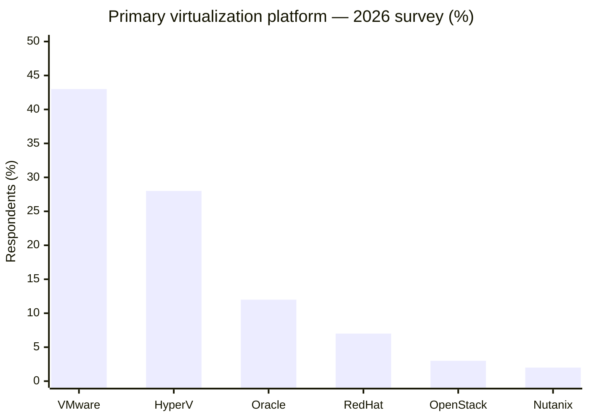

# Enterprise Server Virtualization in 2026: VMware's Market Position and Competitive Momentum

> **RESEARCH STATUS — FINAL EDITORIAL EDITION (v3.0, 29 October 2026).** This file was reconciled against the other five existing METI reports. It preserves original source-access classifications and does **not** claim that external URLs were freshly opened on 29 October. "Final" refers to the selected/reconciled documentation, **not** an independently audited worldwide infrastructure census. Detailed source and claim registers follow in the original body.

**Reconciled edition note (29 October 2026):** The ~43% VMware and ~28% Hyper-V figures describe **surveyed primary-platform responses**, not worldwide revenue/VM-share. The principal S&P Global 451 article and methodology directory were **publisher-indexed but not fully reopened** in the underlying research. The separate private-cloud survey measures a different population; 63% must not be described as completed migrations. **No new external validation was performed for this edition.**

**METI | Independent technology research for Cloud & Infrastructure Leadership**  
**Evidence cutoff:** 29 October 2026  
**Scope:** Global enterprise server virtualization; primary-platform preference, private-cloud installed presence, migration intentions, and competitive landscape  
**Purpose:** Provide an executive decision input, not a vendor recommendation  
**Research style:** Evidence-led, consulting-grade; not authored or endorsed by EY

---

## Executive summary

### VMware leads in a reported 2026 survey; this is not an audited worldwide market-share census

**Finding 1 — VMware is the most frequently selected primary virtualization platform in a 2026 enterprise survey.** S&P Global 451 Research's *Virtualization 2026* study reports **nearly 43%** selecting VMware, comprising approximately **27% vSphere/vSphere Foundation** and **16% VMware Cloud Foundation (VCF)**. **Microsoft Hyper-V follows at nearly 28%**, with Oracle **12%**, Red Hat **7%**, OpenStack **3%** and Nutanix **2%**. These are **shares of primary-platform survey responses**, not worldwide revenue, installed-VM, or active-license market shares. [S01][C01]

**Finding 2 — installed presence exceeds primary-platform share.** In a separate S&P Global 451 Research *private-cloud infrastructure* survey, nearly **90% of surveyed private-cloud environments contained VMware-based workloads**. These respondents may operate several hypervisors; VMware presence therefore cannot be equated with VMware being the primary platform. The two 451 surveys must **not** be combined into a single market-share denominator. [S03][C02]

**Finding 3 — retention and diversification are both documented, but plans are not completed migrations.** In that separate private-cloud survey, **37%** planned to maintain the bulk of VMware workloads, while the remainder described several different approaches. The publisher's summary explicitly includes **undecided organizations (6%)** among the broader non-retention group; thus it would be incorrect to state that 63% had completed, committed to, or even definitively decided on migration. [S03][C03]

**Finding 4 — an independent, like-for-like worldwide 2026 revenue-market-share series is not established by the publicly accessible sources reviewed.** Gartner published a 2026 *Magic Quadrant for Server Virtualization Platforms* covering **17 vendors**, but its public abstract is a competitive evaluation, **not a vendor-revenue market-share table**. Other online technographic estimates mix different categories, products and detection methods. [S04][S06][S07][C04]

**Analyst assessment:** The evidence supports **VMware's enduring enterprise position alongside growing multi-platform optionality**, not an immediate industry-wide replacement. For a Cloud Technology Leader, future exposure should be assessed by **production VM distribution, product contract and core counts, application certification, and renewal decisions**, rather than Broadcom financial growth or any one survey alone. This interpretation is grounded in the differentiated metrics above; it is not a forecast of VMware customer losses. [C01–C04]

---

**Source-access qualification for the headline exhibit:** The ~43%, ~28% and other primary-platform figures come from **publisher-indexed S&P Global 451 Research material**; the original article could not be fully reopened in the historical research run and the underlying crosstabs are not publicly inspected. Treat as attributed research-publisher figures, **not independently revalidated market-share measurements**. This same qualification applies to any slide reproducing the chart.

## 1. Exhibit — 2026 primary virtualization platform share

**Metric:** Respondents' selected **primary** virtualization platform, *S&P Global 451 Research, Virtualization 2026* (approximate percentages).

| Platform family | Approx. primary-platform responses | Publisher's characterization | Evidence |
|---|---:|---|---|
| **VMware — combined** | **43%** | **27%** vSphere / vSphere Foundation and **16%** VMware Cloud Foundation | [S01] |
| Microsoft Hyper-V | 28% | Primary hypervisor for production workloads | [S01] |
| Oracle virtualization | 12% | Publisher's Oracle category; specific product mix not exposed in the summary | [S01] |
| Red Hat | 7% | Publisher's Red Hat category | [S01] |
| OpenStack solutions | 3% | OpenStack solutions category | [S01] |
| Nutanix | 2% | Publisher's Nutanix category | [S01] |

**Interpretation guardrails**

- **Do not** treat the ~43% as Broadcom's global virtualization revenue market share or its percentage of production VMs.
- **Do not** add the 27% and 16% again to 43%; they are components of the VMware combined figure.
- **Do not** infer Nutanix's total customer base or enterprise penetration from the 2% *primary-platform* response; a secondary platform is not captured in that category.
- **Do not** assign the percentage-point gap between the listed categories and 100% to an invented 'Other' segment: the summary reports rounded, selectively listed values.
- **Do not** use a line chart of 2023–2026 share using unlike datasets; no comparable, validated annual series was identified.

### Survey methodology and statistical boundaries

S&P Global's analyst directory describes *Virtualization 2026* as an **online survey of approximately 789 respondents**, conducted **5 May–26 June 2026**. It states that the main survey portion involved **approximately 230 current hypervisor users**. The advertised **±4 percentage-point, 95% confidence** figure concerns survey top-line statistics and **must not be mechanically applied to the smaller hypervisor-user subset**. The exact denominator and weighting for each platform category are not established from the freely accessible summary. Accordingly, the figures should be presented as **approximately reported survey shares**, not estimates with invented precision. [S02][C05]

The publisher's blog text was available through search indexing and its existence/date were corroborated through the official 451 Alliance archive, but automated direct opening of that blog article was unsuccessful during this review. It is therefore marked **publisher-indexed, not fully reopened**; the methodology directory itself likewise remained indexed-only in the available retrieval environment. [S01][S02][S08]

---

## 2. Installed presence vs. future disposition: a second, different survey

S&P Global 451 Research separately studied private-cloud infrastructure. Its directly opened May/June 2026 article makes the following statements. [S03]

| Indicator | Reported result | Appropriate reading |
|---|---:|---|
| Surveyed private-cloud environments containing VMware-based workloads | **Nearly 90%** | VMware **present**; not necessarily primary or exclusive |
| Organizations intending to keep the bulk of their VMware workloads | **37%** | Intended retention of most workloads, not a current deployment census |
| Organizations described in the publisher's broader non-retention cohort | **63%** | Mixed responses, **including evaluation and indecision**; not completed exits |
| Current VMware users shifting **some workloads** to alternative private-cloud platforms while keeping a reduced footprint | **About one quarter** | Scoped partial diversification |
| Actively evaluating VMware alternatives **or** already transitioning | **About one third** | Combines evaluations with actual transition activity |
| Undecided about future approach | **6%** | No decided migration strategy |

**Critical correction to common market headlines:** The publisher groups the 63% outside the 'maintain the bulk' cohort, but also separately identifies 6% undecided. Therefore **“63% of VMware customers are migrating” is not a valid equivalent statement**. Its labels and categories are about self-reported future approaches and are not confirmed workload migrations. [S03][C03]

### What the two S&P studies establish together

- **Platform selection:** VMware's ~43% is a **primary-platform measure** from *Virtualization 2026*.
- **Installed presence:** nearly 90% is a **presence measure** within a separate **private-cloud respondent population**.
- **Future intent:** 37% / 63% is a **response-strategy split** within that private-cloud research, not customer churn.
- Because populations, questions and denominators differ, **do not compare 43% and 90% as a gain or decline**.

---

## 3. Independent triangulation: different surveys, different questions

| 2026 publication | Population / sponsor | Reported observation | What it adds | What it cannot establish |
|---|---|---|---|---|
| **S&P Global 451 — Virtualization 2026** | Online survey, ~789 respondents; ~230 current hypervisor users in relevant survey portion; May–June 2026 | VMware ~43% primary, Microsoft ~28% | Cross-vendor primary-platform comparison | Global revenue, VM or license-share census [S01][S02] |
| **S&P Global 451 — Private-cloud survey** | Separate private-cloud respondent population; exact accessible-summary denominator not confirmed | Nearly 90% VMware presence; 37% plan to retain bulk | Installed reach and strategic options | Installed-VM share or completed migration rate [S03] |
| **CloudBolt research** | Vendor-commissioned; **302 North American IT decision-makers**, companies with 1,000+ staff; January 2026 | **86% self-report actively reducing** VMware footprint; vendor commentary separately cites **4% fully moved away** | Illustrates the difference between active reduction and complete exit | Representative worldwide customer churn; independently verified VM counts [S05] |
| **HPE 'Great Virtualization Reset'** | HPE-sponsored; **nearly 400** senior IT decision-makers; December 2025–January 2026 | More than two-thirds planning material virtualization changes; only **5%** reported fully ready | Competitive change under evaluation and readiness gap | Installed platform share or realized migration volumes [S09] |
| **Gartner 2026 Magic Quadrant** | Analyst assessment of **17 products/vendors**; published 14 September 2026 | Competitive positioning and criteria | Product/provider viability comparison | Market share [S04] |

**Analyst interpretation:** The direction of the responses is compatible with **gradual diversification and workload-level reduction of VMware dependence**, but the stronger vendor-sponsored migration statistics should not be used as if independently replicated by S&P Global. Respondent selection, regions, questions, sponsoring organizations and intended versus completed activities are materially different. [C06]

---

## 4. What counts as actual virtualization 'market share'?

| Metric | Denominator | What is available in this research | Suitability for Cloud Leadership |
|---|---|---|---|
| **Primary-platform survey share** | Respondent organizations identifying one primary platform | **Yes:** S&P 451 ~43% VMware, ~28% Hyper-V | **Recommended lead exhibit**; label survey basis |
| **Installed presence** | Environments containing any vendor workloads | **Yes:** S&P separate private-cloud survey, ~90% VMware | Useful for footprint persistence, **not** exclusive share |
| **Share of production VMs / host cores** | All deployed production workloads or hosts in a consistently defined market | **No comparable audited 2026 table verified** | Best operational measure, but evidence gap remains |
| **Revenue share** | Vendor revenue for like-for-like virtualization software products | **No comparable public 2026 vendor table verified** | Would inform supplier economics, not deployed estate |
| **Unique active customer share** | Unique current purchasing organizations | **No comparable audited 2026 table verified** | Needed for net customer-base direction |
| **Migration intent / reduction plans** | Surveyed organizations within a defined cohort | **Yes**, multiple 2026 surveys | Indicator of future competitive pressure, **not market share** |

**Why some online figures are excluded from the headline:** The public 6sense technographic listing mixes VMware, vSphere, ESXi, desktop virtualization applications and other technologies as separate detectable products; categories can overlap. It cannot be compared directly with the 451 primary-hypervisor survey. Statista publishes a July 2026 category page for virtualization market share, but the exact underlying figures were access-restricted during this review. Neither is used to create a synthetic 'global market share' figure. [S06][S07][C07]

Similarly, Broadcom's financial results and its disclosures about VCF purchasing among its largest 10,000 accounts are **commercial or accounting measures**. They are **not independent observations of unique customer growth or of deployed virtualization market share**.

---

## 5. Competitive implications for a global biopharma cloud estate

**Verified observation → Interpretation → Decision question**

**A. VMware remains widely embedded.** VMware is the most frequent primary choice in the 451 survey and present in most private-cloud environments surveyed separately. **Interpretation:** Migration efforts may need to operate alongside a long-lived VMware estate rather than assume a rapid exit. **Question:** Which VMware workloads are structurally constrained by application, OT, backup, security or platform integration? [S01][S03]

**B. Microsoft is the clearest named alternative in the primary-platform survey.** Hyper-V is about 28%, compared with VMware about 43%. **Interpretation:** Microsoft has a substantial installed operational constituency, but Hyper-V share does not demonstrate that Azure Local is certified for each industrial application. **Question:** Which enterprise and manufacturing applications explicitly support the proposed Microsoft virtualization configuration? [S01]

**C. Market share does not capture the best solution for every workload.** Red Hat, Nutanix and other platforms may play an important role in selected parts of enterprise estates even if they are not named as the single primary hypervisor. **Interpretation:** A modular estate evaluation can reveal viable alternatives not visible in headline primary-platform share. **Question:** Where can an alternative deliver verified service continuity, recoverability, automation and lifecycle support? [S01][S04]

**D. Surveyed organizations express change intentions, not evidence of executed exits.** S&P's retention/alternatives survey, CloudBolt's reduction survey, and HPE's change-readiness survey do not establish how many VM instances have actually been retired from VMware. **Interpretation:** Customer claims and proofs of actual production migration should receive more weight than intention surveys in vendor selection. **Question:** Which production migration references match the scale and operating controls of the enterprise's own environment? [S03][S05][S09]

**E. Biopharma context limits transferability.** These general-enterprise studies do not disclose a statistically valid biopharma-only market-share breakout. **Interpretation:** They establish competitive context, not a verified platform ranking for GxP manufacturing, validated laboratory systems, or specialized OT applications. **Question:** Which application vendors expressly certify the proposed virtualization layer and versions, and what change-control evidence would be required? [S01–S04]

---

## 6. Executive questions remaining

1. What is the current **VMware share of production VMs and licensed host cores**, globally and by workload class, under a consistent numerator/denominator definition?
2. Is the estate predominantly **vSphere-only, VCF, or VMware-specialized manufacturing/OT workloads**? Market position and alternative viability differ between these configurations.
3. Which on-premises alternatives have **application-vendor and recovery-stack support** for production workload classes?
4. What proportion of the estate can be migrated **without changing production service levels, validation state or recovery objectives**?
5. What are the **three-year total costs** of continued VMware use, mixed estates, and migration, including transition/support/dual-run costs—not simply license list prices?

**Research recommendation:** Use the 451 primary-platform shares as the **market-position exhibit**, the separate private-cloud study as the **installed-presence and migration-intention exhibit**, and customer-specific migrations as **execution evidence**. Do not present these as interchangeable market-share estimates.

---

## 7. Evidence register and source-access audit

**Verification convention:** “Opened” means the relevant original publisher page was retrieved and inspected in this research session. “Publisher-indexed; direct open unsuccessful” means publisher-authored text was returned by source search and the publication could be located, but a subsequent direct fetch failed. “Abstract only” means full subscription research was not reviewed. These labels are intentionally narrower than calling every retrieved snippet “fully validated.”

| Source ID | Original publisher, dated record | Original URL | Source access in this review | Claims supported |
|---|---|---|---|---|
| **S01** | S&P Global 451 Alliance, Melanie Posey, **12 Aug 2026**, *VMware holds its ground as virtualization strategies diversify* | https://blog.451alliance.com/vmware-holds-its-ground-as-virtualization-strategies-diversify/ | **Publisher-indexed; direct article open unsuccessful**. Original 451 archive corroborates title and publication date. | C01, C05 |
| **S02** | S&P Global 451 Research, analyst directory, *Virtualization 2026 Survey Data Hub* entry, **24 Jul 2026** | https://451research.com/index.php?name=Melanie%2BPosey&option=com_analystdirectory&view=analyst | **Publisher-indexed; direct page open unsuccessful**. Searchable publisher record states survey period, respondent totals and sample limitation. | C05 |
| **S03** | S&P Global 451 Alliance, Melanie Posey, **11 May / updated 22 Jun 2026**, *Security and operational control drive expansion in organizations' IT environments* | https://blog.451alliance.com/security-and-operational-control-drive-expansion-in-organizations-it-environments/ | **Original page opened and inspected**, including summary and private-cloud definition. | C02, C03 |
| **S04** | Gartner, **14 Sep 2026**, *Magic Quadrant for Server Virtualization Platforms* | https://www.gartner.com/en/documents/8377781 | **Official abstract indexed; direct full-page open unsuccessful; full report restricted**. Original abstract names 17 competitors; does not present market-share percentages. | C04 |
| **S05** | CloudBolt Software, **17 Feb 2026**, *New CloudBolt research: 86% of companies actively reducing their VMware footprint*; associated January survey | https://www.cloudbolt.io/company/news/new-cloudbolt-research-86-of-companies-actively-reducing-their-vmware-footprint/ | **Publisher-indexed; direct page retrieval timed out**. Publisher's report listing and survey description corroborated. | C06 |
| **S06** | Statista, **13 Jul 2026 update**, *Leading virtualization platform technologies worldwide* | https://www.statista.com/statistics/1252355/top-virtualization-technologies-by-domain/ | **Original page returned HTTP 403**. Exact share values not used. | C07 |
| **S07** | 6sense, *Virtualization Platform Technologies* (2026 page) | https://technographics.6sense.com/virtualization | **Publisher-indexed; direct open unsuccessful**. Broad mixed categories preclude like-for-like comparison. | C07 |
| **S08** | S&P Global 451 Alliance, *Cloud & Managed Services Transformation research archive* | https://www.451alliance.com/resources/research-reports/cloud-managed-services-transformation | **Original publisher archive opened**, with August 2026 article entry visible in current indexed version; a cached older open lacked recent entries. | Publication confirmation for S01 |
| **S09** | Hewlett Packard Enterprise, **10 Feb 2026**, *New research finds only 5% of enterprises are fully ready for the Great Virtualization Reset* | https://www.hpe.com/us/en/newsroom/press-release/2026/02/new-research-finds-only-5-of-enterprises-are-fully-ready-for-the-great-virtualization-reset.html | **Original page opened and inspected**, including fieldwork dates and methodology paragraph. | C06 |

### Claim register

| Claim ID | Material finding | Original source | Evidence boundary |
|---|---|---|---|
| **C01** | VMware ~43% primary; Hyper-V ~28%; Oracle ~12%; Red Hat ~7%; OpenStack ~3%; Nutanix ~2% | S01 | Primary-platform survey response, **not worldwide installed-VM or revenue share** |
| **C02** | VMware workloads in nearly 90% of surveyed private-cloud environments | S03 | **Presence** in private-cloud survey; not primary selection or global share |
| **C03** | 37% plan to keep bulk of VMware workloads; remainder includes reductions, evaluations and undecided | S03 | Future intent; **not 63% completed migrations** |
| **C04** | Gartner 2026 virtualization Magic Quadrant evaluates 17 vendors | S04 | Competitive positioning, **not market share** |
| **C05** | 2026 451 survey ~789 respondents, May 5–June 26; ~230 current hypervisor users; stated ±4 top-line margin | S02 | Full question-level bases and subpopulation sampling error **not independently available** |
| **C06** | CloudBolt 86% report reduction; HPE >two-thirds planning change | S05, S09 | **Different vendor-sponsored sample populations**; no equivalence to completed migration |
| **C07** | Technographic and gated categories cannot validate an alternative like-for-like 2026 share table | S06, S07 | Explicit exclusion from primary exhibit |

### Research assurance and remaining limitations

- **Original publisher full pages opened for key substantive secondary study and HPE methodology:** S03 and S09; S&P official 451 archive opened separately.
- **Publisher-authored survey figures identified, but not fully reopened at original article URL:** S01/S02. The principal **43% chart remains directly attributed to the publisher and accessible in its indexed publication text**, with the access limitation disclosed rather than concealed.
- **Full underlying 451 survey instruments, crosstabs, weightings and question-level bases:** not available through the public summary; cannot independently re-estimate subpopulation confidence intervals.
- **Like-for-like 2026 worldwide product revenue/production-VM share tables:** not validated in the accessible record.
- **Biopharma-specific breakdown:** not established by the reviewed general-enterprise surveys.
- **No market-share time series invented:** different studies measure different populations, products and denominators; a 2023-to-2026 line would be methodologically unsupported.

**Overall finding:** Credible 2026 original research supports VMware's lead in **surveyed primary-platform choice** and substantial private-cloud installed presence, with meaningful competitive pressure and mixed virtualization strategies. It does **not** establish a precise worldwide revenue/VM market-share series or customer-loss rate. This is the evidence-grounded conclusion suitable for Cloud Leadership.

---

## Editorial release provenance (29 October 2026)

This is a **history-reconciled final editorial edition** assembled solely from METI research files created earlier in the same conversation. It does not represent new public-web source checking. Source-access statuses describe the **original research run**, not guaranteed present-day availability. See `00_README_AND_VERSION_MANIFEST.md` for source-file mapping, cross-document precedence, and quality limitations.
